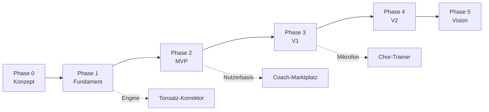

# Umsetzungsplan

Dieser Plan beschreibt, wie wir Harmonia Schritt für Schritt bauen: vom leeren Repository bis zur Vision. Er ist ein lebendes Dokument. Wir passen ihn an, sobald wir etwas Neues lernen.

## Aufbau

**Querschnitt** – gilt für alle Phasen:

| Dokument | Inhalt |
|---|---|
| [Architektur](architektur.md) | Systemaufbau, Monorepo, Pakete, Umgebungen, Sicherheit |
| [Theorie-Engine](theorie-engine.md) | Fachlicher Kern: Tonhöhen, Intervalle, Akkorde, Harmonik, Stimmführung |
| [Notation, Audio, Eingabe](notation-audio-eingabe.md) | Notendarstellung, Klang, Klaviatur, Mikrofon, MIDI |
| [Übersetzungen und Glossar](i18n-und-glossar.md) | Texte DE/EN (US/UK), Fachglossar, Prüfungen, Sprachwahl |
| [Inhalte und Didaktik](inhalte-und-didaktik.md) | Kursstruktur, Übungstypen, Lernlogik, Inhaltsproduktion |
| [Datenmodell](datenmodell.md) | Tabellen, Zugriffsregeln, Synchronisation |
| [KI-Tutor](ki-tutor.md) | Aufbau, Werkzeuge, Wissensbasis, Kosten, Qualität |
| [Motivation und Social](motivation-und-social.md) | XP, Streaks, Ligen, Ratings, Rush, Duelle |
| [Monetarisierung](monetarisierung.md) | Abos, Paywall, Marktplatz, Schule, Zertifikate – technisch |
| [Qualität und Betrieb](qualitaet-und-betrieb.md) | Tests, CI/CD, Releases, Monitoring, Barrierefreiheit |
| [Recht und Compliance](recht-und-compliance.md) | Checkliste je Phase (keine Rechtsberatung) |
| [Risiken](risiken.md) | Risikoregister mit Gegenmaßnahmen |
| [Offene Fragen](offene-fragen.md) | Entscheidungen, die noch ausstehen |

**Phasen** – die Arbeitsschritte:

| Phase | Ziel | Dokument |
|---|---|---|
| 0 – Konzept | Alle Grundsatzentscheidungen getroffen, Accounts und Design-Richtung stehen | [phase-0-konzept.md](phase-0-konzept.md) |
| 1 – Fundament | Technischer Prototyp: eine Lektion läuft auf iOS, Android und Web | [phase-1-fundament.md](phase-1-fundament.md) |
| 2 – MVP | Erste öffentliche Version: Stufen 1–2, KI-Tutor, Gratis + Premium, DE + EN | [phase-2-mvp.md](phase-2-mvp.md) |
| 3 – V1 | Ligen, Duelle, Rush, adaptive Lernlogik, Mikrofon, MIDI, Stufen 3–4 | [phase-3-v1.md](phase-3-v1.md) |
| 4 – V2 | Coach-Marktplatz, KI-Live-Calls, Tonsatz-Korrektor, Schule, Zertifikate, Stufe 5 | [phase-4-v2.md](phase-4-v2.md) |
| 5 – Vision | Song-Analyse, Creator-Kurse, Stufe 6, weitere Sprachen | [phase-5-vision.md](phase-5-vision.md) |

## Abhängigkeiten der Phasen

Der Coach-Marktplatz kommt bewusst spät. Ein Marktplatz braucht auf beiden Seiten genug Menschen (Coaches und Lernende). Die Lernenden bringt die App aus Phase 2 und 3 mit.

## Arbeitsschritte

Jeder Schritt hat eine eindeutige ID (z. B. **P1.07**) und dieselbe Struktur:

- **Ziel:** was danach möglich ist
- **Abhängig von:** Schritte, die vorher fertig sein müssen
- **Umfang:** S, M, L oder XL – relative Größe, keine Zeitzusage
- **Aufgaben:** Checkliste
- **Fertig, wenn:** prüfbare Abnahmekriterien
- **Tests:** was automatisch geprüft wird

Wir arbeiten die Schritte innerhalb einer Phase in der angegebenen Reihenfolge ab. Schritte ohne gegenseitige Abhängigkeit können parallel laufen.

## Definition of Done (gilt für jeden Schritt)

- [ ] Abnahmekriterien des Schritts erfüllt
- [ ] Läuft auf iOS, Android und Web (sofern der Schritt die App betrifft)
- [ ] Alle UI-Texte und Inhalte auf Deutsch **und** Englisch, keine hartkodierten Texte
- [ ] Lint, Formatierung, Typprüfung und Tests grün in der CI
- [ ] Neue Logik hat Tests; fachliche Logik zusätzlich mit Beispielen aus der Literatur geprüft
- [ ] Grundlegende Barrierefreiheit: Screenreader-Beschriftungen, ausreichende Kontraste, Feedback nicht nur über Farbe
- [ ] Dokumentation aktualisiert (Plan, ADR, CLAUDE.md, falls betroffen)
- [ ] Fachliche Prüfung durch Claude bei allem, was Musiktheorie betrifft, mit mehreren unabhängigen Prüfmitteln ([ADR 0005](../decisions/0005-fachliche-pruefung-durch-claude.md))

## Arbeitsweise (entschieden am 02.10.2026)

- **Rollen:** Claude entwirft, implementiert und prüft fachlich ([ADR 0005](../decisions/0005-fachliche-pruefung-durch-claude.md)). Phillip trifft Produkt- und Geschäftsentscheidungen, gibt Design und Merge frei und testet auf echten Geräten.
- **Ablauf pro Schritt:** eigener Branch → Pull Request mit Beschreibung und Testnachweis → CI grün → Merge durch Claude (Phillip hat am 02.10.2026 dauerhaft freigegeben, nach grüner CI zu mergen; Geschäfts- und Designfragen gehen weiter an ihn). Seit 03.10.2026 arbeitet Claude die Schritte fortlaufend ab, ohne vor jedem Schritt zu fragen.
- **Tracking:** jeder Arbeitsschritt ist ein GitHub-Issue mit seiner ID im Titel (Phase 0: #1–#7, Phase 1: #8–#27). Ein GitHub-Projekt-Board zeigt den Stand. Pull Requests schließen ihr Issue mit „Closes #…“.
- **Entscheidungen:** alles mit Tragweite als ADR in `docs/decisions/`.
- **Rückblick:** am Ende jeder Phase ein kurzer Rückblick. Was lief gut, was ändern wir? Der Plan wird danach angepasst.
