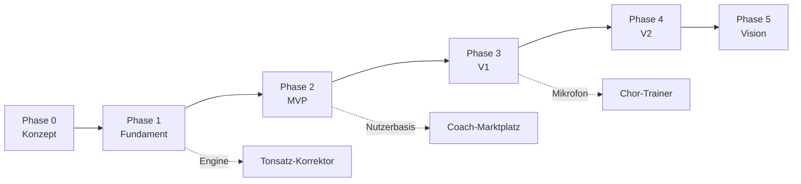

# Umsetzungsplan

Dieser Plan beschreibt, wie wir Harmonia Schritt für Schritt bauen: vom leeren Repository bis zur Vision. Er ist ein lebendes Dokument. Wir passen ihn an, sobald wir etwas Neues lernen.

## Aufbau

**Querschnitt** – gilt für alle Phasen:

| Dokument | Inhalt |
|---|---|
| [Architektur](architektur.md) | Systemaufbau, Monorepo, Pakete, Umgebungen, Sicherheit |
| [Duelle P3.06](duelle.md) | Live-Matchmaking, Ghosts, Einladungen, Rating und offene Abnahme |
| [Tägliches Rätsel P3.07](taegliches-raetsel.md) | 42-Tage-Vorrat, Tageswechsel, Einmalantwort und eigene Serie |
| [Freunde und Quests P3.08](freunde-und-quests.md) | Einmal-Einladungen, private Freundesliste und gemeinsame Wochenquest |
| [Mikrofon und Stimmgerät P3.09](mikrofon-und-stimmgeraet.md) | Lokale Tonhöhenerkennung, Berechtigungen und Geräte-Messreihe |
| [MIDI-Eingabe P3.11](midi-eingabe.md) | MIDI-Keyboard auf Web/iOS/Android, Geräteauswahl, Sustain und offene Geräteabnahme |
| [Rhythmus-Übungsmodus P3.12](rhythmus-uebungsmodus.md) | Langsames Üben mit Schleife und Metronom vor dem bewerteten Durchlauf |
| [Engine und Notation v2 P3.13](engine-und-notation-v2.md) | Vierklänge, Harmonikgrundlagen und mehrstimmige Notation; F03 und Literaturabgleich offen |
| [Harmonik und Diktat P3.14](harmonik-und-diktat-uebungen.md) | Vier neue Aufgabentypen, Septakkorde und freier Übungssatz; Fach- und Geräteabnahme offen |
| [Theorie-Engine](theorie-engine.md) | Fachlicher Kern: Tonhöhen, Intervalle, Akkorde, Harmonik, Stimmführung |
| [Stimmführung P4.09 – technischer Entwurf](stimmfuehrung-entwurf.md) | SATB-Musterprüfung mit Partitur-/Notenbezug, Testkorpus, lokalem DE/EN-Bericht und bearbeitbarer Satzwerkstatt mit Gesamt-/Solo-Wiedergabe; Fachprüfung offen |
| [Tonsatz-Korrektor P4.10 – interner Entwurf](tonsatz-korrektor-entwurf.md) | Grafischer SATB-Editor, sechs DE/EN-Lektionen in Stufe 4–5, lokalisierte Befunde und gebundenes Tutor-Werkzeug; Fach-/Produktfreigabe offen |
| [Notation, Audio, Eingabe](notation-audio-eingabe.md) | Notendarstellung, Klang, Klaviatur, Mikrofon, MIDI |
| [Übersetzungen und Glossar](i18n-und-glossar.md) | Texte DE/EN (US/UK), Fachglossar, Prüfungen, Sprachwahl |
| [Audio-Latenz messen](audio-latenz-messen.md) | Messanleitung und Ergebnisvorlage für P1.16 |
| [Design-Richtung](design-richtung.md) | Prinzipien, Farben (Kontrast geprüft), Schrift, Bewegung, Logo-Entwurf, Kern-Screens |
| [Inhalte und Didaktik](inhalte-und-didaktik.md) | Kursstruktur, Übungstypen, Lernlogik, Inhaltsproduktion |
| [Inhalts-Pipeline P2.04](inhalts-pipeline.md) | Katalog, Referenz-/Sprachprüfung, Freigabefilter und offene EAS-Anbindung |
| [Fähigkeitsgraph P2.05](faehigkeitsgraph.md) | Stufen 1–2 als Entwurf, Lernziele, geprüfte Reihenfolge und erzeugte Planungsdiagramme |
| [Tonhöheneingaben P2.06](tonhoeheneingabe.md) | Noten setzen, Tasten finden und Intervalle aufbauen; erster technisch umgesetzter Teil |
| [Tonleitern und Vorzeichnungen P2.06](tonleitern-und-vorzeichnungen.md) | Vier weitere Typen, Zwölf-Aufgaben-Satz, schrittweise Schreibaufgaben und fachliche Konventionen |
| [Akkordübungen P2.06](akkorduebungen.md) | Dreiklänge schreiben, sehen und mit klingendem Grundtonbezug hören; neun Aufgaben und Fehlerwiederholung |
| [Rhythmus und Takt P2.06](rhythmus-und-takt.md) | Notenanfänge nach Einzähltakt mittippen, sichtbare Taktangaben gliedern; sechs Aufgaben und Timing-Auswertung |
| [Wissensaufgaben P2.06](wissensaufgaben.md) | 45 Grundlagenbegriffe, Erklärungen zuordnen und Dauern/Tonhöhen ordnen; neun Aufgaben, vollständige Eingaben und neue Fehlerwiederholungen |
| [Notationseinstieg P2.07](notationseinstieg.md) | Drei Lektionen mit 8/10/12 Aufgaben, sieben Wissenskarten, vollständige Klangbeispiele und ein vorbereiteter Grundlagenartikel |
| [Klaviatur und Vorzeichen P2.07](klaviatur-und-vorzeichen.md) | Zweite Einheit mit drei Lektionen, acht Karten, dreizehn Klaviaturbeispielen und festen Tastenfragen ohne Oktavvoraussetzung |
| [Oktavlagen und Hilfslinien P2.07](oktavlagen-und-hilfslinien.md) | Dritte Einheit mit drei Lektionen, vollständigen Namen, bis zu zwei Hilfslinien und Tastenfragen aus dem Notenbild |
| [Puls, Tempo und Zählgruppen P2.07](puls-tempo-und-zaehlgruppen.md) | Erste Rhythmuseinheit mit drei Lektionen, gleichmäßigem Mittippen, acht Karten und dreizehn Klickbeispielen ohne Notenlese-Voraussetzung |
| [Notenwerte und Pausen P2.07](notenwerte-und-pausen.md) | Fünfte Einheit: Noten-/Pausenzeichen, exakte Taktlücken, neun Karten, 15 Hörbeispiele und drei Lektionen |
| [Einfache Taktarten und Auftakt P2.07](einfache-taktarten-und-auftakt.md) | Sechste Einheit: 2/4, 3/4 und 4/4, Einzählen, Auftaktfragen und kurze Rhythmen mit Pausen |
| [Intervallgröße und Richtung P2.07](intervallgroesse-und-richtung.md) | Siebte Einheit: Prime bis Oktave zählen, Richtung und Wiederholung/Schritt/Sprung erkennen |
| [Stufe 1 vollständig intern P2.07](stufe-1-vollstaendig.md) | Alle 13 geplanten Einheiten, 40 Fähigkeiten, 37 Lektionen, 370 Aufgaben und die offene getrennte Abnahme |
| [Bassschlüssel und großes System P2.08](bassschluessel-und-grosses-system.md) | Erste Stufe-2-Einheit: drei Lektionen, Oktavnamensübersetzung, verbundene Systeme und 30 Aufgaben |
| [Stufe 2 vollständig intern P2.08](stufe-2-vollstaendig.md) | Alle 16 Einheiten, 50 Fähigkeiten, 48 Lektionen und 480 Aufgaben; getrennte fachliche Freigabe offen |
| [Zeitreise durch die Musikgeschichte P4.12](zeitreise-musikgeschichte.md) | Vier interne Epochenstationen mit eigenen Klangmodellen, fiktiven Interviews und Quellenbezug; Fachfreigabe offen |
| [Stufe 3 als interner Entwurf P3.15](stufe-3-vollstaendig.md) | Zwölf Einheiten mit Formen, Instrumenten, Jazz/Pop, Geschichte und 360 Aufgaben; getrennte fachliche Freigabe offen |
| [Stufe 4 als interner Entwurf P3.16](stufe-4-vollstaendig.md) | 13 Einheiten mit Studienvorbereitung und 390 Aufgaben; getrennte fachliche Freigabe offen |
| [Prüfungsmodus P3.17](pruefungsmodus.md) | Zwei interne Vorlagen mit Theorie/Gehörbildung, Zeitlimit, Punkten und Lernpfad-Empfehlungen; fachliche Abnahme offen |
| [Organisationen und Klassen P4.13 – interner Entwurf](schule-dashboard-entwurf.md) | Lokales Lehrer-Dashboard, Codes, klassenbezogene Lernstandfreigaben und PostgreSQL-RLS mit synthetischen Konten; Rechts-/Produktfreigabe offen |
| [Tutor-Lernplaner P3.18](tutor-lernplaner.md) | Servergeprüfte Lernübersicht, kurze Wochenvorschläge und separater Stufe-3/4-Testkatalog; fachliche Abnahme offen |
| [Wissensbasis v2 P3.19](wissensbasis-v2.md) | 25 Entwurfsartikel für Stufen 3–4, erweiterte Quellensuche und 150 Suchfragen; fachliche Abnahme offen |
| [Rückblick Phase 3](phase-3-rueckblick.md) | Technischer Übergabestand, offene Freigaben und angepasste Startbedingungen für Phase 4 |
| [Onboarding P2.09](onboarding.md) | Gespeicherter Erststart, Mini-Aufgabe, Gast-/E-Mail-Anmeldung und offene Testpersonen-/Geräteabnahme |
| [Einstufungstest P2.10](einstufungstest.md) | Adaptive Aufgaben, getrennte Bereichsniveaus, Startpunkte, Wiederholung und SQLite-Wiederaufnahme |
| [Lernpfad P2.11](lernpfad.md) | Graphbasierte Freischaltung, 80-%-Regel, freiwillige Wiederholung, Offline-Nachweise und Kontosynchronisation |
| [Feedback und Inhaltsmeldungen P2.13](feedback-und-inhaltsmeldungen.md) | Lösungen, Quellenklang, feste Hinweise und lokale Gast-/Konto-Meldungswarteschlange |
| [Lektionsablauf P2.12](lektionsablauf.md) | Aufgabenmischung, Pause/Wiederaufnahme, Verwerfen, geprüftes XP-Ergebnis und lokale Lernserie |
| [Erste Intervallqualitäten P2.07](erste-intervallqualitaeten.md) | Achte Einheit: Halbtonabstände, kleine/große Terzen, reine Quarte/Quinte/Oktave und Tritonus-Kontrast |
| [Übungs-Framework P1.19](uebungs-framework.md) | Generatoren, Engine-Bewertung, Hinweise, Aufgabenablauf und Hör-Pause |
| [Erste Lektion P1.20](erste-lektion.md) | Einführung, zehn Aufgaben, Fehlerwiederholung, SQLite und Personen-Test |
| [Rückblick Phase 1](phase-1-rueckblick.md) | Technischer Zwischenstand, offene Abnahmen und Konsequenzen für Phase 2 |
| [Datenmodell](datenmodell.md) | Tabellen, Zugriffsregeln, Synchronisation |
| [Supabase-Grundlage P1.04](supabase-grundlage.md) | Lokale Dienste, Profilmigration, RLS-/API-Tests und offene EU-Projekte |
| [KI-Tutor](ki-tutor.md) | Aufbau, Werkzeuge, Wissensbasis, Kosten, Qualität |
| [Motivation und Social](motivation-und-social.md) | XP, Streaks, Ligen, Ratings, Rush, Duelle |
| [Monetarisierung](monetarisierung.md) | Abos, Paywall, Marktplatz, Schule, Zertifikate – technisch |
| [Qualität und Betrieb](qualitaet-und-betrieb.md) | Tests, CI/CD, Releases, Monitoring, Barrierefreiheit |
| [Recht und Compliance](recht-und-compliance.md) | Checkliste je Phase (keine Rechtsberatung) |
| [Risiken](risiken.md) | Risikoregister mit Gegenmaßnahmen |
| [Offene Fragen](offene-fragen.md) | Entscheidungen, die noch ausstehen |

**Phasen** – die Arbeitsschritte:

| Phase | Ziel | Dokument |
|---|---|---|
| 0 – Konzept | Alle Grundsatzentscheidungen getroffen, Accounts und Design-Richtung stehen | [phase-0-konzept.md](phase-0-konzept.md) |
| 1 – Fundament | Technischer Prototyp: eine Lektion läuft auf iOS, Android und Web | [phase-1-fundament.md](phase-1-fundament.md) |
| 2 – MVP | Erste öffentliche Version: Stufen 1–2, KI-Tutor, Gratis + Premium, DE + EN | [phase-2-mvp.md](phase-2-mvp.md) |
| 3 – V1 | Ligen, Duelle, Rush, adaptive Lernlogik, Mikrofon, MIDI, Stufen 3–4 | [phase-3-v1.md](phase-3-v1.md) |
| 4 – V2 | Coach-Marktplatz, KI-Live-Calls, Tonsatz-Korrektor, Schule, Zertifikate, Stufe 5 | [phase-4-v2.md](phase-4-v2.md) |
| 5 – Vision | Song-Analyse, Creator-Kurse, Stufe 6, weitere Sprachen | [phase-5-vision.md](phase-5-vision.md) |

## Abhängigkeiten der Phasen

Der Coach-Marktplatz kommt bewusst spät. Ein Marktplatz braucht auf beiden Seiten genug Menschen (Coaches und Lernende). Die Lernenden bringt die App aus Phase 2 und 3 mit.

## Arbeitsschritte

Jeder Schritt hat eine eindeutige ID (z. B. **P1.07**) und dieselbe Struktur:

- **Ziel:** was danach möglich ist
- **Abhängig von:** Schritte, die vorher fertig sein müssen
- **Umfang:** S, M, L oder XL – relative Größe, keine Zeitzusage
- **Aufgaben:** Checkliste
- **Fertig, wenn:** prüfbare Abnahmekriterien
- **Tests:** was automatisch geprüft wird

Wir arbeiten die Schritte innerhalb einer Phase in der angegebenen Reihenfolge ab. Schritte ohne gegenseitige Abhängigkeit können parallel laufen.

## Definition of Done (gilt für jeden Schritt)

- [ ] Abnahmekriterien des Schritts erfüllt
- [ ] Läuft auf iOS, Android und Web (sofern der Schritt die App betrifft)
- [ ] Alle UI-Texte und Inhalte auf Deutsch **und** Englisch, keine hartkodierten Texte
- [ ] Lint, Formatierung, Typprüfung und Tests grün in der CI
- [ ] Neue Logik hat Tests; fachliche Logik zusätzlich mit Beispielen aus der Literatur geprüft
- [ ] Grundlegende Barrierefreiheit: Screenreader-Beschriftungen, ausreichende Kontraste, Feedback nicht nur über Farbe
- [ ] Dokumentation aktualisiert (Plan, ADR, CLAUDE.md, falls betroffen)
- [ ] Fachliche Prüfung durch Claude bei allem, was Musiktheorie betrifft, mit mehreren unabhängigen Prüfmitteln ([ADR 0005](../decisions/0005-fachliche-pruefung-durch-claude.md))

## Arbeitsweise (entschieden am 02.10.2026)

- **Rollen:** Claude entwirft, implementiert und prüft fachlich ([ADR 0005](../decisions/0005-fachliche-pruefung-durch-claude.md)). Phillip trifft Produkt- und Geschäftsentscheidungen und testet auf echten Geräten. Die Design-Richtung hat er am 03.10.2026 an Claude übertragen ([design-richtung.md](design-richtung.md)).
- **Ablauf pro Schritt:** eigener Branch → Pull Request mit Beschreibung und Testnachweis → CI grün → Merge durch Claude (Phillip hat am 02.10.2026 dauerhaft freigegeben, nach grüner CI zu mergen; Geschäfts- und Designfragen gehen weiter an ihn). Seit 03.10.2026 arbeitet Claude die Schritte fortlaufend ab, ohne vor jedem Schritt zu fragen.
- **Tracking:** jeder Arbeitsschritt ist ein GitHub-Issue mit seiner ID im Titel (Phase 0: #1–#7, Phase 1: #8–#27). Ein GitHub-Projekt-Board zeigt den Stand. Pull Requests schließen ihr Issue mit „Closes #…“.
- **Entscheidungen:** alles mit Tragweite als ADR in `docs/decisions/`.
- **Rückblick:** am Ende jeder Phase ein kurzer Rückblick. Was lief gut, was ändern wir? Der Plan wird danach angepasst.
