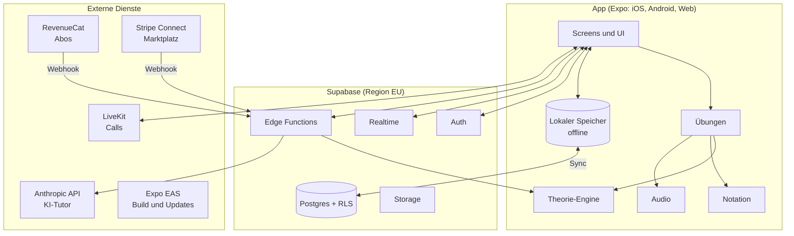
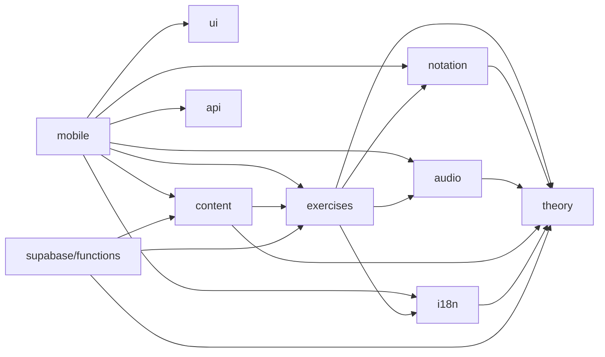

# Architektur

Grundlage: [ADR 0001](../decisions/0001-plattform-und-tech-stack.md) (Expo + Supabase), [ADR 0002](../decisions/0002-ki-tutor-und-fachliche-korrektheit.md) (Engine entscheidet, KI erklärt), [ADR 0003](../decisions/0003-zweisprachigkeit-de-en.md) (Deutsch und Englisch ab Start).

## Systemüberblick



**Leitlinien**

1. **Offline zuerst:** Lektionen, Übungen, Engine, Notation und Audio laufen ohne Netz. Ergebnisse werden lokal gespeichert und später synchronisiert.
2. **Eine Engine, zwei Orte:** Die Theorie-Engine ist reines TypeScript ohne Plattformabhängigkeiten. Sie läuft in der App (sofortiges Feedback) und in Edge Functions (Prüfung von Wettbewerbs-Ergebnissen, Werkzeuge für den KI-Tutor).
3. **Der Server ist die Wahrheit für Wettbewerb und Geld:** XP aus Duellen, Ligen, Ratings, Abos und Buchungen werden serverseitig berechnet oder geprüft, nie nur vom Client gemeldet.
4. **Inhalte als Code:** Kurse und Übungsdefinitionen liegen versioniert im Repository, werden in der CI geprüft und mit der App ausgeliefert.
5. **Austauschbare Anbieter:** Externe Dienste werden über eigene Schnittstellen angesprochen (z. B. `TutorModelProvider`, `PaymentProvider`), damit ein Wechsel möglich bleibt.

## Monorepo-Struktur

```
harmonia/
├── apps/
│   ├── mobile/              Expo-App (iOS, Android, Web) mit Expo Router
│   └── dashboard/           Web-Dashboard für Coaches und Lehrkräfte (ab Phase 4)
├── packages/
│   ├── theory/              Theorie-Engine – reines TypeScript, keine UI, keine Plattform-APIs
│   ├── notation/            Score-Modell, Layout, SVG-Renderer
│   ├── audio/               Klangerzeugung, Sampler, Metronom, Tonhöhenerkennung
│   ├── exercises/           Übungstypen: Generatoren, Bewertung, Hinweise
│   ├── content/             Kurse, Lektionen, Wissensartikel (Daten) + Schemas
│   ├── i18n/                UI-Übersetzungen DE/EN, Musik-Terminologie, Benennungssysteme
│   ├── ui/                  Design-System (Tokens, Basiskomponenten)
│   ├── api/                 Typisierter Client für Supabase und Edge Functions
│   └── config/              Gemeinsame TypeScript-Konfiguration (ESLint und Prettier liegen im Wurzelverzeichnis)
├── supabase/
│   ├── migrations/          SQL-Migrationen (versioniert)
│   ├── functions/           Edge Functions (Deno, TypeScript)
│   ├── tests/               Datenbank-Tests (pgTAP)
│   └── seed.sql             Testdaten für lokale Entwicklung
├── tools/                   Skripte: Inhaltsprüfung, Sample-Aufbereitung, Tutor-Evals
└── docs/                    Konzept, Plan, Entscheidungen
```

**Paket-Abhängigkeiten** (nur in Pfeilrichtung erlaubt, geprüft von `tools/check-package-graph.mjs` in `pnpm lint`):



`theory` hängt von nichts ab. So bleibt sie in App und Edge Functions gleich nutzbar.

**Werkzeuge**

| Thema | Wahl | Bemerkung |
|---|---|---|
| Sprache | TypeScript, `strict` | Überall, auch in Edge Functions |
| Paketmanager | pnpm 10 Workspaces mit Katalog für gemeinsame Versionen | Expo unterstützt isolierte pnpm-Installationen ab SDK 54. pnpm 12 startet nicht über Corepack in Node 22, deshalb vorerst pnpm 10 |
| App-Framework | Expo mit Expo Router | Dateibasiertes Routing für iOS, Android und Web |
| Lint/Format | ESLint (typescript-eslint, mit Typinformationen), Prettier | Paket-Abhängigkeiten prüft `tools/check-package-graph.mjs` |
| Tests Pakete | Vitest + fast-check | fast-check für eigenschaftsbasierte Tests der Engine |
| Tests App | jest-expo + React Native Testing Library | Komponententests |
| E2E Web | Playwright | |
| E2E Mobil | Maestro | |
| DB-Tests | pgTAP über Supabase CLI | Vor allem Zugriffsregeln (RLS) |

## Zustand in der App

- **Serverdaten:** TanStack Query (Caching, Wiederholung, Offline-Pausierung). Kandidat, in P1.03 bestätigen.
- **Lokaler Zustand:** kleiner Store (z. B. Zustand) für Sitzungszustand von Lektionen.
- **Persistenz offline:** SQLite über `expo-sqlite` für Versuche, Fortschritt und Warteschlange der Synchronisation; schneller Key-Value-Speicher für Einstellungen.
- **Synchronisation:** Jede Aktion (z. B. abgeschlossene Aufgabe) bekommt eine Client-ID (UUID) und wird idempotent hochgeladen. Doppelte Uploads haben keine Wirkung. Konflikte: Der Server führt zusammen (Summen, Maxima). Für Wettbewerbswerte rechnet nur der Server.

## Umgebungen

| Umgebung | Supabase | App-Kanal | Zweck |
|---|---|---|---|
| lokal | Supabase CLI (Docker) | Development Build | Entwicklung |
| staging | eigenes Projekt, EU-Region | EAS-Kanal `preview` | Tests, Beta |
| production | eigenes Projekt, EU-Region | EAS-Kanal `production` | Live |

- Konfiguration über Umgebungsvariablen. Öffentliche Werte mit Präfix `EXPO_PUBLIC_`, geheime Werte nur in EAS-Secrets, Supabase-Secrets und GitHub-Secrets – nie im Repository.
- Migrationen laufen über die CI zuerst gegen staging, dann production.

## Sicherheit

- **Zugriffsregeln:** RLS auf jeder Tabelle. Standard: Nutzer lesen und schreiben nur eigene Zeilen. Öffentliche Daten (Bestenlisten) nur über Views oder Funktionen mit minimalen Feldern.
- **Schreibrechte für Wettbewerb und Geld** nur über Edge Functions oder `security definer`-Funktionen mit Prüfung.
- **Schlüssel:** Der Service-Role-Key von Supabase und alle Anbieter-Keys liegen nur auf dem Server.
- **Webhooks** (RevenueCat, Stripe) werden per Signatur geprüft und idempotent verarbeitet.
- **Missbrauchsschutz:** Ratenbegrenzung für KI-Tutor und Wettbewerb pro Nutzer, Plausibilitätsprüfungen (z. B. Antwortzeiten).
- **Abhängigkeiten:** automatische Sicherheitsupdates (Dependabot oder Renovate), Lizenzprüfung neuer Pakete.

## Beobachtbarkeit

- **Fehler und Abstürze:** Sentry (React Native SDK, EU-Datenregion prüfen)
- **Produkt-Analytics:** nur mit Einwilligung; Kandidat PostHog (EU-Hosting prüfen). Ein kleines, dokumentiertes Event-Schema statt „alles tracken“.
- **Server:** Logs der Edge Functions; Kosten pro KI-Anfrage in einer eigenen Tabelle (`ai_usage`).
