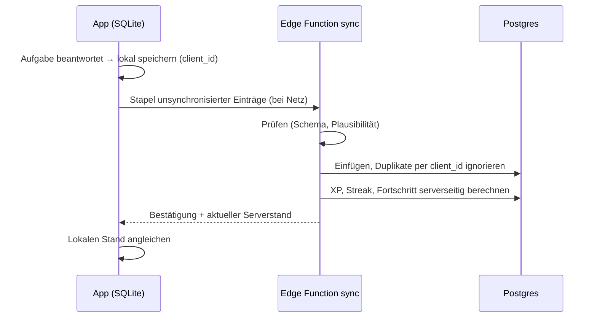

# Datenmodell (Entwurf)

Postgres in Supabase, Region EU. Alle Tabellen mit Row Level Security (RLS). Änderungen nur über Migrationen in `supabase/migrations/`. Die Spalten sind ein Entwurf, Details klären die jeweiligen Arbeitsschritte.

**Grundsätze**

- Inhalte (Kurse, Lektionen, Übungsdefinitionen) liegen **nicht** in der Datenbank, sondern versioniert in der App. Die Datenbank speichert nur IDs und `content_version`.
- So wenig personenbezogene Daten wie möglich (Datensparsamkeit).
- Werte für Wettbewerb und Geld (XP in Ligen, Ratings, Abos, Buchungen) schreibt nur der Server.
- Jede Tabelle mit Nutzerbezug hat `user_id` mit `on delete cascade` auf das Konto, damit eine Kontolöschung vollständig ist.

## Phase 2 (MVP)

| Tabelle | Zweck | Wichtige Spalten |
|---|---|---|
| `profiles` | Profil und Einstellungen | Bereits P1.04: `id` (= Auth-User), `display_name`, `locale` (de/en-US/en-GB), `created_at`, `updated_at`. Noch Entwurf für P2: `note_naming` (de/intl), `harmony_system` (functions/roman/both), `daily_goal_xp`, `timezone`, `age_confirmed`, `onboarding_completed_at` |
| `lesson_attempts` | Durchgänge von Lektionen | `id`, `client_id` (Idempotenz), `user_id`, `lesson_id`, `content_version`, `started_at`, `finished_at`, `accuracy`, `xp_awarded` |
| `item_attempts` | Einzelne Aufgaben | `id`, `attempt_id`, `user_id`, `exercise_type`, `skill_ids[]`, `params` (jsonb), `answer` (jsonb), `correct`, `response_ms`, `hints_used`, `created_at` |
| `skill_progress` | Stand je Fähigkeit | `user_id`, `skill_id`, `status` (offen/gelernt/getestet), `last_practiced_at`; ab Phase 3 Rating- und FSRS-Felder |
| `xp_ledger` | XP als Buchungen | `id`, `user_id`, `amount`, `source` (lesson/rush/duel/quest), `ref_id`, `created_at` |
| `streaks` | Lernserie | `user_id`, `current`, `longest`, `last_active_date` (in Nutzer-Zeitzone), `freezes_available` |
| `tutor_conversations` | Gespräche mit dem KI-Tutor | `id`, `user_id`, `context` (jsonb: Lektion/Aufgabe), `created_at` |
| `tutor_messages` | Nachrichten | `id`, `conversation_id`, `role`, `content` (jsonb), `created_at` |
| `tutor_reports` | Private Meldung zu einer gespeicherten KI-Antwort | `id`, `user_id`, `conversation_id`, `message_id`, `category`, `message`, `created_at`; FK-Löschkaskaden, eigene Leserechte, Schreiben nur Service |
| `ai_usage` | Kosten und Kontingente | `user_id`, `day`, `requests`, `input_tokens`, `output_tokens`, `cache_read_tokens`, `cost_estimate` |
| `entitlements` | Abo-Berechtigungen (Spiegel aus RevenueCat) | `user_id`, `entitlement` (premium/max), `active`, `expires_at`, `store`, `product_id`, `will_renew`, `billing_issue`, `updated_at` |
| `billing_events` | Begrenzter validierter Webhook-Kern, nur Server | `event_id` (eindeutig), `provider`, `payload`, `received_at`, `processed_at`, `attempts`, `outcome` |
| `billing_accounts` | Private Fetch-/Projektionslease | `user_id`, `lease`, `lease_until`, `provider_request_ms`, `last_attempt_at`, `synced_at` |
| `content_reports` | Gemeldete Inhaltsfehler | `id`, `user_id`, `content_id`, `content_version`, `message`, `status` |
| `knowledge_indexes` | Aktiver Wissensstand je Auslieferung | `lane` (`published`/`preview`), `snapshot`, `content_version`, `article_count`, `chunk_count`, `updated_at` |
| `knowledge_chunks` | Versionierte Quellenabschnitte des Tutors | Schlüssel (`lane`, `id`), `snapshot`, `article_id`, `locale`, `content_version`, `status`, `stage`, `section`, `part`, `start_char`, `end_char`, `title`, `heading`, `body`, `skill_ids`, `tsv` (gespeicherter DE-/EN-Volltextvektor mit GIN) |

**Aufbewahrung:** `item_attempts` wächst am schnellsten. Nach 12 Monaten werden Einzelaufgaben zu Tageswerten je Fähigkeit verdichtet (Frist offen, im Löschkonzept festlegen). Tutor-Gespräche sind für Nutzer löschbar.

**Profil-Grundlage P1.04:** Die Locale übernimmt die vorhandenen App-Werte einschließlich US/UK; ein zusätzliches `en_terminology`-Feld wäre redundant. Weitere Einstellungen sind noch nicht implementiert. Nur der Auth-Trigger erzeugt Profile; Nutzer dürfen ihre eigene Zeile lesen und ausschließlich Anzeigename/Sprache ändern. Details und lokale Tests: [supabase-grundlage.md](supabase-grundlage.md).

**Lokaler Einstieg P2.09:** `harmonia-device.db` ergänzt ein getrenntes Geräteschema 1 mit `device_preferences` (eine validierte JSON-Zeile). Sprache/Darstellung/Haptik, Lernziel/Selbsteinschätzung, Einstufungswunsch, Tagesziel, Erinnerungs-Einwilligung/-Uhrzeit, Ablauf-/Mini-Zustand und Zeitpunkte werden lokal bewahrt. E-Mail/Codes/Token liegen dort nicht; Supabase-Sitzungen verwenden Web-SDK-Speicherung bzw. natives SecureStore. Die bisherige Lektionsdatenbank bleibt Schema 1. Keine neue Supabase-Profilmigration; Sync und die Übernahme lokaler Versuche in ein Konto bleiben P2.03. Details: [Onboarding](onboarding.md).
## Phase 3 (V1)

**P3.01 umgesetzt:** `skill_progress` speichert Rating, Abweichung, Volatilität, Beobachtungsanzahl und letzten serverseitigen Übungszeitpunkt. Lernpfadstatus wird weiterhin aus den P2-Nachweisen abgeleitet. `item_difficulty` enthält private globale Modellparameter je versioniertem Parameterprofil. `rating_control` schützt diese mit einer Revision; `learning_events.rating_version/rating_outcome/rated_at` sind idempotente Verarbeitungsbelege. Die vorher erwähnte `item_attempts`-Tabelle ist weiterhin nur ein früher Entwurf und wurde nicht als zweiter Rohantwortspeicher eingeführt. Details: [Ratings](ratings-glicko2.md), ADR 0028.

| Tabelle | Zweck | Wichtige Spalten |
|---|---|---|
| `skill_progress` (erweitert) | Rating und Wiederholung | `rating`, `rating_deviation`, `volatility` (Glicko-2), `fsrs_stability`, `fsrs_difficulty`, `fsrs_due`, `fsrs_reps`, `fsrs_lapses`, `fsrs_state` |
| `item_difficulty` | Schwierigkeit je Parameter-Gruppe | `bucket_id`, `rating`, `rating_deviation`, `attempts` |
| `league_cohorts` (P3.04) | Ligagruppen pro UTC-Woche | `id`, `tier`, `week_start`, `capacity`, `movement`, `closed_at` |
| `league_members` (P3.04) | Eigene Mitgliedschaft, Wochen-XP und eingefrorenes Resultat | `user_id`, `week_start`, `cohort_id`, `slot`, `xp`, `joined_at`, `final_rank`, `outcome` (promoted/stayed/relegated), `next_tier`, `seen_at`, `push_attempted_at` |
| `league_accounts`, `league_rules` (P3.04) | Aktuelle Stufe, eigener Ergebnis-Push-Schalter und neue Gruppenregeln | `tier`, `push_consent`; `capacity`, `movement` |
| `rush_runs` (P3.05) | Eingefrorene Serverläufe und bestätigte Summen | `id`, `user_id`, `mode` (three/five/survival), `bank`, `seed`, `pool`, `policy`, `state`, `started_at`, `deadline`, `last_at`, `finished_at`, `revision`, `correct`, `mistakes`, `score`, `xp`, `retained_at` |
| `rush_steps` (P3.05) | Von der Edge-Engine geprüfte Schritte, zwölf Monate Rohdaten | `sequence`, `user_id`, `run_id`, `ordinal`, `answer`, `correct`, `points`, `received_at` |
| `rush_policy`, `rush_daily_usage` (P3.05) | Versionierte Regeln und atomare Starts pro UTC-Tag | `policy`; `user_id`, `day`, `used` |
| `duels` | Live- und Ghost-Duelle | `id`, `player_a`, `player_b` (oder `ghost_of_run`), `seed`, `status`, `score_a`, `score_b`, `winner`, `rating_delta_a`, `rating_delta_b` |
| `duel_ratings` | Duell-Wertung | `user_id`, `rating`, `rating_deviation`, `volatility`, `games` |
| `daily_puzzles` (P3.07) | Global eingefrorenes Rätsel pro Datum | `day`, `bank`, `spec`, `seed`, `difficulty` |
| `daily_puzzle_results` (P3.07) | Eigene Einmalantwort und Serienbeleg | `user_id`, `day`, `answer`, `correct`, `time_zone`, `answered_at`, `retained_at` |
| `friendships` (Relationsgrenze P3.05, Verwaltung P3.08) | Gegenseitig bestätigte Freunde; pending/accepted/blocked, Service-only | `user_id`, `friend_id`, `status`, `created_at` |
| `friend_quests` | Gemeinsame Wochenziele | `id`, `week_start`, `user_a`, `user_b`, `goal_type`, `target`, `progress`, `completed_at` |
| `push_tokens` | Push-Benachrichtigungen | `user_id`, `token`, `platform`, `created_at` |

## Phase 4 (V2)

| Tabelle | Zweck | Wichtige Spalten |
|---|---|---|
| `coach_profiles` | Coaches | `user_id`, `bio` (jsonb de/en), `languages[]`, `specialties[]`, `hourly_rate_cents`, `currency`, `stripe_account_id`, `verification_status`, `pro_active` |
| `coach_availability` | Verfügbarkeit | `coach_id`, `rrule` oder Zeitfenster, `timezone` |
| `bookings` | Buchungen | `id`, `coach_id`, `student_id`, `starts_at`, `ends_at`, `status`, `price_cents`, `platform_fee_cents` (15 %), `stripe_payment_intent_id`, `call_room_id` |
| `reviews` | Bewertungen | `booking_id`, `rating`, `text`, `status` (Moderation) |
| `homework` | Hausaufgaben vom Coach | `id`, `coach_id`, `student_id`, `items` (jsonb), `due_at`, `completed_at` |
| `organizations` | Schulen | `id`, `name`, `license_seats`, `license_valid_until` |
| `org_members` | Rollen | `org_id`, `user_id`, `role` (admin/teacher/student) |
| `classes`, `class_members` | Klassen | … |
| `assignments`, `assignment_results` | Aufgaben für Klassen | … |
| `certificates` | Zertifikate | `id`, `user_id`, `level`, `issued_at`, `verification_code` |
| `certificate_attempts` | Prüfungsversuche | `id`, `user_id`, `level`, `seed`, `score`, `passed` |
| `tax_reporting_data` | Daten für Meldepflichten (DAC7) | Coach-Stammdaten nach gesetzlicher Vorgabe, streng zugriffsbeschränkt |

## Zugriffsregeln (RLS) – Muster

| Muster | Beispiel |
|---|---|
| Nur eigene Zeilen lesen/schreiben | `profiles`, `tutor_conversations`, `content_reports` |
| Nur eigene Zeilen lesen, Schreiben nur Server | `entitlements`, `xp_ledger`, `streaks`, `skill_progress` (Rating-Felder), `duels` |
| Öffentlich über Funktion mit minimalen Feldern | Bestenlisten (Anzeigename, Punktzahl) |
| Rollenbasiert | Schule: Lehrkräfte sehen Ergebnisse ihrer Klassen; Coaches sehen Lernstand nur mit Freigabe |

Jede Regel bekommt einen pgTAP-Test: Was darf ein Nutzer sehen, was darf er nicht sehen?

## Synchronisation (Offline)

## Wissensbasis v1 (P2.16)

Öffentliche Leser sehen ausschließlich `published` mit `freigegeben`; auch Konten lesen keine `preview`-Datensätze. Indexabgleich und Suche sind Service-RPCs. `replace_knowledge_index` ersetzt einen Snapshot transaktional, `search_knowledge` liefert nur IDs/Ränge aus exakt passender Sprache und erwartetem Snapshot. Modelltexte stammen anschließend aus bekannten kompilierten Katalogdatensätzen. Quellen-IDs enthalten einen SHA-256 über kanonischen Originaltext und Metadaten; alte Quellen werden nach Rückzug nicht weitergesucht. Validierte Zitate werden mit der privaten Tutorantwort gespeichert und beim Löschen des Gesprächs entfernt. Details: [Wissensbasis](wissensbasis.md).

## Tutor-Oberfläche (P2.17)

`tutor_reports` enthält keine Kopie der KI-Antwort: Der private Service-RPC prüft die eigene Assistentennachricht im eigenen Gespräch und verarbeitet die Meldungs-ID idempotent. Direkte Clients dürfen nur eigene Meldungen lesen. Antworten-/Gesprächs-/Kontolöschung entfernt Meldungen per Fremdschlüssel. Meldungen benötigen kein aktives Modellkontingent; freie Beschreibung ist auf 2000 Zeichen begrenzt und E-Mail-Adressen werden vor Speicherung redigiert. Der Verlauf liefert auf Wunsch die letzten 100 Nachrichten mit exklusivem Cursor für ältere Einträge. Keine lokale Persistenz von Chat oder ungesendeten Fragen; Kontowechsel löscht private App-Sitzungsdaten. Details: [Tutor-Oberfläche](tutor-oberflaeche.md).

P3.04: Öffentliche Ranglisten-RPC liefert nur gruppeninterne Kennung, Rang, Wochen-XP und eigene Markierung. Reale Migrationen, TTL und gemeinsames Push-Tagesbudget: [Ligen](ligen.md), ADR 0031. Die früh geplante separate Tabelle `push_tokens` wird dafür nicht angelegt; das bestehende Reminder-Geräte-/Zustellsystem wird erweitert.

P3.06: `duel_queue` hält Wartende, `duel_invites` zeitlich begrenzte Links, `duel_games` die gemeinsame eingefrorene Rush-Bank, `duel_players` eigene Summen und Ergebnisse, `duel_steps` geprüfte Antworten und `duel_ratings` das separate Glicko-2. Nur Service-RPCs schreiben; private Realtime-Kanäle übertragen unverbindliche Fortschrittssignale. Live-XP hat `source_kind=duel` und `duel_game_id` im bestehenden Ledger. Details: [Duelle](duelle.md), ADR 0033.
