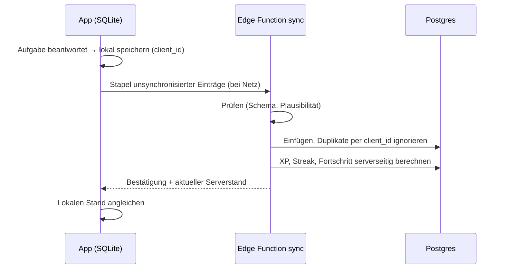

# Datenmodell (Entwurf)

Postgres in Supabase, Region EU. Alle Tabellen mit Row Level Security (RLS). Änderungen nur über Migrationen in `supabase/migrations/`. Die Spalten sind ein Entwurf, Details klären die jeweiligen Arbeitsschritte.

**Grundsätze**

- Inhalte (Kurse, Lektionen, Übungsdefinitionen) liegen **nicht** in der Datenbank, sondern versioniert in der App. Die Datenbank speichert nur IDs und `content_version`.
- So wenig personenbezogene Daten wie möglich (Datensparsamkeit).
- Werte für Wettbewerb und Geld (XP in Ligen, Ratings, Abos, Buchungen) schreibt nur der Server.
- Jede Tabelle mit Nutzerbezug hat `user_id` mit `on delete cascade` auf das Konto, damit eine Kontolöschung vollständig ist.

## Phase 2 (MVP)

| Tabelle | Zweck | Wichtige Spalten |
|---|---|---|
| `profiles` | Profil und Einstellungen | `id` (= Auth-User), `display_name`, `locale` (de/en), `note_naming` (de/intl), `harmony_system` (functions/roman/both), `daily_goal_xp`, `timezone`, `age_confirmed`, `onboarding_completed_at` |
| `lesson_attempts` | Durchgänge von Lektionen | `id`, `client_id` (Idempotenz), `user_id`, `lesson_id`, `content_version`, `started_at`, `finished_at`, `accuracy`, `xp_awarded` |
| `item_attempts` | Einzelne Aufgaben | `id`, `attempt_id`, `user_id`, `exercise_type`, `skill_ids[]`, `params` (jsonb), `answer` (jsonb), `correct`, `response_ms`, `hints_used`, `created_at` |
| `skill_progress` | Stand je Fähigkeit | `user_id`, `skill_id`, `status` (offen/gelernt/getestet), `last_practiced_at`; ab Phase 3 Rating- und FSRS-Felder |
| `xp_ledger` | XP als Buchungen | `id`, `user_id`, `amount`, `source` (lesson/rush/duel/quest), `ref_id`, `created_at` |
| `streaks` | Lernserie | `user_id`, `current`, `longest`, `last_active_date` (in Nutzer-Zeitzone), `freezes_available` |
| `tutor_conversations` | Gespräche mit dem KI-Tutor | `id`, `user_id`, `context` (jsonb: Lektion/Aufgabe), `created_at` |
| `tutor_messages` | Nachrichten | `id`, `conversation_id`, `role`, `content` (jsonb), `created_at` |
| `ai_usage` | Kosten und Kontingente | `user_id`, `day`, `requests`, `input_tokens`, `output_tokens`, `cache_read_tokens`, `cost_estimate` |
| `entitlements` | Abo-Berechtigungen (Spiegel aus RevenueCat) | `user_id`, `entitlement` (premium/max), `active`, `expires_at`, `store`, `updated_at` |
| `billing_events` | Rohdaten der Webhooks | `id`, `provider`, `event_id` (eindeutig), `payload`, `processed_at` |
| `content_reports` | Gemeldete Inhaltsfehler | `id`, `user_id`, `content_id`, `content_version`, `message`, `status` |
| `knowledge_chunks` | Wissensbasis des Tutors | `id`, `article_id`, `locale`, `title`, `body`, `tsv` (Volltextindex), `content_version` |

**Aufbewahrung:** `item_attempts` wächst am schnellsten. Nach 12 Monaten werden Einzelaufgaben zu Tageswerten je Fähigkeit verdichtet (Frist offen, im Löschkonzept festlegen). Tutor-Gespräche sind für Nutzer löschbar.

## Phase 3 (V1)

| Tabelle | Zweck | Wichtige Spalten |
|---|---|---|
| `skill_progress` (erweitert) | Rating und Wiederholung | `rating`, `rating_deviation`, `volatility` (Glicko-2), `fsrs_stability`, `fsrs_difficulty`, `fsrs_due`, `fsrs_reps`, `fsrs_lapses`, `fsrs_state` |
| `item_difficulty` | Schwierigkeit je Parameter-Gruppe | `bucket_id`, `rating`, `rating_deviation`, `attempts` |
| `league_cohorts` | Ligagruppen pro Woche | `id`, `tier`, `week_start` |
| `league_members` | Mitglieder und Ergebnis | `cohort_id`, `user_id`, `xp_week`, `final_rank`, `outcome` (aufstieg/bleibt/abstieg) |
| `rush_runs` | Theorie-Rush | `id`, `user_id`, `mode` (3/5 min), `seed`, `score`, `answers` (jsonb), `validated` |
| `duels` | Live- und Ghost-Duelle | `id`, `player_a`, `player_b` (oder `ghost_of_run`), `seed`, `status`, `score_a`, `score_b`, `winner`, `rating_delta_a`, `rating_delta_b` |
| `duel_ratings` | Duell-Wertung | `user_id`, `rating`, `rating_deviation`, `volatility`, `games` |
| `daily_puzzles` | Tägliches Rätsel | `date`, `puzzle` (jsonb), `difficulty` |
| `daily_puzzle_results` | Ergebnisse | `date`, `user_id`, `solved`, `attempts`, `time_ms` |
| `friendships` | Freunde | `user_id`, `friend_id`, `status`, `created_at` |
| `friend_quests` | Gemeinsame Wochenziele | `id`, `week_start`, `user_a`, `user_b`, `goal_type`, `target`, `progress`, `completed_at` |
| `push_tokens` | Push-Benachrichtigungen | `user_id`, `token`, `platform`, `created_at` |

## Phase 4 (V2)

| Tabelle | Zweck | Wichtige Spalten |
|---|---|---|
| `coach_profiles` | Coaches | `user_id`, `bio` (jsonb de/en), `languages[]`, `specialties[]`, `hourly_rate_cents`, `currency`, `stripe_account_id`, `verification_status`, `pro_active` |
| `coach_availability` | Verfügbarkeit | `coach_id`, `rrule` oder Zeitfenster, `timezone` |
| `bookings` | Buchungen | `id`, `coach_id`, `student_id`, `starts_at`, `ends_at`, `status`, `price_cents`, `platform_fee_cents` (15 %), `stripe_payment_intent_id`, `call_room_id` |
| `reviews` | Bewertungen | `booking_id`, `rating`, `text`, `status` (Moderation) |
| `homework` | Hausaufgaben vom Coach | `id`, `coach_id`, `student_id`, `items` (jsonb), `due_at`, `completed_at` |
| `organizations` | Schulen | `id`, `name`, `license_seats`, `license_valid_until` |
| `org_members` | Rollen | `org_id`, `user_id`, `role` (admin/teacher/student) |
| `classes`, `class_members` | Klassen | … |
| `assignments`, `assignment_results` | Aufgaben für Klassen | … |
| `certificates` | Zertifikate | `id`, `user_id`, `level`, `issued_at`, `verification_code` |
| `certificate_attempts` | Prüfungsversuche | `id`, `user_id`, `level`, `seed`, `score`, `passed` |
| `tax_reporting_data` | Daten für Meldepflichten (DAC7) | Coach-Stammdaten nach gesetzlicher Vorgabe, streng zugriffsbeschränkt |

## Zugriffsregeln (RLS) – Muster

| Muster | Beispiel |
|---|---|
| Nur eigene Zeilen lesen/schreiben | `profiles`, `tutor_conversations`, `content_reports` |
| Nur eigene Zeilen lesen, Schreiben nur Server | `entitlements`, `xp_ledger`, `streaks`, `skill_progress` (Rating-Felder), `duels` |
| Öffentlich über Funktion mit minimalen Feldern | Bestenlisten (Anzeigename, Punktzahl) |
| Rollenbasiert | Schule: Lehrkräfte sehen Ergebnisse ihrer Klassen; Coaches sehen Lernstand nur mit Freigabe |

Jede Regel bekommt einen pgTAP-Test: Was darf ein Nutzer sehen, was darf er nicht sehen?

## Synchronisation (Offline)

