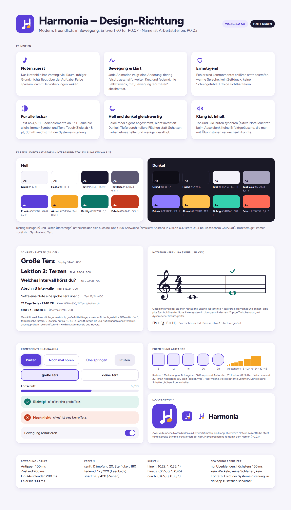
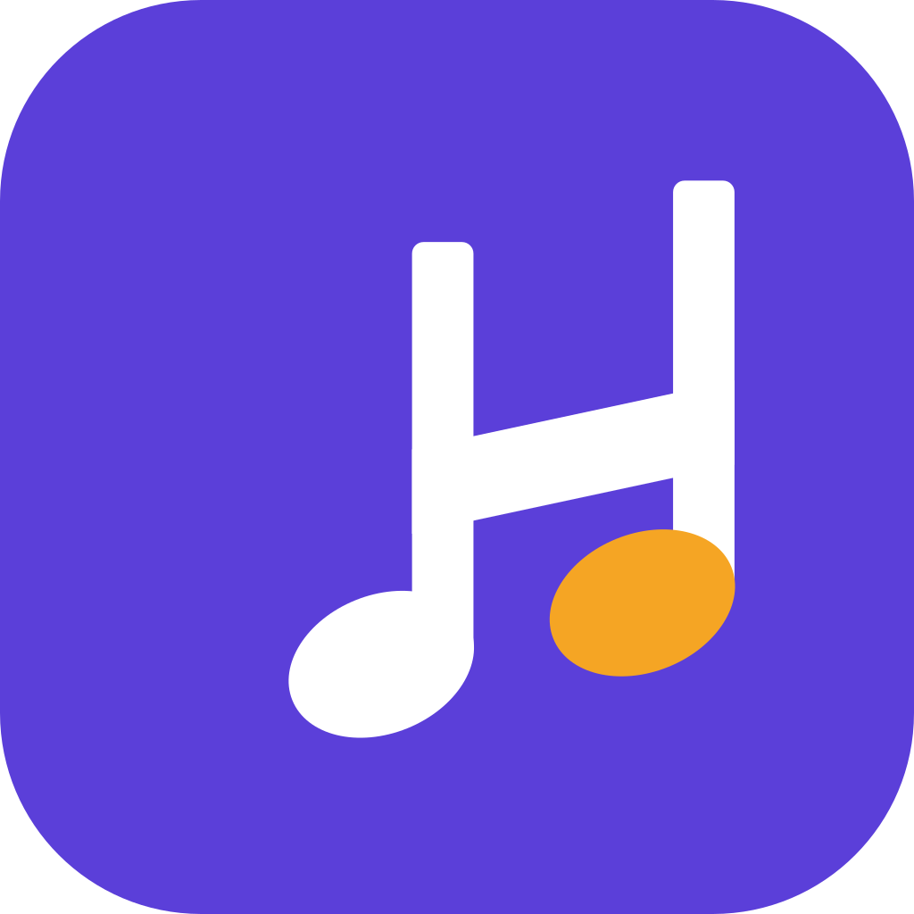
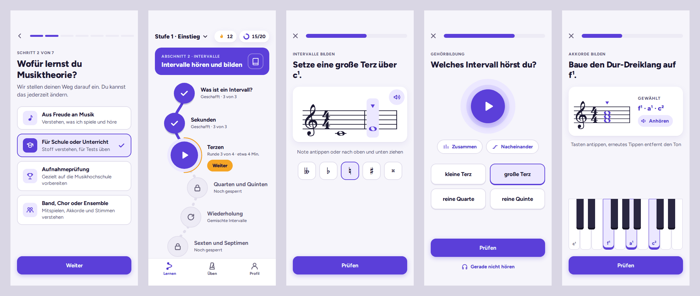
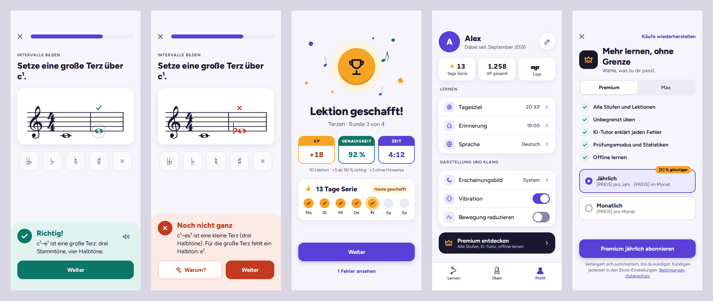
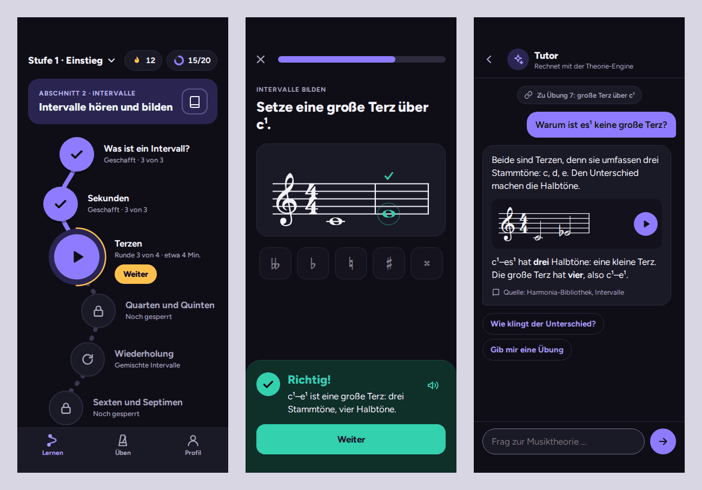

# Design-Richtung (P0.07)

- **Stand:** 03.10.2026, Entwurf v0
- **Entschieden von:** Claude. Phillip hat die Design-Richtung am 03.10.2026 vollständig übertragen („Du machst alles. Sehr schön modern und animiert.“). Einwände sind jederzeit möglich und werden dann hier nachgetragen.
- **Interaktive Fassung:** [Design-Leinwand](https://claude.ai/artifact/EP3RA5PQr2hNtn9dPhwEk6) mit allen Screens und laufenden Animationen (privat, nur für Phillip freigegeben)
- **Umsetzung:** Tokens und Bausteine in `packages/ui` (P1.06). Es gelten die Werte im Code (`packages/ui/src/tokens.ts`), dieses Dokument erklärt sie. Änderungen nach P0.07 sind unten vermerkt.

## Leitidee

**Modern, freundlich, in Bewegung.** Harmonia soll sich leicht anfühlen wie eine Lern-App für jeden Tag und trotzdem ernsthaft mit Musik umgehen. Das Notenbild steht im Mittelpunkt. Farbe und Bewegung erklären, was passiert: richtig, falsch, geschafft, weiter.

## Prinzipien

1. **Noten zuerst.** Das Notenbild hat Vorrang: viel Raum, ruhiger Grund, nichts liegt über der Aufgabe. Farbe sparsam einsetzen, damit Hervorhebungen wirken.
2. **Bewegung erklärt.** Jede Animation zeigt eine Änderung. Kurz und federnd, nie Selbstzweck. Mit „Bewegung reduzieren“ bleibt nur Überblenden.
3. **Ermutigend.** Fehler sind Lernmomente: erklären statt bestrafen, kein Zeitdruck, keine Schuldgefühle ([motivation-und-social.md](motivation-und-social.md)). Erfolge sichtbar feiern.
4. **Für alle lesbar.** Text mindestens 4,5 : 1, Bedienelemente mindestens 3 : 1 (WCAG 2.2 AA). Farbe nie allein, immer mit Symbol und Text. Touch-Ziele ab 48 pt. Schrift wächst mit der Systemeinstellung.
5. **Hell und dunkel gleichwertig.** Beide Modi sind eigens abgestimmt, nicht invertiert. Im Dunkelmodus entsteht Tiefe durch hellere Flächen statt Schatten.
6. **Klang ist Inhalt.** Ton und Bild laufen synchron (die klingende Note leuchtet). Keine Effektgeräusche, die man mit Übungstönen verwechseln könnte.

## Farben

Ein violett-blaues Primär (Marke, Aktionen, „aktiv“), ein warmes Bernstein als Akzent (Belohnung, Serie, XP), Blaugrün für richtig, Rotorange für falsch. Die Grautöne sind leicht violett getönt, damit alles zusammenpasst.

| Rolle | Hell | Dunkel | Verwendung |
|---|---|---|---|
| Grund | `#F6F5FB` | `#0F0E17` | Bildschirmhintergrund |
| Fläche | `#FFFFFF` | `#1A1926` | Karten, Leisten, Tab-Leiste |
| Versenkt | `#EDEBF5` | `#252336` | Spuren (Fortschritt), gesperrte Elemente. Dunkel in P1.06 von `#13121C` aufgehellt: Die Spur war im Browser auf dem Grund kaum zu sehen |
| Linie | `#E1DEEC` | `#2C2A3C` | Trennlinien, Ränder ohne Bedeutung |
| Linie kräftig | `#8A86A0` | `#77738F` | Ränder, die ein Bedienelement erkennbar machen (Eingabefeld, Schalter aus) |
| Text | `#1A1830` | `#F3F2FA` | Fließtext, Notentinte |
| Text leise | `#5C5873` | `#A9A5BF` | Nebentexte, Beschriftungen |
| Primär | `#5B3FD9` | `#8E7BFF` | Hauptknopf, aktive Note, Fortschritt |
| Auf Primär | `#FFFFFF` | `#0F0E17` | Text auf Primär |
| Primär als Text | `#5136CC` | `#A797FF` | Links, Zweitknöpfe |
| Primär weich | `#ECE8FF` | `#2A2550` | Ausgewählte Antwort, Chips |
| Akzent | `#F5A524` | `#FFC14D` | Serie, XP, Belohnung (nur als Fläche oder Symbol) |
| Akzent als Text | `#8F5300` | `#FFC967` | Text in Akzentfarbe |
| Richtig | `#0B7768` | `#34D1AE` | Richtige Note, Erfolgsleiste |
| Richtig weich | `#E1F3EF` | `#0F2F29` | Hintergrund der Erfolgsleiste |
| Falsch | `#C43A1E` | `#FF6B57` | Falsche Note, Fehlerleiste |
| Falsch weich | `#FCEAE5` | `#3A1C16` | Hintergrund der Fehlerleiste |

Auf Richtig, Falsch und Akzent steht im Hellmodus Weiß (Akzent: dunkler Text), im Dunkelmodus der dunkle Grund.

### Prüfung

- **Kontrast:** Alle 60 Farbpaare, die in den Screens vorkommen, mit zwei unabhängigen Mitteln berechnet: eigene Umsetzung der WCAG-Formel (relative Leuchtdichte) und `wcagContrast` aus [culori](https://culorijs.org/) 4.0.2. Beide Werte stimmen überein, alle Paare erfüllen die Grenze. Auswahl:

| Paar | Hell | Dunkel | Grenze |
|---|---|---|---|
| Text auf Grund | 15,9 : 1 | 17,2 : 1 | 4,5 |
| Text leise auf Grund | 6,3 : 1 | 8,1 : 1 | 4,5 |
| Text leise auf Versenkt | 5,8 : 1 | 6,4 : 1 | 4,5 |
| Auf Primär / Primär | 6,7 : 1 | 5,9 : 1 | 4,5 |
| Primär als Text auf Primär weich | 6,4 : 1 | 5,8 : 1 | 4,5 |
| Richtig auf Fläche | 5,5 : 1 | 9,0 : 1 | 4,5 |
| Richtig auf Richtig weich | 4,7 : 1 | 6,4 : 1 | 4,5 |
| Falsch auf Fläche | 5,3 : 1 | 6,2 : 1 | 4,5 |
| Falsch auf Falsch weich | 4,5 : 1 | 5,8 : 1 | 4,5 |
| Akzent als Text auf Fläche | 6,2 : 1 | 11,4 : 1 | 4,5 |
| Linie kräftig auf Fläche | 3,5 : 1 | 3,8 : 1 | 3 |

- **Farbfehlsichtigkeit:** Richtig und Falsch mit den Machado-Matrizen von culori simuliert (Protanopie, Deuteranopie, Tritanopie) und den Abstand in OKLab gemessen. Der erste Entwurf mit klassischem Grün und Rot lag bei Deuteranopie bei 0,04 (hell) bzw. 0,03 (dunkel), also kaum unterscheidbar. Mit Blaugrün und Rotorange sind es 0,12 bzw. 0,12, bei den anderen Formen 0,13 bis 0,37. Die Bedeutung hängt trotzdem nie an der Farbe allein (Symbol, Text, Haptik).
- **Seit P1.06** prüft `packages/ui/src/tokens.test.ts` bei jedem Push alle Paare aus `CONTRAST_PAIRS` (eigene Formel, culori als Gegenprobe) und den Abstand Richtig/Falsch bei Farbfehlsichtigkeit. Die Hervorhebungsfarben im Notenbild sind Richtig, Falsch und Primär; ein Test der App prüft, dass `packages/notation` dieselben Werte nutzt.

## Schrift

**Figtree** (SIL Open Font License 1.1, über `@expo-google-fonts/figtree`) für alle Texte, in den Stärken 400, 600, 700 und 800.

Verglichen wurden neun freie Schriften. Gemessen mit fontTools an den TTF-Dateien der Expo-Pakete, verglichen im Browser:

| Schrift | Mittellänge | ẞ korrekt | Hochzahlen ¹²³⁴⁵ | Tabellenziffern | Größe je Schnitt |
|---|---|---|---|---|---|
| **Figtree** | 0,500 em | ja | ja | ja | 39 KB |
| Plus Jakarta Sans | 0,536 em | nein, zeigt „SS“ | ja | ja | 92 KB |
| Manrope | 0,540 em | ja | ja | ja | 94 KB |
| Sora | 0,534 em | nein, zeigt „SS“ | ⁴⁵ fehlen | ja | 56 KB |
| DM Sans | 0,504 em | ja | ⁴⁵ fehlen | nein | 55 KB |
| Outfit | 0,475 em | ja | ⁴⁵ fehlen | ja | 53 KB |
| Lexend | 0,525 em | ja | ja | nein | 76 KB |
| Nunito | 0,484 em | ja | ja | nein | 129 KB |
| Bricolage Grotesque | 0,517 em | ja | ja | ja | 88 KB |

Gründe für Figtree: freundlich-geometrisch und gut lesbar, korrektes großes ẞ, Hochzahlen für die Oktavlagen (c¹ bis c⁵), Tabellenziffern für XP und Zeiten, kleinste Dateien. Manrope wäre die Alternative mit größerer Mittellänge, ist aber mehr als doppelt so groß.

**Größen** (pt, Zeilenhöhe in Klammern):

| Stufe | Größe | Stärke | Beispiel |
|---|---|---|---|
| Display | 34 (40) | 800 | „Lektion geschafft!“ |
| Titel 1 | 28 (34) | 800 | Bildschirmtitel |
| Titel 2 | 22 (28) | 700 | Aufgabenstellung, Feedback |
| Titel 3 | 18 (24) | 700 | Abschnitte |
| Text | 17 (24) | 400 | Fließtext, Antworten |
| Klein | 15 (20) | 600 | Zahlen, Hinweise |
| Fußnote | 13 (18) | 400 | Nebeninfos |
| Überzeile | 12 (16) | 700, Großbuchstaben, +0,08 em | „INTERVALLE BILDEN“ |

Alle Texte skalieren mit der Systemschrift. Layouts müssen bei 200 % lesbar bleiben (umbrechen statt abschneiden).

**Musikzeichen:**

- Notenbilder zeichnet die eigene Engine mit **Bravura** (SMuFL, SIL OFL 1.1). Im Übungsbereich mindestens 14 pt je Zwischenraum. Die Notentinte ist die Textfarbe.
- Kreuz, Be und Auflösungszeichen fehlen in allen neun geprüften Textschriften. Bravura selbst taugt im Fließtext nicht: Es setzt die Zeichen wie im Notensystem mittig auf die Grundlinie, im Browser standen sie dadurch zu tief (geprüft in P1.06).
- Im Fließtext nutzen wir deshalb **Bravura Text** (Steinberg, SIL OFL 1.1), die SMuFL-Schrift für Text: ♭ ♮ ♯ stehen dort auf der Grundlinie und sind so hoch wie Großbuchstaben. Die volle Schrift hat 3 MB. Wir binden nur eine Teilmenge von 16 KB ein (♭ ♮ ♯ und das Doppelkreuz), erzeugt mit `tools/make-accidental-font.py`.
- Bravura hat einen reservierten Schriftnamen. Eine veränderte Fassung, etwa eine Teilmenge, darf nicht „Bravura“ heißen. Die Teilmenge heißt deshalb „Harmonia Accidentals“, Copyright und Lizenz bleiben in der Datei, der Lizenztext liegt daneben. Bravura für Notenbilder binden wir unverändert ein.
- Die Unicode-Doppelzeichen 𝄪 und 𝄫 stehen in Bravura Text tiefgestellt. `MusicText` ersetzt 𝄪 durch das SMuFL-Doppelkreuz (1,3-fach) und 𝄫 durch zwei Be. Der Screenreader liest den Originaltext.

## Formen, Abstände, Ebenen

- **Abstände:** Raster von 4 pt: 4, 8, 12, 16, 24, 32, 48. Bildschirmrand 20 pt. Auf Tablet und Web ist der Inhalt höchstens 560 pt breit und zentriert.
- **Radien:** 8 Markierungen, 12 Eingaben, 16 Knöpfe und Antworten, 20 Karten, 28 Blätter von unten, rund für Chips und Lernpfad-Knoten.
- **Ebenen:** Im Hellmodus weiche, leicht violett getönte Schatten. Im Dunkelmodus keine Schatten, höhere Ebenen sind heller.
- **Touch-Ziele:** mindestens 48 × 48 pt, Hauptknöpfe 56 pt hoch und so breit wie der Inhalt.
- **Symbole:** Linien-Symbole mit 2 pt Strich und runden Enden, gefüllt für den aktiven Tab. Eigener kleiner Satz in `packages/ui` (`Icon`), dieselben Zeichnungen wie in den Entwürfen. Bibliotheken in P1.06 geprüft und verworfen:
  - Phosphor (MIT) hat Musik-Symbole und Füllvarianten. Einzelimporte liefern aber TypeScript-Quelltext, der unsere strengen Typregeln verletzt (`exactOptionalPropertyTypes`). Der Gesamtimport zieht alle rund 1.500 Symbole ins Bundle, weil Metro hier nicht tree-shaked.
  - Lucide (ISC) hat nur Linien und dasselbe Problem mit dem Gesamtimport.

## Bewegung

Die Leinwand zeigt alle Animationen in Schleife, mit Schalter für die reduzierte Fassung.

**Werte** (Umsetzung mit Reanimated 4):

| Was | Wert |
|---|---|
| Antippen | 100 ms |
| Zustandswechsel | 200 ms |
| Ein- und Ausblenden | 280 ms |
| Feier | bis 900 ms, danach Ruhe |
| Feder „sanft“ | Dämpfung 20, Steifigkeit 180 |
| Feder „federnd“ (Feedback) | Dämpfung 12, Steifigkeit 220 |
| Feder „straff“ (Ziehen von Noten) | Dämpfung 28, Steifigkeit 420 |
| Kurve hinein | `cubic-bezier(0.22, 1, 0.36, 1)` |
| Kurve hinaus | `cubic-bezier(0.55, 0, 1, 0.45)` |
| Kurve durch | `cubic-bezier(0.65, 0, 0.35, 1)` |

**Die wichtigsten Animationen:**

| Moment | Bewegung | Reduziert |
|---|---|---|
| Antippen | Knopf auf 96 %, Feder zurück | kurz abdunkeln |
| Richtig | Note wird blaugrün, Haken springt auf, Ring breitet sich aus, Leiste gleitet von unten herein | Überblenden |
| Falsch | sanftes Kopfschütteln der Antwort (400 ms, abklingend), Farbwechsel, Leiste gleitet herein. Nie rot blinkend | nur Farbwechsel |
| Fortschritt | Balken wächst mit leichtem Überschwingen, Funke an der Spitze | springt auf den neuen Wert |
| Nächste Lektion | Knoten „atmet“ (2,4 s). Einzige Dauerschleife | steht still |
| Lektion geschafft | Pokal springt auf, Noten fliegen als Konfetti, XP zählen hoch | Überblenden |
| Wiedergabe | Die klingende Note leuchtet, ein Abspielstrich läuft mit. Geplant auf der Audio-Uhr, nicht per Timer ([ADR 0006](../decisions/0006-audio-grundlage.md)) | nur die Farbe |
| Nächste Aufgabe | Alte Aufgabe gleitet 28 pt hinaus, neue herein | Überblenden in 150 ms |

**Bewegung reduzieren:** folgt der Systemeinstellung (`AccessibilityInfo` von React Native, reagiert auf Änderungen während die App läuft; im Web `prefers-reduced-motion`) und lässt sich in der App zusätzlich einschalten. Dann gibt es keine Bewegung über größere Strecken, kein Wackeln, keine Schleifen und kein Konfetti, nur Überblenden bis 150 ms und Farbwechsel.

**Haptik** (`expo-haptics`, in den Einstellungen abschaltbar). Im Web vibriert expo-haptics 57 über den Browser, wo das Gerät es kann (Android-Browser, auf iOS Safari über einen Umweg), am Desktop gar nicht:

- Antippen von Antworten und Tasten: leichter Impuls
- Richtig: Erfolgs-Rückmeldung
- Falsch: Warn-Rückmeldung. Sie ist kürzer als die Fehler-Rückmeldung (im Web zwei statt drei Impulse) und passt zum Prinzip „ermutigend“.

**Klang:** keine Effektgeräusche. Ob eine Lektion mit einer kurzen Kadenz auf dem Klavier endet, prüfen wir mit der ersten Lektion (P1.20). Sie wäre Inhalt, kein Effekt.

## Logo-Entwurf

- **Idee:** Zwei verbundene Noten bilden ein H. Der Balken ist der Querstrich und steigt an. Die zweite Note in Akzentfarbe steht für die zweite Stimme: zwei Stimmen, ein Klang.
- **Dateien:** [App-Symbol](bilder/logo-app-symbol.svg), [Zeichen ohne Fläche](bilder/logo-zeichen.svg). Wortmarke: Zeichen links, „Harmonia“ in Figtree 800 mit −0,02 em Laufweite.
- **Kleinste Größe:** 16 px (geprüft bei 16, 32, 64 und 160 px, auf hellem und dunklem Grund).
- **Vor dem Store:** Die Store-Symbole brauchen eine quadratische Fläche ohne Rundung (iOS rundet selbst) und unter Android eine adaptive Variante mit Schutzzone. Das entsteht mit dem Namen in P0.03, zusammen mit der Markenrecherche für Wort und Zeichen.

## Kern-Screens

Alle Screens auf der [Design-Leinwand](https://claude.ai/artifact/EP3RA5PQr2hNtn9dPhwEk6), Größe 390 × 844 pt. Notenbilder darin zeichnet die eigene Engine. Preise sind Platzhalter, weil sie aus dem Store kommen.

| Screen | Entscheidungen |
|---|---|
| **Onboarding** | Eine Frage pro Screen, Fortschritt in 7 Segmenten (Ablauf aus P2.09). Große Antwortkarten mit Symbol und Untertitel. |
| **Lernpfad** | Knoten auf einer geschwungenen Linie, jeweils **mit Titel und Stand**. Das hilft bei der Orientierung und mit dem Screenreader. Der aktuelle Knoten ist größer, hat einen Ring für den Fortschritt und einen Knopf „Weiter“. Oben: Stufe, Serie, Tagesziel. Abschnittskarte mit Leitfaden. |
| **Übung: Noten setzen** | Notensystem in einer Karte mit 14 pt je Zwischenraum. Die Antwortspalte ist hinterlegt, damit klar ist, wo die Note hingehört. Vorzeichenleiste mit allen fünf Zeichen, „Anhören“ in der Karte. „Prüfen“ unten. |
| **Übung: Hören** | Großer Abspielknopf, Wiedergabe „Zusammen“ oder „Nacheinander“, Antworten 2 × 2. Darunter „Gerade nicht hören“ mit Kopfhörer-Symbol (F12, [ADR 0006](../decisions/0006-audio-grundlage.md)). |
| **Übung: Klaviatur** | Klaviatur c¹ bis e² am unteren Rand (Daumen). Gewählte Tasten mit Tonnamen, darüber zeigt das Notenbild die Eingabe sofort. Schwarze Tasten tragen für den Screenreader beide Namen (cis¹ oder des¹). Die Schreibweise legt die Übung fest (P1.18). |
| **Feedback** | Leiste von unten in Richtig- bzw. Falsch-Farbe: Symbol, Überschrift, ein Satz mit Begründung (Stammtöne und Halbtöne). „Warum?“ öffnet den Tutor mit dem Kontext der Aufgabe. Das Notenbild bleibt sichtbar. |
| **Lektionsergebnis** | XP mit Aufschlüsselung (Werte aus [motivation-und-social.md](motivation-und-social.md): 10 + 5 ab 90 % + 3 ohne Hinweise), Genauigkeit, Zeit, Serie mit Wochenansicht. „Fehler ansehen“ als zweite Aktion. |
| **Profil und Einstellungen** | Kennzahlen (Serie, XP, Liga als Dynamikzeichen, z. B. *mp*), Lernen (Tagesziel, Erinnerung, Sprache), Darstellung und Klang (Erscheinungsbild, Vibration, Bewegung reduzieren), Premium-Zeile. |
| **Paywall** | Premium und Max umschaltbar, Leistungen aus [business-model.md](../business-model.md). Laufzeit, Preis und Verlängerung stehen klar da. „Käufe wiederherstellen“ oben. Kein Countdown, keine vorausgewählten Tricks ([monetarisierung.md](monetarisierung.md)). |
| **Tutor-Chat** | Bezug zur Übung oben, Antworten mit Notenbeispiel und Abspielknopf, Quellenangabe, Vorschläge für die nächste Frage. Fachlich rechnet die Engine ([ADR 0002](../decisions/0002-ki-tutor-und-fachliche-korrektheit.md)). |

Ein klickbarer Prototyp der Lektion entfällt. Das Übungs-Framework (P1.19) baut den echten Ablauf, das ist aussagekräftiger.

## Offen

- Name und Marke (P0.03, F16): Das Logo ist ein Entwurf für den Arbeitstitel.
- Prüfung auf echten Geräten: Lesbarkeit der Schrift, Haptik, Bewegung (mit den Gerätetests aus P1.06).
