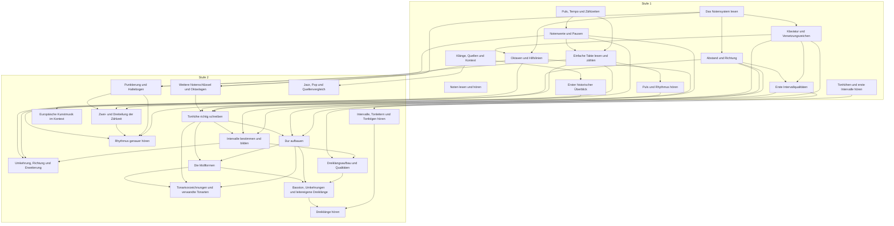
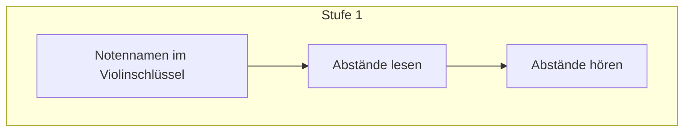
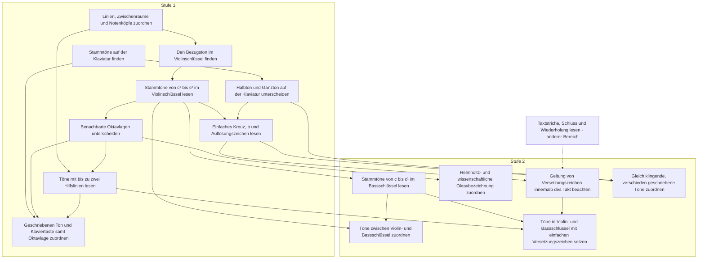
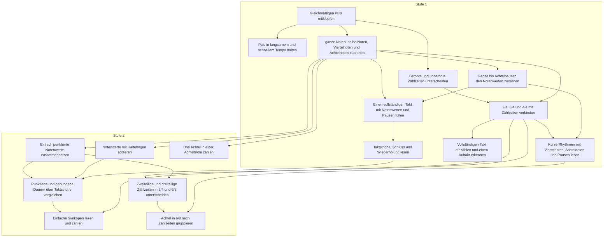
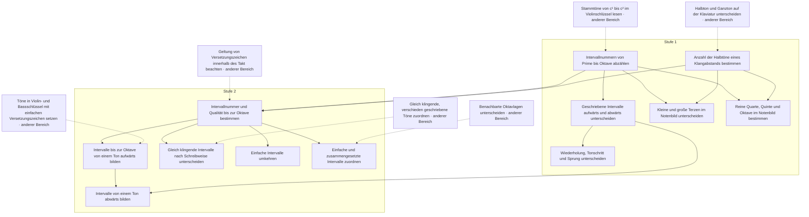
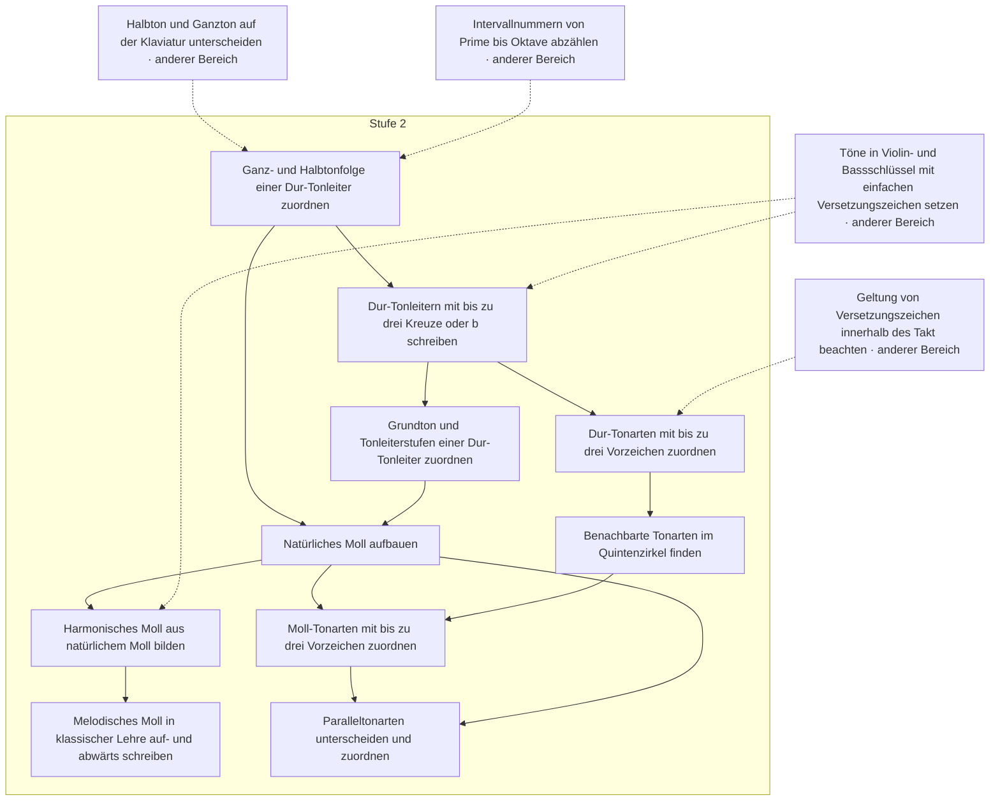
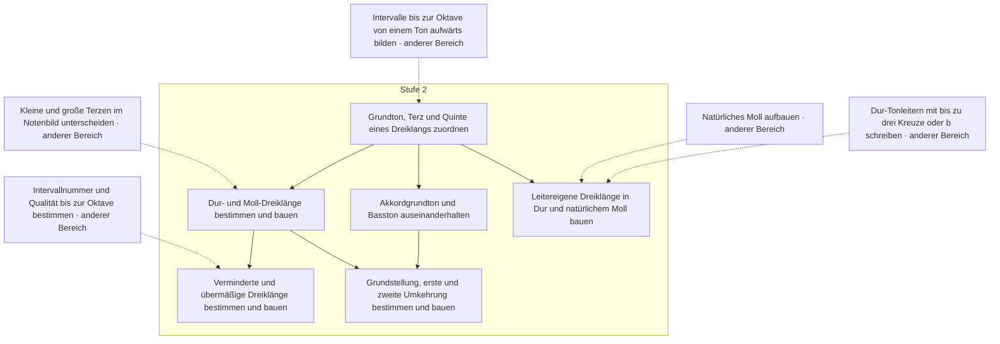
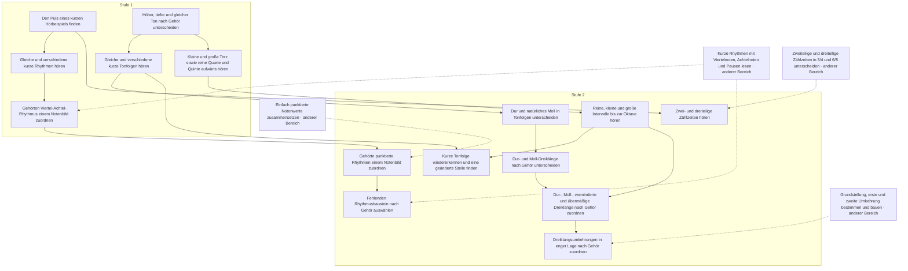
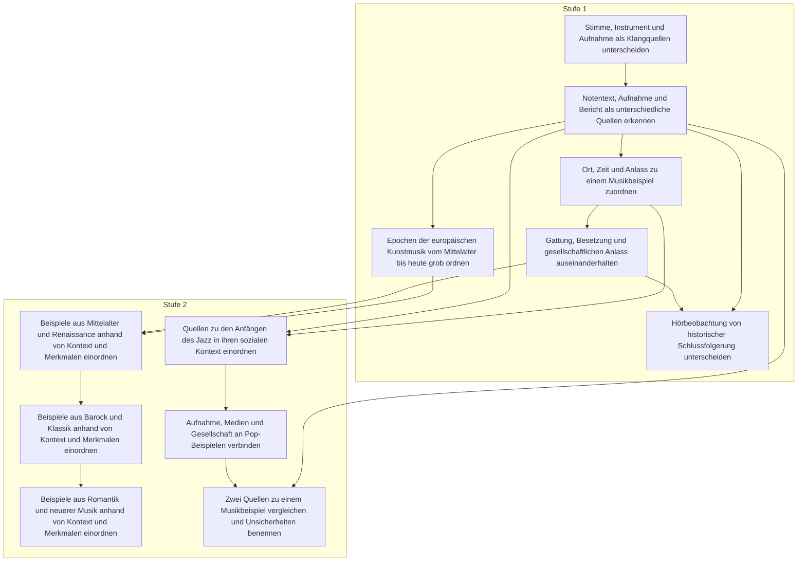

# Fähigkeitsgraph Stufen 1–2 (Entwurf)

<!-- Erzeugt mit pnpm curriculum:render; Änderungen an Katalog, Plan oder Übersetzungen vornehmen. -->

Katalog-/Planversion 9. 8 Bereiche, 13 Bereichsstufen, 29 Einheiten und 90 Fähigkeiten.

Pfeile zeigen von der Voraussetzung zum folgenden Lernziel. Die Reihenfolge ist eine mögliche Reihenfolge für die Planung; unabhängige Zweige bleiben im Graphen unabhängig. Die Tabellen zeigen alle direkten Voraussetzungen, auch über Bereichsgrenzen hinweg.

Die Einheiten haben noch keine vollständigen Lektionen. Technische Prüfungen ersetzen die separate fachliche Abnahme durch Claude nicht. Diese Ansicht gehört zur Planung und ist kein Lernpfad in der App.

## Reihenfolge der Einheiten

| Nr. | Stufe | Bereich | Einheit | Fähigkeiten |
|---|---|---|---|---|
| 1 | 1 | Grundlagen | Noten lesen und hören · `fundament.reading-and-listening` | 3 |
| 2 | 1 | Notation und Tonhöhen | Das Notensystem lesen · `notation.l1.staff` | 3 |
| 3 | 1 | Notation und Tonhöhen | Klaviatur und Versetzungszeichen · `notation.l1.keyboard` | 3 |
| 4 | 1 | Notation und Tonhöhen | Oktaven und Hilfslinien · `notation.l1.register` | 3 |
| 5 | 1 | Rhythmus und Metrum | Puls, Tempo und Zählzeiten · `rhythm.l1.pulse` | 3 |
| 6 | 1 | Rhythmus und Metrum | Notenwerte und Pausen · `rhythm.l1.values` | 4 |
| 7 | 1 | Rhythmus und Metrum | Einfache Takte lesen und zählen · `rhythm.l1.simple-meter` | 3 |
| 8 | 1 | Intervalle | Abstand und Richtung · `intervals.l1.size` | 3 |
| 9 | 1 | Intervalle | Erste Intervallqualitäten · `intervals.l1.first-qualities` | 3 |
| 10 | 1 | Gehörbildung | Puls und Rhythmus hören · `aural.l1.pulse-rhythm` | 3 |
| 11 | 1 | Gehörbildung | Tonhöhen und erste Intervalle hören · `aural.l1.pitch-intervals` | 3 |
| 12 | 1 | Musikgeschichte und Quellen | Klänge, Quellen und Kontext · `history.l1.sources` | 3 |
| 13 | 1 | Musikgeschichte und Quellen | Erster historischer Überblick · `history.l1.overview` | 3 |
| 14 | 2 | Notation und Tonhöhen | Weitere Notenschlüssel und Oktavlagen · `notation.l2.clefs-registers` | 3 |
| 15 | 2 | Notation und Tonhöhen | Tonhöhe richtig schreiben · `notation.l2.spelling` | 3 |
| 16 | 2 | Rhythmus und Metrum | Punktierung und Haltebogen · `rhythm.l2.dotted-tied` | 4 |
| 17 | 2 | Rhythmus und Metrum | Zwei- und Dreiteilung der Zählzeit · `rhythm.l2.subdivision` | 3 |
| 18 | 2 | Intervalle | Intervalle bestimmen und bilden · `intervals.l2.qualities-build` | 3 |
| 19 | 2 | Intervalle | Umkehrung, Richtung und Erweiterung · `intervals.l2.inversion` | 3 |
| 20 | 2 | Tonleitern und Tonarten | Dur aufbauen · `scales.l2.major` | 3 |
| 21 | 2 | Tonleitern und Tonarten | Die Mollformen · `scales.l2.minor` | 3 |
| 22 | 2 | Tonleitern und Tonarten | Tonartvorzeichnungen und verwandte Tonarten · `scales.l2.keys` | 4 |
| 23 | 2 | Dreiklänge | Dreiklangsaufbau und Qualitäten · `chords.l2.qualities` | 3 |
| 24 | 2 | Dreiklänge | Basston, Umkehrungen und leitereigene Dreiklänge · `chords.l2.inversions` | 3 |
| 25 | 2 | Gehörbildung | Rhythmus genauer hören · `aural.l2.rhythm-detail` | 3 |
| 26 | 2 | Gehörbildung | Intervalle, Tonleitern und Tonfolgen hören · `aural.l2.melody` | 3 |
| 27 | 2 | Gehörbildung | Dreiklänge hören · `aural.l2.triads` | 3 |
| 28 | 2 | Musikgeschichte und Quellen | Europäische Kunstmusik im Kontext · `history.l2.period-contexts` | 3 |
| 29 | 2 | Musikgeschichte und Quellen | Jazz, Pop und Quellenvergleich · `history.l2.jazz-pop-sources` | 3 |

## Grundlagen · `fundament`

| Stufe / Einheit | Fähigkeit (DE) | Skill-ID | Ziel (EN-US / EN-GB) | Direkte Voraussetzungen | Status |
|---|---|---|---|---|---|
| 1 · Noten lesen und hören | Notennamen im Violinschlüssel | `notation.note-name` | Note names in the treble clef | — | entwurf |
| 1 · Noten lesen und hören | Abstände lesen | `interval.identify.visual` | Read distances | `notation.note-name` | entwurf |
| 1 · Noten lesen und hören | Abstände hören | `interval.identify.aural` | Hear distances | `interval.identify.visual` | entwurf |

## Notation und Tonhöhen · `area.notation`

| Stufe / Einheit | Fähigkeit (DE) | Skill-ID | Ziel (EN-US / EN-GB) | Direkte Voraussetzungen | Status |
|---|---|---|---|---|---|
| 1 · Das Notensystem lesen | Linien, Zwischenräume und Notenköpfe zuordnen | `notation.staff` | Locate lines, spaces and noteheads | — | entwurf |
| 1 · Das Notensystem lesen | Den Bezugston im Violinschlüssel finden | `notation.treble-clef` | Find the reference pitch in the treble clef | `notation.staff` | entwurf |
| 1 · Das Notensystem lesen | Stammtöne von c¹ bis c² im Violinschlüssel lesen | `notation.treble-natural` | Read natural notes from C4 to C5 in the treble clef | `notation.treble-clef` | entwurf |
| 1 · Klaviatur und Versetzungszeichen | Stammtöne auf der Klaviatur finden | `notation.keyboard-layout` | Find natural notes on the keyboard | — | entwurf |
| 1 · Klaviatur und Versetzungszeichen | Halbton und Ganzton auf der Klaviatur unterscheiden | `notation.semitone` | Distinguish a half step from a whole step on the keyboard / Distinguish a semitone from a tone on the keyboard | `notation.keyboard-layout` | entwurf |
| 1 · Klaviatur und Versetzungszeichen | Einfaches Kreuz, b und Auflösungszeichen lesen | `notation.accidentals` | Read a single sharp, flat and natural | `notation.treble-natural`, `notation.semitone` | entwurf |
| 1 · Oktaven und Hilfslinien | Benachbarte Oktavlagen unterscheiden | `notation.octave-register` | Distinguish adjacent octave registers | `notation.treble-natural` | entwurf |
| 1 · Oktaven und Hilfslinien | Töne mit bis zu zwei Hilfslinien lesen | `notation.ledger-lines` | Read notes with up to two ledger lines | `notation.staff`, `notation.octave-register` | entwurf |
| 1 · Oktaven und Hilfslinien | Geschriebenen Ton und Klaviertaste samt Oktavlage zuordnen | `notation.pitch-match` | Match a written pitch to a piano key in the correct register | `notation.keyboard-layout`, `notation.octave-register`, `notation.ledger-lines` | entwurf |
| 2 · Weitere Notenschlüssel und Oktavlagen | Stammtöne von c bis c¹ im Bassschlüssel lesen | `notation.bass-natural` | Read natural notes from C3 to C4 in the bass clef | `notation.treble-natural` | entwurf |
| 2 · Weitere Notenschlüssel und Oktavlagen | Töne zwischen Violin- und Bassschlüssel zuordnen | `notation.grand-staff` | Match pitches between treble and bass clef | `notation.treble-natural`, `notation.bass-natural` | entwurf |
| 2 · Weitere Notenschlüssel und Oktavlagen | Helmholtz- und wissenschaftliche Oktavbezeichnung zuordnen | `notation.octave-systems` | Match Helmholtz and scientific octave notation | `notation.octave-register` | entwurf |
| 2 · Tonhöhe richtig schreiben | Geltung von Versetzungszeichen innerhalb des Takt beachten | `notation.accidental-scope` | Apply accidentals within a measure / Apply accidentals within a bar | `notation.accidentals`, `rhythm.barlines` | entwurf |
| 2 · Tonhöhe richtig schreiben | Gleich klingende, verschieden geschriebene Töne zuordnen | `notation.enharmonic-spelling` | Match pitches with the same sound but different spellings | `notation.accidentals`, `notation.semitone` | entwurf |
| 2 · Tonhöhe richtig schreiben | Töne in Violin- und Bassschlüssel mit einfachen Versetzungszeichen setzen | `notation.write-pitch` | Place notes in treble and bass clef with single accidentals | `notation.ledger-lines`, `notation.bass-natural`, `notation.accidental-scope` | entwurf |

## Rhythmus und Metrum · `area.rhythm`

| Stufe / Einheit | Fähigkeit (DE) | Skill-ID | Ziel (EN-US / EN-GB) | Direkte Voraussetzungen | Status |
|---|---|---|---|---|---|
| 1 · Puls, Tempo und Zählzeiten | Gleichmäßigen Puls mitklopfen | `rhythm.pulse` | Tap a steady pulse | — | entwurf |
| 1 · Puls, Tempo und Zählzeiten | Puls in langsamem und schnellem Tempo halten | `rhythm.tempo` | Maintain a pulse at slow and fast tempos | `rhythm.pulse` | entwurf |
| 1 · Puls, Tempo und Zählzeiten | Betonte und unbetonte Zählzeiten unterscheiden | `rhythm.beat-group` | Distinguish accented and unaccented beats | `rhythm.pulse` | entwurf |
| 1 · Notenwerte und Pausen | ganze Noten, halbe Noten, Viertelnoten und Achtelnoten zuordnen | `rhythm.note-values` | Match whole notes, half notes, quarter notes and eighth notes / Match semibreves, minims, crotchets and quavers | `rhythm.pulse` | entwurf |
| 1 · Notenwerte und Pausen | Ganze bis Achtelpausen den Notenwerten zuordnen | `rhythm.rests` | Match whole notes through eighth notes to their rests / Match semibreves through quavers to their rests | `rhythm.note-values` | entwurf |
| 1 · Notenwerte und Pausen | Einen vollständigen Takt mit Notenwerten und Pausen füllen | `rhythm.measure-fill` | Complete a measure with note values and rests / Complete a bar with note values and rests | `rhythm.note-values`, `rhythm.rests` | entwurf |
| 1 · Notenwerte und Pausen | Taktstriche, Schluss und Wiederholung lesen | `rhythm.barlines` | Read bar lines, endings and repeats | `rhythm.measure-fill` | entwurf |
| 1 · Einfache Takte lesen und zählen | 2/4, 3/4 und 4/4 mit Zählzeiten verbinden | `rhythm.meter-simple` | Relate 2/4, 3/4 and 4/4 to their beats | `rhythm.beat-group`, `rhythm.note-values` | entwurf |
| 1 · Einfache Takte lesen und zählen | Vollständigen Takt einzählen und einen Auftakt erkennen | `rhythm.count-in` | Count in a full measure and recognize an upbeat / Count in a full bar and recognise an upbeat | `rhythm.meter-simple` | entwurf |
| 1 · Einfache Takte lesen und zählen | Kurze Rhythmen mit Viertelnoten, Achtelnoten und Pausen lesen | `rhythm.read-basic` | Read short rhythms with quarter notes, eighth notes and rests / Read short rhythms with crotchets, quavers and rests | `rhythm.meter-simple`, `rhythm.rests` | entwurf |
| 2 · Punktierung und Haltebogen | Einfach punktierte Notenwerte zusammensetzen | `rhythm.dotted-values` | Construct singly dotted note values | `rhythm.note-values` | entwurf |
| 2 · Punktierung und Haltebogen | Notenwerte mit Haltebogen addieren | `rhythm.ties` | Add note values joined by a tie | `rhythm.note-values` | entwurf |
| 2 · Punktierung und Haltebogen | Punktierte und gebundene Dauern über Taktstriche vergleichen | `rhythm.dotted-and-tied` | Compare dotted and tied durations across bar lines | `rhythm.dotted-values`, `rhythm.ties`, `rhythm.barlines` | entwurf |
| 2 · Punktierung und Haltebogen | Einfache Synkopen lesen und zählen | `rhythm.syncopation-basic` | Read and count simple syncopations | `rhythm.dotted-and-tied`, `rhythm.meter-simple` | entwurf |
| 2 · Zwei- und Dreiteilung der Zählzeit | Drei Achtel in einer Achteltriole zählen | `rhythm.triplet` | Count three notes in a eighth note triplet / Count three notes in a quaver triplet | `rhythm.note-values` | entwurf |
| 2 · Zwei- und Dreiteilung der Zählzeit | Zweiteilige und dreiteilige Zählzeiten in 3/4 und 6/8 unterscheiden | `rhythm.compound-meter` | Distinguish duple and triple beat subdivisions in 3/4 and 6/8 | `rhythm.meter-simple`, `rhythm.dotted-values` | entwurf |
| 2 · Zwei- und Dreiteilung der Zählzeit | Achtel in 6/8 nach Zählzeiten gruppieren | `rhythm.group-6-8` | Group eighth notes by beat in 6/8 / Group quavers by beat in 6/8 | `rhythm.compound-meter`, `rhythm.read-basic` | entwurf |

## Intervalle · `area.intervals`

| Stufe / Einheit | Fähigkeit (DE) | Skill-ID | Ziel (EN-US / EN-GB) | Direkte Voraussetzungen | Status |
|---|---|---|---|---|---|
| 1 · Abstand und Richtung | Intervallnummern von Prime bis Oktave abzählen | `interval.generic-size` | Count interval numbers from unison to octave | `notation.treble-natural` | entwurf |
| 1 · Abstand und Richtung | Geschriebene Intervalle aufwärts und abwärts unterscheiden | `interval.direction` | Distinguish written ascending and descending intervals | `interval.generic-size` | entwurf |
| 1 · Abstand und Richtung | Wiederholung, Tonschritt und Sprung unterscheiden | `interval.steps-leaps` | Distinguish repeated notes, steps and leaps | `interval.direction` | entwurf |
| 1 · Erste Intervallqualitäten | Anzahl der Halbtöne eines Klangabstands bestimmen | `interval.semitone-distance` | Count sounding distances in half steps / Count sounding distances in semitones | `notation.semitone` | entwurf |
| 1 · Erste Intervallqualitäten | Kleine und große Terzen im Notenbild unterscheiden | `interval.thirds` | Distinguish written minor and major thirds | `interval.generic-size`, `interval.semitone-distance` | entwurf |
| 1 · Erste Intervallqualitäten | Reine Quarte, Quinte und Oktave im Notenbild bestimmen | `interval.perfect-fourth-fifth-octave` | Identify written perfect fourths, fifths and octaves | `interval.generic-size`, `interval.semitone-distance` | entwurf |
| 2 · Intervalle bestimmen und bilden | Intervallnummer und Qualität bis zur Oktave bestimmen | `interval.simple-qualities` | Identify interval number and quality up to the octave | `interval.generic-size`, `interval.semitone-distance`, `notation.accidental-scope` | entwurf |
| 2 · Intervalle bestimmen und bilden | Intervalle bis zur Oktave von einem Ton aufwärts bilden | `interval.build` | Build ascending intervals up to the octave from a given pitch | `interval.simple-qualities`, `notation.write-pitch` | entwurf |
| 2 · Intervalle bestimmen und bilden | Gleich klingende Intervalle nach Schreibweise unterscheiden | `interval.enharmonic-distinction` | Distinguish equal-sounding intervals by spelling | `interval.simple-qualities`, `notation.enharmonic-spelling` | entwurf |
| 2 · Umkehrung, Richtung und Erweiterung | Einfache Intervalle umkehren | `interval.inversion` | Invert simple intervals | `interval.simple-qualities` | entwurf |
| 2 · Umkehrung, Richtung und Erweiterung | Intervalle von einem Ton abwärts bilden | `interval.descending` | Build descending intervals from a given pitch | `interval.build`, `interval.direction` | entwurf |
| 2 · Umkehrung, Richtung und Erweiterung | Einfache und zusammengesetzte Intervalle zuordnen | `interval.simple-compound` | Relate simple and compound intervals | `interval.simple-qualities`, `notation.octave-register` | entwurf |

## Tonleitern und Tonarten · `area.scales`

| Stufe / Einheit | Fähigkeit (DE) | Skill-ID | Ziel (EN-US / EN-GB) | Direkte Voraussetzungen | Status |
|---|---|---|---|---|---|
| 2 · Dur aufbauen | Ganz- und Halbtonfolge einer Dur-Tonleiter zuordnen | `scale.major-pattern` | Identify the whole step and half step pattern of a major scale / Identify the tone and semitone pattern of a major scale | `notation.semitone`, `interval.generic-size` | entwurf |
| 2 · Dur aufbauen | Dur-Tonleitern mit bis zu drei Kreuze oder b schreiben | `scale.major-build` | Write major scales with up to three sharps or flats | `scale.major-pattern`, `notation.write-pitch` | entwurf |
| 2 · Dur aufbauen | Grundton und Tonleiterstufen einer Dur-Tonleiter zuordnen | `scale.tonic` | Identify the tonic and scale degrees of a major scale | `scale.major-build` | entwurf |
| 2 · Die Mollformen | Natürliches Moll aufbauen | `scale.natural-minor` | Build natural minor scales | `scale.major-pattern`, `scale.tonic` | entwurf |
| 2 · Die Mollformen | Harmonisches Moll aus natürlichem Moll bilden | `scale.harmonic-minor` | Build harmonic minor from natural minor | `scale.natural-minor`, `notation.write-pitch` | entwurf |
| 2 · Die Mollformen | Melodisches Moll in klassischer Lehre auf- und abwärts schreiben | `scale.melodic-minor` | Write ascending and descending melodic minor in the classical convention | `scale.harmonic-minor` | entwurf |
| 2 · Tonartvorzeichnungen und verwandte Tonarten | Dur-Tonarten mit bis zu drei Vorzeichen zuordnen | `key.signature-major` | Identify major keys with up to three sharps or flats | `scale.major-build`, `notation.accidental-scope` | entwurf |
| 2 · Tonartvorzeichnungen und verwandte Tonarten | Benachbarte Tonarten im Quintenzirkel finden | `key.fifths` | Find neighboring keys in the circle of fifths / Find neighbouring keys in the circle of fifths | `key.signature-major` | entwurf |
| 2 · Tonartvorzeichnungen und verwandte Tonarten | Moll-Tonarten mit bis zu drei Vorzeichen zuordnen | `key.signature-minor` | Identify minor keys with up to three sharps or flats | `scale.natural-minor`, `key.fifths` | entwurf |
| 2 · Tonartvorzeichnungen und verwandte Tonarten | Paralleltonarten unterscheiden und zuordnen | `key.relative` | Distinguish and match relative keys | `key.signature-minor`, `scale.natural-minor` | entwurf |

## Dreiklänge · `area.chords`

| Stufe / Einheit | Fähigkeit (DE) | Skill-ID | Ziel (EN-US / EN-GB) | Direkte Voraussetzungen | Status |
|---|---|---|---|---|---|
| 2 · Dreiklangsaufbau und Qualitäten | Grundton, Terz und Quinte eines Dreiklangs zuordnen | `chord.triad-structure` | Identify the root, third and fifth of a triad | `interval.build` | entwurf |
| 2 · Dreiklangsaufbau und Qualitäten | Dur- und Moll-Dreiklänge bestimmen und bauen | `chord.major-minor` | Identify and build major and minor triads | `chord.triad-structure`, `interval.thirds` | entwurf |
| 2 · Dreiklangsaufbau und Qualitäten | Verminderte und übermäßige Dreiklänge bestimmen und bauen | `chord.diminished-augmented` | Identify and build diminished and augmented triads | `chord.major-minor`, `interval.simple-qualities` | entwurf |
| 2 · Basston, Umkehrungen und leitereigene Dreiklänge | Akkordgrundton und Basston auseinanderhalten | `chord.root-and-bass` | Distinguish chord root from bass note | `chord.triad-structure` | entwurf |
| 2 · Basston, Umkehrungen und leitereigene Dreiklänge | Grundstellung, erste und zweite Umkehrung bestimmen und bauen | `chord.inversions` | Identify and build root-position, first-inversion and second-inversion triads | `chord.root-and-bass`, `chord.major-minor` | entwurf |
| 2 · Basston, Umkehrungen und leitereigene Dreiklänge | Leitereigene Dreiklänge in Dur und natürlichem Moll bauen | `chord.diatonic-triads` | Build diatonic triads in major and natural minor | `scale.major-build`, `scale.natural-minor`, `chord.triad-structure` | entwurf |

## Gehörbildung · `area.aural`

| Stufe / Einheit | Fähigkeit (DE) | Skill-ID | Ziel (EN-US / EN-GB) | Direkte Voraussetzungen | Status |
|---|---|---|---|---|---|
| 1 · Puls und Rhythmus hören | Den Puls eines kurzen Hörbeispiels finden | `aural.pulse` | Find the pulse in a short listening example | — | entwurf |
| 1 · Puls und Rhythmus hören | Gleiche und verschiedene kurze Rhythmen hören | `aural.same-different-rhythm` | Hear whether two short rhythms are the same or different | `aural.pulse` | entwurf |
| 1 · Puls und Rhythmus hören | Gehörten Viertel-Achtel-Rhythmus einem Notenbild zuordnen | `aural.rhythm-choice-basic` | Match a heard rhythm of quarter notes and eighth notes to notation / Match a heard rhythm of crotchets and quavers to notation | `aural.same-different-rhythm`, `rhythm.read-basic` | entwurf |
| 1 · Tonhöhen und erste Intervalle hören | Höher, tiefer und gleicher Ton nach Gehör unterscheiden | `aural.pitch-direction` | Distinguish higher, lower and repeated pitches by ear | — | entwurf |
| 1 · Tonhöhen und erste Intervalle hören | Gleiche und verschiedene kurze Tonfolgen hören | `aural.same-different-melody` | Hear whether two short melodies are the same or different | `aural.pitch-direction` | entwurf |
| 1 · Tonhöhen und erste Intervalle hören | Kleine und große Terz sowie reine Quarte und Quinte aufwärts hören | `aural.third-fourth-fifth` | Recognize ascending minor and major thirds, perfect fourths and fifths / Recognise ascending minor and major thirds, perfect fourths and fifths | `aural.pitch-direction` | entwurf |
| 2 · Rhythmus genauer hören | Gehörte punktierte Rhythmen einem Notenbild zuordnen | `aural.rhythm-choice-dotted` | Match heard dotted rhythms to notation | `aural.rhythm-choice-basic`, `rhythm.dotted-values` | entwurf |
| 2 · Rhythmus genauer hören | Zwei- und dreiteilige Zählzeiten hören | `aural.simple-compound-pulse` | Hear duple and triple beat subdivisions | `aural.pulse`, `rhythm.compound-meter` | entwurf |
| 2 · Rhythmus genauer hören | Fehlenden Rhythmusbaustein nach Gehör auswählen | `aural.rhythm-completion` | Choose a missing rhythm pattern by ear | `aural.rhythm-choice-dotted`, `rhythm.read-basic` | entwurf |
| 2 · Intervalle, Tonleitern und Tonfolgen hören | Reine, kleine und große Intervalle bis zur Oktave hören | `aural.simple-intervals` | Recognize perfect, minor and major intervals up to the octave by ear / Recognise perfect, minor and major intervals up to the octave by ear | `aural.third-fourth-fifth` | entwurf |
| 2 · Intervalle, Tonleitern und Tonfolgen hören | Dur und natürliches Moll in Tonfolgen unterscheiden | `aural.major-minor-scale` | Distinguish major from natural minor in melodies | `aural.same-different-melody` | entwurf |
| 2 · Intervalle, Tonleitern und Tonfolgen hören | Kurze Tonfolge wiedererkennen und eine geänderte Stelle finden | `aural.melodic-memory` | Recognize a short melody and locate a changed note / Recognise a short melody and locate a changed note | `aural.same-different-melody`, `aural.simple-intervals` | entwurf |
| 2 · Dreiklänge hören | Dur- und Moll-Dreiklänge nach Gehör unterscheiden | `aural.triad-major-minor` | Distinguish major and minor triads by ear | `aural.major-minor-scale` | entwurf |
| 2 · Dreiklänge hören | Dur-, Moll-, verminderte und übermäßige Dreiklänge nach Gehör zuordnen | `aural.triad-quality` | Recognize major, minor, diminished and augmented triads by ear / Recognise major, minor, diminished and augmented triads by ear | `aural.triad-major-minor`, `aural.simple-intervals` | entwurf |
| 2 · Dreiklänge hören | Dreiklangsumkehrungen in enger Lage nach Gehör zuordnen | `aural.triad-inversions` | Recognize close-position triad inversions by ear / Recognise close-position triad inversions by ear | `aural.triad-quality`, `chord.inversions` | entwurf |

## Musikgeschichte und Quellen · `area.history`

| Stufe / Einheit | Fähigkeit (DE) | Skill-ID | Ziel (EN-US / EN-GB) | Direkte Voraussetzungen | Status |
|---|---|---|---|---|---|
| 1 · Klänge, Quellen und Kontext | Stimme, Instrument und Aufnahme als Klangquellen unterscheiden | `history.sound-source` | Distinguish voices, instruments and recordings as sound sources | — | entwurf |
| 1 · Klänge, Quellen und Kontext | Notentext, Aufnahme und Bericht als unterschiedliche Quellen erkennen | `history.source-types` | Recognize scores, recordings and reports as different kinds of source / Recognise scores, recordings and reports as different kinds of source | `history.sound-source` | entwurf |
| 1 · Klänge, Quellen und Kontext | Ort, Zeit und Anlass zu einem Musikbeispiel zuordnen | `history.context` | Relate place, time and occasion to a musical example | `history.source-types` | entwurf |
| 1 · Erster historischer Überblick | Epochen der europäischen Kunstmusik vom Mittelalter bis heute grob ordnen | `history.european-timeline` | Place periods of European art music from the Middle Ages to the present in broad order | `history.source-types` | entwurf |
| 1 · Erster historischer Überblick | Gattung, Besetzung und gesellschaftlichen Anlass auseinanderhalten | `history.genre-function` | Distinguish genre, performing forces and social occasion | `history.context` | entwurf |
| 1 · Erster historischer Überblick | Hörbeobachtung von historischer Schlussfolgerung unterscheiden | `history.listening-observation` | Distinguish a listening observation from a historical inference | `history.source-types`, `history.genre-function` | entwurf |
| 2 · Europäische Kunstmusik im Kontext | Beispiele aus Mittelalter und Renaissance anhand von Kontext und Merkmalen einordnen | `history.medieval-renaissance` | Place medieval and Renaissance examples using context and musical features | `history.european-timeline`, `history.genre-function` | entwurf |
| 2 · Europäische Kunstmusik im Kontext | Beispiele aus Barock und Klassik anhand von Kontext und Merkmalen einordnen | `history.baroque-classical` | Place Baroque and Classical examples using context and musical features | `history.medieval-renaissance` | entwurf |
| 2 · Europäische Kunstmusik im Kontext | Beispiele aus Romantik und neuerer Musik anhand von Kontext und Merkmalen einordnen | `history.romantic-modern` | Place Romantic and more recent examples using context and musical features | `history.baroque-classical` | entwurf |
| 2 · Jazz, Pop und Quellenvergleich | Quellen zu den Anfängen des Jazz in ihren sozialen Kontext einordnen | `history.jazz-roots` | Place sources about the origins of jazz in their social context | `history.context`, `history.source-types` | entwurf |
| 2 · Jazz, Pop und Quellenvergleich | Aufnahme, Medien und Gesellschaft an Pop-Beispielen verbinden | `history.popular-contexts` | Relate recording, media and society using examples of popular music | `history.jazz-roots` | entwurf |
| 2 · Jazz, Pop und Quellenvergleich | Zwei Quellen zu einem Musikbeispiel vergleichen und Unsicherheiten benennen | `history.compare-sources` | Compare two sources about a musical example and identify uncertainties | `history.source-types`, `history.popular-contexts` | entwurf |
