# Fähigkeitsgraph Stufen 1–2 (Entwurf)

<!-- Erzeugt mit pnpm curriculum:render; Änderungen an Katalog, Plan oder Übersetzungen vornehmen. -->

Katalog-/Planversion 28. 18 Bereiche, 39 Bereichsstufen, 66 Einheiten und 200 Fähigkeiten.

Pfeile zeigen von der Voraussetzung zum folgenden Lernziel. Die Reihenfolge ist eine mögliche Reihenfolge für die Planung; unabhängige Zweige bleiben im Graphen unabhängig. Die Tabellen zeigen alle direkten Voraussetzungen, auch über Bereichsgrenzen hinweg.

Die Einheiten haben noch keine vollständigen Lektionen. Technische Prüfungen ersetzen die separate fachliche Abnahme durch Claude nicht. Diese Ansicht gehört zur Planung und ist kein Lernpfad in der App.

## Reihenfolge der Einheiten

| Nr. | Stufe | Bereich | Einheit | Fähigkeiten |
|---|---|---|---|---|
| 1 | 1 | Grundlagen | Noten lesen und hören · `fundament.reading-and-listening` | 3 |
| 2 | 1 | Notation und Tonhöhen | Das Notensystem lesen · `notation.l1.staff` | 3 |
| 3 | 1 | Notation und Tonhöhen | Klaviatur und Versetzungszeichen · `notation.l1.keyboard` | 3 |
| 4 | 1 | Notation und Tonhöhen | Oktaven und Hilfslinien · `notation.l1.register` | 3 |
| 5 | 1 | Rhythmus und Metrum | Puls, Tempo und Zählzeiten · `rhythm.l1.pulse` | 3 |
| 6 | 1 | Rhythmus und Metrum | Notenwerte und Pausen · `rhythm.l1.values` | 4 |
| 7 | 1 | Rhythmus und Metrum | Einfache Takte lesen und zählen · `rhythm.l1.simple-meter` | 3 |
| 8 | 1 | Intervalle | Abstand und Richtung · `intervals.l1.size` | 3 |
| 9 | 1 | Intervalle | Erste Intervallqualitäten · `intervals.l1.first-qualities` | 3 |
| 10 | 1 | Gehörbildung | Puls und Rhythmus hören · `aural.l1.pulse-rhythm` | 3 |
| 11 | 1 | Gehörbildung | Tonhöhen und erste Intervalle hören · `aural.l1.pitch-intervals` | 3 |
| 12 | 1 | Musikgeschichte und Quellen | Klänge, Quellen und Kontext · `history.l1.sources` | 3 |
| 13 | 1 | Musikgeschichte und Quellen | Erster historischer Überblick · `history.l1.overview` | 3 |
| 14 | 2 | Notation und Tonhöhen | Weitere Notenschlüssel und Oktavlagen · `notation.l2.clefs-registers` | 3 |
| 15 | 2 | Notation und Tonhöhen | Tonhöhe richtig schreiben · `notation.l2.spelling` | 3 |
| 16 | 2 | Rhythmus und Metrum | Punktierung und Haltebogen · `rhythm.l2.dotted-tied` | 4 |
| 17 | 2 | Rhythmus und Metrum | Zwei- und Dreiteilung der Zählzeit · `rhythm.l2.subdivision` | 3 |
| 18 | 2 | Intervalle | Intervalle bestimmen und bilden · `intervals.l2.qualities-build` | 3 |
| 19 | 2 | Intervalle | Umkehrung, Richtung und Erweiterung · `intervals.l2.inversion` | 3 |
| 20 | 2 | Tonleitern und Tonarten | Tonartvorzeichnungen im Violinschlüssel · `scales.l2.key-reading` | 1 |
| 21 | 2 | Tonleitern und Tonarten | Dur aufbauen · `scales.l2.major` | 3 |
| 22 | 2 | Tonleitern und Tonarten | Die Mollformen · `scales.l2.minor` | 3 |
| 23 | 2 | Tonleitern und Tonarten | Tonartvorzeichnungen und verwandte Tonarten · `scales.l2.keys` | 4 |
| 24 | 2 | Dreiklänge | Dreiklangsaufbau und Qualitäten · `chords.l2.qualities` | 3 |
| 25 | 2 | Dreiklänge | Basston, Umkehrungen und leitereigene Dreiklänge · `chords.l2.inversions` | 3 |
| 26 | 2 | Gehörbildung | Rhythmus genauer hören · `aural.l2.rhythm-detail` | 3 |
| 27 | 2 | Gehörbildung | Intervalle, Tonleitern und Tonfolgen hören · `aural.l2.melody` | 3 |
| 28 | 2 | Gehörbildung | Dreiklänge hören · `aural.l2.triads` | 3 |
| 29 | 2 | Musikgeschichte und Quellen | Europäische Kunstmusik im Kontext · `history.l2.period-contexts` | 3 |
| 30 | 2 | Musikgeschichte und Quellen | Jazz, Pop und Quellenvergleich · `history.l2.jazz-pop-sources` | 3 |
| 31 | 3 | Tonleitern und Tonarten | Modale Tonleitern · `scales.l3.modes` | 3 |
| 32 | 3 | Dreiklänge | Septakkorde · `chords.l3.sevenths` | 3 |
| 33 | 3 | Harmonielehre | Stufen und Funktionen · `harmony.l3.functions` | 3 |
| 34 | 3 | Harmonielehre | Einfache Kadenzen · `harmony.l3.cadences` | 3 |
| 35 | 3 | Harmonielehre | Tonartwechsel als Einstieg · `harmony.l3.modulation` | 3 |
| 36 | 3 | Gehörbildung | Diktat und Blattsingen · `aural.l3.dictation` | 3 |
| 37 | 3 | Formenlehre | Motiv und Phrase · `forms.l3.phrases` | 3 |
| 38 | 3 | Formenlehre | Kleine Formen · `forms.l3.designs` | 3 |
| 39 | 3 | Instrumentenkunde | Instrumentenfamilien · `instruments.l3.families` | 3 |
| 40 | 3 | Instrumentenkunde | Partitur und Transposition · `instruments.l3.scores` | 3 |
| 41 | 3 | Jazz und Pop | Jazz- und Pop-Grundlagen · `jazzpop.l3.harmony` | 3 |
| 42 | 3 | Musikgeschichte und Quellen | Musikgeschichte aus Quellen · `history.l3.methods` | 3 |
| 43 | 4 | Notation und Tonhöhen | Mehrstimmige Partitur · `notation.l4.multivoice` | 3 |
| 44 | 4 | Rhythmus und Metrum | Komplexere Rhythmik · `rhythm.l4.complex` | 3 |
| 45 | 4 | Dreiklänge | Erweiterte Akkorde · `chords.l4.extensions` | 3 |
| 46 | 4 | Harmonielehre | Angewandte Harmonik · `harmony.l4.applied` | 3 |
| 47 | 4 | Tonsatz und Stimmführung | Vierstimmiger Satz · `satz.l4.voice-leading` | 3 |
| 48 | 4 | Tonsatz und Stimmführung | Generalbass-Grundlagen · `satz.l4.figured-bass` | 3 |
| 49 | 4 | Formenlehre | Sonatenform als Modell · `forms.l4.sonata` | 3 |
| 50 | 4 | Werkanalyse | Werkbezogene Analyse · `analysis.l4.score` | 3 |
| 51 | 4 | Jazz und Pop | Jazz-Voicings und Lead Sheets · `jazzpop.l4.voicings` | 3 |
| 52 | 4 | Instrumentenkunde | Instrumentieren und Partitur · `instruments.l4.orchestration` | 3 |
| 53 | 4 | Akustik und Stimmungen | Akustik und Stimmungen · `acoustics.l4.tuning` | 3 |
| 54 | 4 | Gehörbildung | Gehörbildung zur Studienvorbereitung · `aural.l4.preparation` | 3 |
| 55 | 4 | Musikgeschichte und Quellen | Historische Werke einordnen · `history.l4.survey` | 3 |
| 56 | 4 | Tonsatz und Stimmführung | Vierstimmige Dreiklänge · `satz.l4.writing` | 3 |
| 57 | 4 | Gehörbildung | Chor-Trainer · Entwurf · `aural.l4.choir` | 4 |
| 58 | 5 | Tonsatz und Stimmführung | Dominantseptakkord im Satz · `satz.l5.writing` | 3 |
| 59 | 5 | Kontrapunkt | Gattungskontrapunkt: Grundlagen · `counterpoint.l5.species` | 3 |
| 60 | 5 | Kontrapunkt | Imitation, Kanon und Fuge · `counterpoint.l5.imitation` | 3 |
| 61 | 5 | Formenlehre | Formverläufe begründet lesen · `forms.l5.structure` | 3 |
| 62 | 5 | Musik des 20. und 21. Jahrhunderts | Zwölftonreihen und Operationen · `contemporary.l5.serial` | 3 |
| 63 | 5 | Musik des 20. und 21. Jahrhunderts | Tonklassenmengen und Intervalle · `contemporary.l5.sets` | 3 |
| 64 | 5 | Werkanalyse | Werkanalyse: Methode und Beleg · `analysis.l5.methods` | 3 |
| 65 | 5 | Musik des 20. und 21. Jahrhunderts | Prozesse, Medien und Klangmodelle · `contemporary.l5.process` | 3 |
| 66 | 5 | Musik anderer Kulturen | Musikkulturen: Quellen und Modellgrenzen · `world.l5.context` | 3 |

```mermaid
flowchart TD
  subgraph level1["Stufe 1"]
    u0["Noten lesen und hören"]
    u1["Das Notensystem lesen"]
    u2["Klaviatur und Versetzungszeichen"]
    u3["Oktaven und Hilfslinien"]
    u4["Puls, Tempo und Zählzeiten"]
    u5["Notenwerte und Pausen"]
    u6["Einfache Takte lesen und zählen"]
    u7["Abstand und Richtung"]
    u8["Erste Intervallqualitäten"]
    u9["Puls und Rhythmus hören"]
    u10["Tonhöhen und erste Intervalle hören"]
    u11["Klänge, Quellen und Kontext"]
    u12["Erster historischer Überblick"]
  end
  subgraph level2["Stufe 2"]
    u13["Weitere Notenschlüssel und Oktavlagen"]
    u14["Tonhöhe richtig schreiben"]
    u15["Punktierung und Haltebogen"]
    u16["Zwei- und Dreiteilung der Zählzeit"]
    u17["Intervalle bestimmen und bilden"]
    u18["Umkehrung, Richtung und Erweiterung"]
    u19["Tonartvorzeichnungen im Violinschlüssel"]
    u20["Dur aufbauen"]
    u21["Die Mollformen"]
    u22["Tonartvorzeichnungen und verwandte Tonarten"]
    u23["Dreiklangsaufbau und Qualitäten"]
    u24["Basston, Umkehrungen und leitereigene Dreiklänge"]
    u25["Rhythmus genauer hören"]
    u26["Intervalle, Tonleitern und Tonfolgen hören"]
    u27["Dreiklänge hören"]
    u28["Europäische Kunstmusik im Kontext"]
    u29["Jazz, Pop und Quellenvergleich"]
  end
  subgraph level3["Stufe 3"]
    u30["Modale Tonleitern"]
    u31["Septakkorde"]
    u32["Stufen und Funktionen"]
    u33["Einfache Kadenzen"]
    u34["Tonartwechsel als Einstieg"]
    u35["Diktat und Blattsingen"]
    u36["Motiv und Phrase"]
    u37["Kleine Formen"]
    u38["Instrumentenfamilien"]
    u39["Partitur und Transposition"]
    u40["Jazz- und Pop-Grundlagen"]
    u41["Musikgeschichte aus Quellen"]
  end
  subgraph level4["Stufe 4"]
    u42["Mehrstimmige Partitur"]
    u43["Komplexere Rhythmik"]
    u44["Erweiterte Akkorde"]
    u45["Angewandte Harmonik"]
    u46["Vierstimmiger Satz"]
    u47["Generalbass-Grundlagen"]
    u48["Sonatenform als Modell"]
    u49["Werkbezogene Analyse"]
    u50["Jazz-Voicings und Lead Sheets"]
    u51["Instrumentieren und Partitur"]
    u52["Akustik und Stimmungen"]
    u53["Gehörbildung zur Studienvorbereitung"]
    u54["Historische Werke einordnen"]
    u55["Vierstimmige Dreiklänge"]
    u56["Chor-Trainer · Entwurf"]
  end
  subgraph level5["Stufe 5"]
    u57["Dominantseptakkord im Satz"]
    u58["Gattungskontrapunkt: Grundlagen"]
    u59["Imitation, Kanon und Fuge"]
    u60["Formverläufe begründet lesen"]
    u61["Zwölftonreihen und Operationen"]
    u62["Tonklassenmengen und Intervalle"]
    u63["Werkanalyse: Methode und Beleg"]
    u64["Prozesse, Medien und Klangmodelle"]
    u65["Musikkulturen: Quellen und Modellgrenzen"]
  end
  u1 --> u2
  u1 --> u3
  u2 --> u3
  u4 --> u5
  u4 --> u6
  u5 --> u6
  u1 --> u7
  u2 --> u8
  u1 --> u8
  u7 --> u8
  u6 --> u9
  u11 --> u12
  u1 --> u13
  u3 --> u13
  u2 --> u14
  u5 --> u14
  u3 --> u14
  u13 --> u14
  u5 --> u15
  u6 --> u15
  u5 --> u16
  u6 --> u16
  u15 --> u16
  u7 --> u17
  u8 --> u17
  u2 --> u17
  u14 --> u17
  u17 --> u18
  u7 --> u18
  u3 --> u18
  u1 --> u19
  u2 --> u19
  u3 --> u19
  u2 --> u20
  u7 --> u20
  u14 --> u20
  u20 --> u21
  u14 --> u21
  u20 --> u22
  u14 --> u22
  u21 --> u22
  u17 --> u23
  u8 --> u23
  u23 --> u24
  u20 --> u24
  u21 --> u24
  u9 --> u25
  u15 --> u25
  u16 --> u25
  u6 --> u25
  u10 --> u26
  u26 --> u27
  u24 --> u27
  u12 --> u28
  u11 --> u29
  u21 --> u30
  u20 --> u30
  u24 --> u31
  u23 --> u31
  u17 --> u31
  u24 --> u32
  u22 --> u32
  u32 --> u33
  u33 --> u34
  u22 --> u34
  u26 --> u35
  u25 --> u35
  u1 --> u36
  u6 --> u36
  u36 --> u37
  u11 --> u38
  u38 --> u39
  u13 --> u39
  u18 --> u39
  u31 --> u40
  u29 --> u40
  u29 --> u41
  u28 --> u41
  u39 --> u42
  u35 --> u43
  u15 --> u43
  u16 --> u43
  u31 --> u44
  u18 --> u44
  u24 --> u44
  u34 --> u45
  u31 --> u45
  u24 --> u46
  u33 --> u46
  u46 --> u47
  u24 --> u47
  u37 --> u48
  u45 --> u48
  u48 --> u49
  u40 --> u50
  u39 --> u51
  u17 --> u52
  u35 --> u53
  u44 --> u53
  u41 --> u54
  u49 --> u54
  u46 --> u55
  u35 --> u56
  u1 --> u56
  u14 --> u56
  u6 --> u56
  u19 --> u56
  u13 --> u56
  u55 --> u57
  u31 --> u57
  u46 --> u58
  u58 --> u59
  u48 --> u60
  u54 --> u61
  u49 --> u61
  u61 --> u62
  u49 --> u63
  u60 --> u63
  u59 --> u63
  u62 --> u63
  u43 --> u64
  u52 --> u64
  u54 --> u64
  u54 --> u65
```

## Grundlagen · `fundament`

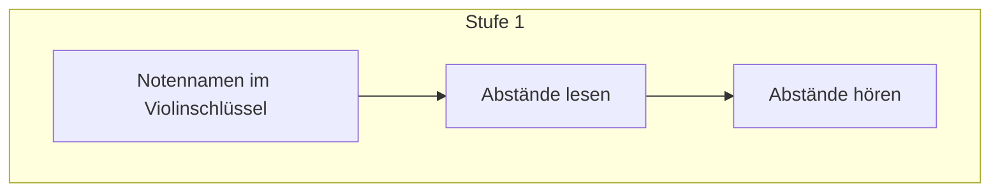

| Stufe / Einheit | Fähigkeit (DE) | Skill-ID | Ziel (EN-US / EN-GB) | Direkte Voraussetzungen | Status |
|---|---|---|---|---|---|
| 1 · Noten lesen und hören | Notennamen im Violinschlüssel | `notation.note-name` | Note names in the treble clef | — | entwurf |
| 1 · Noten lesen und hören | Abstände lesen | `interval.identify.visual` | Read distances | `notation.note-name` | entwurf |
| 1 · Noten lesen und hören | Abstände hören | `interval.identify.aural` | Hear distances | `interval.identify.visual` | entwurf |

## Notation und Tonhöhen · `area.notation`

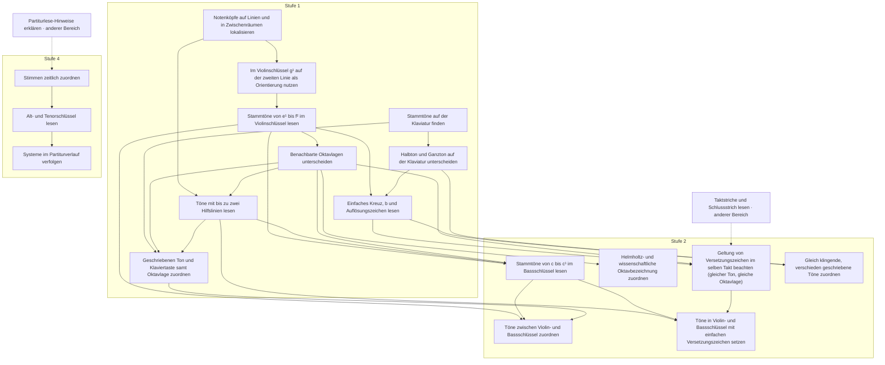

| Stufe / Einheit | Fähigkeit (DE) | Skill-ID | Ziel (EN-US / EN-GB) | Direkte Voraussetzungen | Status |
|---|---|---|---|---|---|
| 1 · Das Notensystem lesen | Notenköpfe auf Linien und in Zwischenräumen lokalisieren | `notation.staff` | Locate noteheads on lines and in spaces | — | entwurf |
| 1 · Das Notensystem lesen | Im Violinschlüssel g¹ auf der zweiten Linie als Orientierung nutzen | `notation.treble-clef` | Use G4 on the second line as the anchor note in the treble clef | `notation.staff` | entwurf |
| 1 · Das Notensystem lesen | Stammtöne von e¹ bis f² im Violinschlüssel lesen | `notation.treble-natural` | Read natural notes from E4 to F5 in the treble clef | `notation.treble-clef` | entwurf |
| 1 · Klaviatur und Versetzungszeichen | Stammtöne auf der Klaviatur finden | `notation.keyboard-layout` | Find natural notes on the keyboard | — | entwurf |
| 1 · Klaviatur und Versetzungszeichen | Halbton und Ganzton auf der Klaviatur unterscheiden | `notation.semitone` | Distinguish a half step from a whole step on the keyboard / Distinguish a semitone from a tone on the keyboard | `notation.keyboard-layout` | entwurf |
| 1 · Klaviatur und Versetzungszeichen | Einfaches Kreuz, b und Auflösungszeichen lesen | `notation.accidentals` | Read a single sharp, flat and natural | `notation.treble-natural`, `notation.semitone` | entwurf |
| 1 · Oktaven und Hilfslinien | Benachbarte Oktavlagen unterscheiden | `notation.octave-register` | Distinguish adjacent octave registers | `notation.treble-natural` | entwurf |
| 1 · Oktaven und Hilfslinien | Töne mit bis zu zwei Hilfslinien lesen | `notation.ledger-lines` | Read notes with up to two ledger lines | `notation.staff`, `notation.octave-register` | entwurf |
| 1 · Oktaven und Hilfslinien | Geschriebenen Ton und Klaviertaste samt Oktavlage zuordnen | `notation.pitch-match` | Match a written pitch to a piano key in the correct register | `notation.keyboard-layout`, `notation.octave-register`, `notation.ledger-lines` | entwurf |
| 2 · Weitere Notenschlüssel und Oktavlagen | Stammtöne von c bis c¹ im Bassschlüssel lesen | `notation.bass-natural` | Read natural notes from C3 to C4 in the bass clef | `notation.treble-natural`, `notation.ledger-lines`, `notation.octave-register` | entwurf |
| 2 · Weitere Notenschlüssel und Oktavlagen | Töne zwischen Violin- und Bassschlüssel zuordnen | `notation.grand-staff` | Match pitches between treble and bass clef | `notation.treble-natural`, `notation.bass-natural`, `notation.pitch-match` | entwurf |
| 2 · Weitere Notenschlüssel und Oktavlagen | Helmholtz- und wissenschaftliche Oktavbezeichnung zuordnen | `notation.octave-systems` | Match Helmholtz and scientific octave notation | `notation.octave-register` | entwurf |
| 2 · Tonhöhe richtig schreiben | Geltung von Versetzungszeichen im selben Takt beachten (gleicher Ton, gleiche Oktavlage) | `notation.accidental-scope` | Apply accidentals within a measure (same note, same octave) / Apply accidentals within a bar (same note, same octave) | `notation.accidentals`, `rhythm.barlines`, `notation.octave-register` | entwurf |
| 2 · Tonhöhe richtig schreiben | Gleich klingende, verschieden geschriebene Töne zuordnen | `notation.enharmonic-spelling` | Match pitches with the same sound but different spellings | `notation.accidentals`, `notation.semitone` | entwurf |
| 2 · Tonhöhe richtig schreiben | Töne in Violin- und Bassschlüssel mit einfachen Versetzungszeichen setzen | `notation.write-pitch` | Place notes in treble and bass clef with single accidentals | `notation.ledger-lines`, `notation.bass-natural`, `notation.accidental-scope` | entwurf |
| 4 · Mehrstimmige Partitur | Stimmen zeitlich zuordnen | `notation.l4.multivoice.s1` | Align voices in time | `instruments.l3.scores.s3` | entwurf |
| 4 · Mehrstimmige Partitur | Alt- und Tenorschlüssel lesen | `notation.l4.multivoice.s2` | Read alto and tenor clefs | `notation.l4.multivoice.s1` | entwurf |
| 4 · Mehrstimmige Partitur | Systeme im Partiturverlauf verfolgen | `notation.l4.multivoice.s3` | Follow systems in a score | `notation.l4.multivoice.s2` | entwurf |

## Rhythmus und Metrum · `area.rhythm`

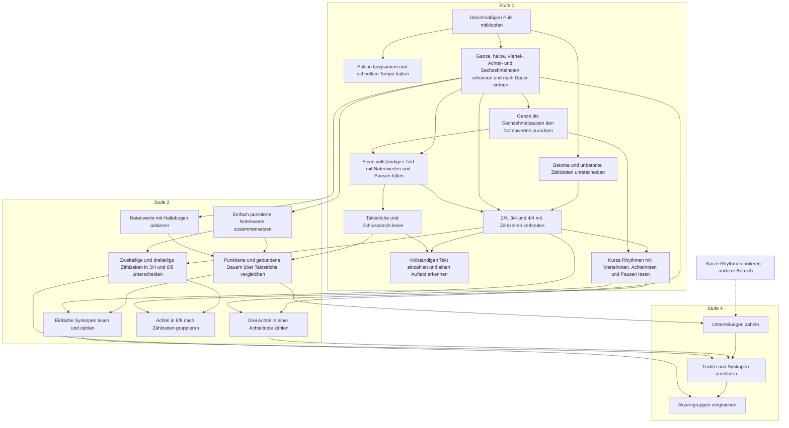

| Stufe / Einheit | Fähigkeit (DE) | Skill-ID | Ziel (EN-US / EN-GB) | Direkte Voraussetzungen | Status |
|---|---|---|---|---|---|
| 1 · Puls, Tempo und Zählzeiten | Gleichmäßigen Puls mitklopfen | `rhythm.pulse` | Tap a steady pulse | — | entwurf |
| 1 · Puls, Tempo und Zählzeiten | Puls in langsamem und schnellem Tempo halten | `rhythm.tempo` | Maintain a pulse at slow and fast tempos | `rhythm.pulse` | entwurf |
| 1 · Puls, Tempo und Zählzeiten | Betonte und unbetonte Zählzeiten unterscheiden | `rhythm.beat-group` | Distinguish accented and unaccented beats | `rhythm.pulse` | entwurf |
| 1 · Notenwerte und Pausen | Ganze, halbe, Viertel-, Achtel- und Sechzehntelnoten erkennen und nach Dauer ordnen | `rhythm.note-values` | Recognize and order whole notes, half notes, quarter notes, eighth notes and sixteenth notes by duration / Recognise and order semibreves, minims, crotchets, quavers and semiquavers by duration | `rhythm.pulse` | entwurf |
| 1 · Notenwerte und Pausen | Ganze bis Sechzehntelpausen den Notenwerten zuordnen | `rhythm.rests` | Match whole notes through sixteenth notes to their rests / Match semibreves through semiquavers to their rests | `rhythm.note-values` | entwurf |
| 1 · Notenwerte und Pausen | Einen vollständigen Takt mit Notenwerten und Pausen füllen | `rhythm.measure-fill` | Complete a measure with note values and rests / Complete a bar with note values and rests | `rhythm.note-values`, `rhythm.rests` | entwurf |
| 1 · Notenwerte und Pausen | Taktstriche und Schlussstrich lesen | `rhythm.barlines` | Read bar lines and the final bar line | `rhythm.measure-fill` | entwurf |
| 1 · Einfache Takte lesen und zählen | 2/4, 3/4 und 4/4 mit Zählzeiten verbinden | `rhythm.meter-simple` | Relate 2/4, 3/4 and 4/4 to their beats | `rhythm.beat-group`, `rhythm.note-values`, `rhythm.measure-fill` | entwurf |
| 1 · Einfache Takte lesen und zählen | Vollständigen Takt einzählen und einen Auftakt erkennen | `rhythm.count-in` | Count in a full measure and recognize a pickup / Count in a full bar and recognise an upbeat | `rhythm.meter-simple`, `rhythm.barlines` | entwurf |
| 1 · Einfache Takte lesen und zählen | Kurze Rhythmen mit Viertelnoten, Achtelnoten und Pausen lesen | `rhythm.read-basic` | Read short rhythms with quarter notes, eighth notes and rests / Read short rhythms with crotchets, quavers and rests | `rhythm.meter-simple`, `rhythm.rests` | entwurf |
| 2 · Punktierung und Haltebogen | Einfach punktierte Notenwerte zusammensetzen | `rhythm.dotted-values` | Construct singly dotted note values | `rhythm.note-values` | entwurf |
| 2 · Punktierung und Haltebogen | Notenwerte mit Haltebogen addieren | `rhythm.ties` | Add note values joined by a tie | `rhythm.note-values` | entwurf |
| 2 · Punktierung und Haltebogen | Punktierte und gebundene Dauern über Taktstriche vergleichen | `rhythm.dotted-and-tied` | Compare dotted and tied durations across bar lines | `rhythm.dotted-values`, `rhythm.ties`, `rhythm.barlines` | entwurf |
| 2 · Punktierung und Haltebogen | Einfache Synkopen lesen und zählen | `rhythm.syncopation-basic` | Read and count simple syncopations | `rhythm.dotted-and-tied`, `rhythm.meter-simple` | entwurf |
| 2 · Zwei- und Dreiteilung der Zählzeit | Drei Achtel in einer Achteltriole zählen | `rhythm.triplet` | Count triplet eighth notes / Count triplet quavers | `rhythm.note-values`, `rhythm.read-basic` | entwurf |
| 2 · Zwei- und Dreiteilung der Zählzeit | Zweiteilige und dreiteilige Zählzeiten in 3/4 und 6/8 unterscheiden | `rhythm.compound-meter` | Distinguish duple and triple beat subdivisions in 3/4 and 6/8 | `rhythm.meter-simple`, `rhythm.dotted-values` | entwurf |
| 2 · Zwei- und Dreiteilung der Zählzeit | Achtel in 6/8 nach Zählzeiten gruppieren | `rhythm.group-6-8` | Group eighth notes by beat in 6/8 / Group quavers by beat in 6/8 | `rhythm.compound-meter`, `rhythm.read-basic` | entwurf |
| 4 · Komplexere Rhythmik | Unterteilungen zählen | `rhythm.l4.complex.s1` | Count subdivisions | `aural.l3.dictation.s2`, `rhythm.dotted-and-tied` | entwurf |
| 4 · Komplexere Rhythmik | Triolen und Synkopen ausführen | `rhythm.l4.complex.s2` | Perform triplets and syncopations | `rhythm.l4.complex.s1`, `rhythm.triplet`, `rhythm.syncopation-basic` | entwurf |
| 4 · Komplexere Rhythmik | Akzentgruppen vergleichen | `rhythm.l4.complex.s3` | Compare accent groups | `rhythm.l4.complex.s2`, `rhythm.compound-meter` | entwurf |

## Intervalle · `area.intervals`

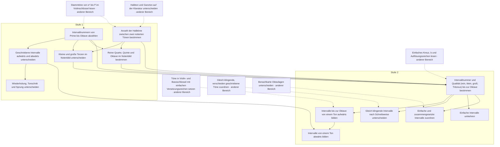

| Stufe / Einheit | Fähigkeit (DE) | Skill-ID | Ziel (EN-US / EN-GB) | Direkte Voraussetzungen | Status |
|---|---|---|---|---|---|
| 1 · Abstand und Richtung | Intervallnummern von Prime bis Oktave abzählen | `interval.generic-size` | Count interval numbers from unison to octave | `notation.treble-natural` | entwurf |
| 1 · Abstand und Richtung | Geschriebene Intervalle aufwärts und abwärts unterscheiden | `interval.direction` | Distinguish written ascending and descending intervals | `interval.generic-size` | entwurf |
| 1 · Abstand und Richtung | Wiederholung, Tonschritt und Sprung unterscheiden | `interval.steps-leaps` | Distinguish repeated notes, steps and leaps | `interval.direction` | entwurf |
| 1 · Erste Intervallqualitäten | Anzahl der Halbtöne zwischen zwei notierten Tönen bestimmen | `interval.semitone-distance` | Count the half steps between two written notes / Count the semitones between two written notes | `notation.semitone`, `notation.treble-natural` | entwurf |
| 1 · Erste Intervallqualitäten | Kleine und große Terzen im Notenbild unterscheiden | `interval.thirds` | Distinguish written minor and major thirds | `interval.generic-size`, `interval.semitone-distance` | entwurf |
| 1 · Erste Intervallqualitäten | Reine Quarte, Quinte und Oktave im Notenbild bestimmen | `interval.perfect-fourth-fifth-octave` | Identify written perfect fourths, fifths and octaves | `interval.generic-size`, `interval.semitone-distance` | entwurf |
| 2 · Intervalle bestimmen und bilden | Intervallnummer und Qualität (rein, klein, groß; Tritonus) bis zur Oktave bestimmen | `interval.simple-qualities` | Identify interval number and quality (perfect, minor, major; tritone) up to the octave | `interval.generic-size`, `interval.semitone-distance`, `notation.accidentals`, `interval.thirds`, `interval.perfect-fourth-fifth-octave` | entwurf |
| 2 · Intervalle bestimmen und bilden | Intervalle bis zur Oktave von einem Ton aufwärts bilden | `interval.build` | Build ascending intervals up to the octave from a given pitch | `interval.simple-qualities`, `notation.write-pitch` | entwurf |
| 2 · Intervalle bestimmen und bilden | Gleich klingende Intervalle nach Schreibweise unterscheiden | `interval.enharmonic-distinction` | Distinguish equal-sounding intervals by spelling | `interval.simple-qualities`, `notation.enharmonic-spelling` | entwurf |
| 2 · Umkehrung, Richtung und Erweiterung | Einfache Intervalle umkehren | `interval.inversion` | Invert simple intervals | `interval.simple-qualities` | entwurf |
| 2 · Umkehrung, Richtung und Erweiterung | Intervalle von einem Ton abwärts bilden | `interval.descending` | Build descending intervals from a given pitch | `interval.build`, `interval.direction` | entwurf |
| 2 · Umkehrung, Richtung und Erweiterung | Einfache und zusammengesetzte Intervalle zuordnen | `interval.simple-compound` | Relate simple and compound intervals | `interval.simple-qualities`, `notation.octave-register` | entwurf |

## Tonleitern und Tonarten · `area.scales`

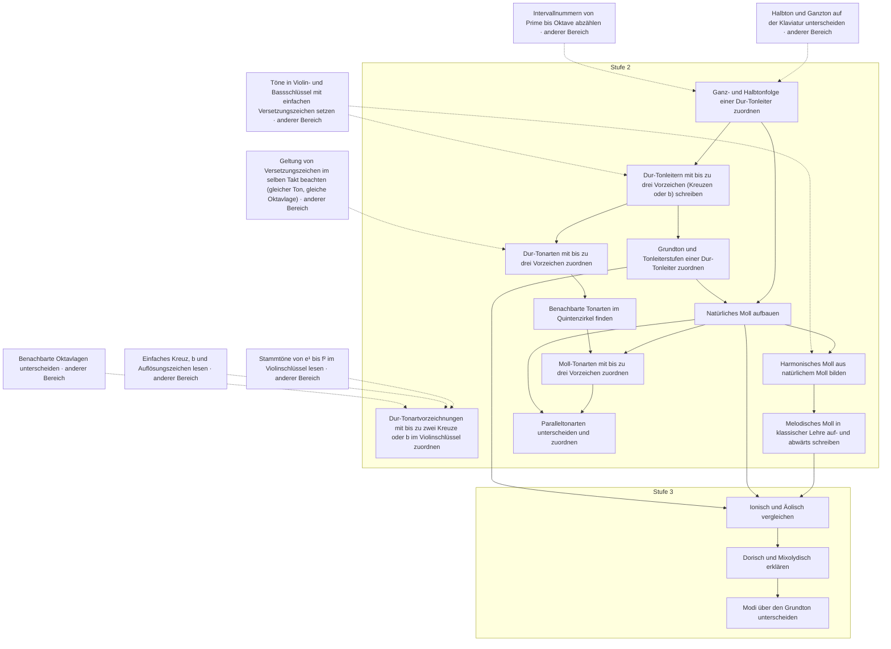

| Stufe / Einheit | Fähigkeit (DE) | Skill-ID | Ziel (EN-US / EN-GB) | Direkte Voraussetzungen | Status |
|---|---|---|---|---|---|
| 2 · Tonartvorzeichnungen im Violinschlüssel | Dur-Tonartvorzeichnungen mit bis zu zwei Kreuze oder b im Violinschlüssel zuordnen | `key.signature-read-treble` | Identify major key signatures with up to two sharps or flats in the treble clef | `notation.treble-natural`, `notation.accidentals`, `notation.octave-register` | entwurf |
| 2 · Dur aufbauen | Ganz- und Halbtonfolge einer Dur-Tonleiter zuordnen | `scale.major-pattern` | Identify the whole step and half step pattern of a major scale / Identify the tone and semitone pattern of a major scale | `notation.semitone`, `interval.generic-size` | entwurf |
| 2 · Dur aufbauen | Dur-Tonleitern mit bis zu drei Vorzeichen (Kreuzen oder b) schreiben | `scale.major-build` | Write major scales with up to three sharps or flats | `scale.major-pattern`, `notation.write-pitch` | entwurf |
| 2 · Dur aufbauen | Grundton und Tonleiterstufen einer Dur-Tonleiter zuordnen | `scale.tonic` | Identify the tonic and scale degrees of a major scale | `scale.major-build` | entwurf |
| 2 · Die Mollformen | Natürliches Moll aufbauen | `scale.natural-minor` | Build natural minor scales | `scale.major-pattern`, `scale.tonic` | entwurf |
| 2 · Die Mollformen | Harmonisches Moll aus natürlichem Moll bilden | `scale.harmonic-minor` | Build harmonic minor from natural minor | `scale.natural-minor`, `notation.write-pitch` | entwurf |
| 2 · Die Mollformen | Melodisches Moll in klassischer Lehre auf- und abwärts schreiben | `scale.melodic-minor` | Write ascending and descending melodic minor in the classical convention | `scale.harmonic-minor` | entwurf |
| 2 · Tonartvorzeichnungen und verwandte Tonarten | Dur-Tonarten mit bis zu drei Vorzeichen zuordnen | `key.signature-major` | Identify major keys with up to three sharps or flats | `scale.major-build`, `notation.accidental-scope` | entwurf |
| 2 · Tonartvorzeichnungen und verwandte Tonarten | Benachbarte Tonarten im Quintenzirkel finden | `key.fifths` | Find neighboring keys in the circle of fifths / Find neighbouring keys in the circle of fifths | `key.signature-major` | entwurf |
| 2 · Tonartvorzeichnungen und verwandte Tonarten | Moll-Tonarten mit bis zu drei Vorzeichen zuordnen | `key.signature-minor` | Identify minor keys with up to three sharps or flats | `scale.natural-minor`, `key.fifths` | entwurf |
| 2 · Tonartvorzeichnungen und verwandte Tonarten | Paralleltonarten unterscheiden und zuordnen | `key.relative` | Distinguish and match relative keys | `key.signature-minor`, `scale.natural-minor` | entwurf |
| 3 · Modale Tonleitern | Ionisch und Äolisch vergleichen | `scales.l3.modes.s1` | Compare Ionian and Aeolian | `scale.melodic-minor`, `scale.natural-minor`, `scale.tonic` | entwurf |
| 3 · Modale Tonleitern | Dorisch und Mixolydisch erklären | `scales.l3.modes.s2` | Explain Dorian and Mixolydian | `scales.l3.modes.s1` | entwurf |
| 3 · Modale Tonleitern | Modi über den Grundton unterscheiden | `scales.l3.modes.s3` | Distinguish modes by tonic | `scales.l3.modes.s2` | entwurf |

## Dreiklänge · `area.chords`

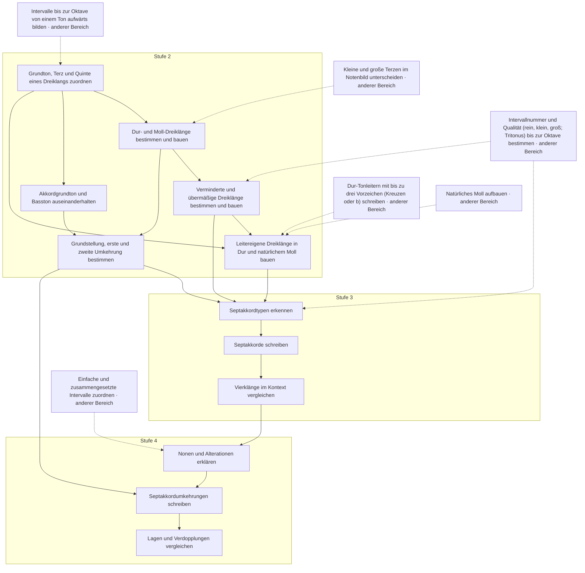

| Stufe / Einheit | Fähigkeit (DE) | Skill-ID | Ziel (EN-US / EN-GB) | Direkte Voraussetzungen | Status |
|---|---|---|---|---|---|
| 2 · Dreiklangsaufbau und Qualitäten | Grundton, Terz und Quinte eines Dreiklangs zuordnen | `chord.triad-structure` | Identify the root, third and fifth of a triad | `interval.build` | entwurf |
| 2 · Dreiklangsaufbau und Qualitäten | Dur- und Moll-Dreiklänge bestimmen und bauen | `chord.major-minor` | Identify and build major and minor triads | `chord.triad-structure`, `interval.thirds` | entwurf |
| 2 · Dreiklangsaufbau und Qualitäten | Verminderte und übermäßige Dreiklänge bestimmen und bauen | `chord.diminished-augmented` | Identify and build diminished and augmented triads | `chord.major-minor`, `interval.simple-qualities` | entwurf |
| 2 · Basston, Umkehrungen und leitereigene Dreiklänge | Akkordgrundton und Basston auseinanderhalten | `chord.root-and-bass` | Distinguish chord root from bass note | `chord.triad-structure` | entwurf |
| 2 · Basston, Umkehrungen und leitereigene Dreiklänge | Grundstellung, erste und zweite Umkehrung bestimmen | `chord.inversions` | Identify root-position, first-inversion and second-inversion triads | `chord.root-and-bass`, `chord.major-minor` | entwurf |
| 2 · Basston, Umkehrungen und leitereigene Dreiklänge | Leitereigene Dreiklänge in Dur und natürlichem Moll bauen | `chord.diatonic-triads` | Build diatonic triads in major and natural minor | `scale.major-build`, `scale.natural-minor`, `chord.triad-structure`, `chord.diminished-augmented` | entwurf |
| 3 · Septakkorde | Septakkordtypen erkennen | `chords.l3.sevenths.s1` | Identify seventh-chord types | `chord.diatonic-triads`, `chord.diminished-augmented`, `chord.inversions`, `interval.simple-qualities` | entwurf |
| 3 · Septakkorde | Septakkorde schreiben | `chords.l3.sevenths.s2` | Build seventh chords | `chords.l3.sevenths.s1` | entwurf |
| 3 · Septakkorde | Vierklänge im Kontext vergleichen | `chords.l3.sevenths.s3` | Compare seventh chords in context | `chords.l3.sevenths.s2` | entwurf |
| 4 · Erweiterte Akkorde | Nonen und Alterationen erklären | `chords.l4.extensions.s1` | Explain ninths and alterations | `chords.l3.sevenths.s3`, `interval.simple-compound` | entwurf |
| 4 · Erweiterte Akkorde | Septakkordumkehrungen schreiben | `chords.l4.extensions.s2` | Write seventh-chord inversions | `chords.l4.extensions.s1`, `chord.inversions` | entwurf |
| 4 · Erweiterte Akkorde | Lagen und Verdopplungen vergleichen | `chords.l4.extensions.s3` | Compare voicings and doublings | `chords.l4.extensions.s2` | entwurf |

## Gehörbildung · `area.aural`

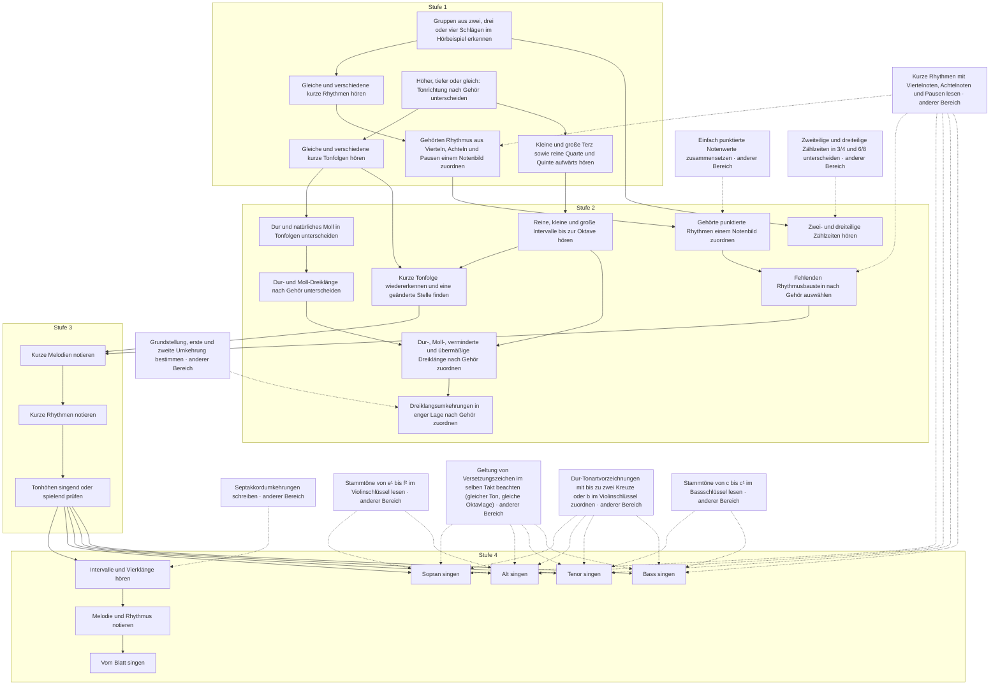

| Stufe / Einheit | Fähigkeit (DE) | Skill-ID | Ziel (EN-US / EN-GB) | Direkte Voraussetzungen | Status |
|---|---|---|---|---|---|
| 1 · Puls und Rhythmus hören | Gruppen aus zwei, drei oder vier Schlägen im Hörbeispiel erkennen | `aural.pulse` | Identify groups of two, three or four beats by ear | — | entwurf |
| 1 · Puls und Rhythmus hören | Gleiche und verschiedene kurze Rhythmen hören | `aural.same-different-rhythm` | Hear whether two short rhythms are the same or different | `aural.pulse` | entwurf |
| 1 · Puls und Rhythmus hören | Gehörten Rhythmus aus Vierteln, Achteln und Pausen einem Notenbild zuordnen | `aural.rhythm-choice-basic` | Match a heard rhythm of quarter notes, eighth notes and rests to notation / Match a heard rhythm of crotchets, quavers and rests to notation | `aural.same-different-rhythm`, `rhythm.read-basic` | entwurf |
| 1 · Tonhöhen und erste Intervalle hören | Höher, tiefer oder gleich: Tonrichtung nach Gehör unterscheiden | `aural.pitch-direction` | Distinguish higher, lower and repeated pitches by ear | — | entwurf |
| 1 · Tonhöhen und erste Intervalle hören | Gleiche und verschiedene kurze Tonfolgen hören | `aural.same-different-melody` | Hear whether two short melodies are the same or different | `aural.pitch-direction` | entwurf |
| 1 · Tonhöhen und erste Intervalle hören | Kleine und große Terz sowie reine Quarte und Quinte aufwärts hören | `aural.third-fourth-fifth` | Recognize ascending minor and major thirds, perfect fourths and fifths / Recognise ascending minor and major thirds, perfect fourths and fifths | `aural.pitch-direction` | entwurf |
| 2 · Rhythmus genauer hören | Gehörte punktierte Rhythmen einem Notenbild zuordnen | `aural.rhythm-choice-dotted` | Match heard dotted rhythms to notation | `aural.rhythm-choice-basic`, `rhythm.dotted-values` | entwurf |
| 2 · Rhythmus genauer hören | Zwei- und dreiteilige Zählzeiten hören | `aural.simple-compound-pulse` | Hear duple and triple beat subdivisions | `aural.pulse`, `rhythm.compound-meter` | entwurf |
| 2 · Rhythmus genauer hören | Fehlenden Rhythmusbaustein nach Gehör auswählen | `aural.rhythm-completion` | Choose a missing rhythm pattern by ear | `aural.rhythm-choice-dotted`, `rhythm.read-basic` | entwurf |
| 2 · Intervalle, Tonleitern und Tonfolgen hören | Reine, kleine und große Intervalle bis zur Oktave hören | `aural.simple-intervals` | Recognize perfect, minor and major intervals up to the octave by ear / Recognise perfect, minor and major intervals up to the octave by ear | `aural.third-fourth-fifth` | entwurf |
| 2 · Intervalle, Tonleitern und Tonfolgen hören | Dur und natürliches Moll in Tonfolgen unterscheiden | `aural.major-minor-scale` | Distinguish major from natural minor in melodies | `aural.same-different-melody` | entwurf |
| 2 · Intervalle, Tonleitern und Tonfolgen hören | Kurze Tonfolge wiedererkennen und eine geänderte Stelle finden | `aural.melodic-memory` | Recognize a short melody and locate a changed note / Recognise a short melody and locate a changed note | `aural.same-different-melody`, `aural.simple-intervals` | entwurf |
| 2 · Dreiklänge hören | Dur- und Moll-Dreiklänge nach Gehör unterscheiden | `aural.triad-major-minor` | Distinguish major and minor triads by ear | `aural.major-minor-scale` | entwurf |
| 2 · Dreiklänge hören | Dur-, Moll-, verminderte und übermäßige Dreiklänge nach Gehör zuordnen | `aural.triad-quality` | Recognize major, minor, diminished and augmented triads by ear / Recognise major, minor, diminished and augmented triads by ear | `aural.triad-major-minor`, `aural.simple-intervals` | entwurf |
| 2 · Dreiklänge hören | Dreiklangsumkehrungen in enger Lage nach Gehör zuordnen | `aural.triad-inversions` | Recognize close-position triad inversions by ear / Recognise close-position triad inversions by ear | `aural.triad-quality`, `chord.inversions` | entwurf |
| 3 · Diktat und Blattsingen | Kurze Melodien notieren | `aural.l3.dictation.s1` | Notate short melodies | `aural.melodic-memory`, `aural.rhythm-completion` | entwurf |
| 3 · Diktat und Blattsingen | Kurze Rhythmen notieren | `aural.l3.dictation.s2` | Notate short rhythms | `aural.l3.dictation.s1` | entwurf |
| 3 · Diktat und Blattsingen | Tonhöhen singend oder spielend prüfen | `aural.l3.dictation.s3` | Check pitches by singing or playing | `aural.l3.dictation.s2` | entwurf |
| 4 · Gehörbildung zur Studienvorbereitung | Intervalle und Vierklänge hören | `aural.l4.preparation.s1` | Hear intervals and seventh chords | `aural.l3.dictation.s3`, `chords.l4.extensions.s2` | entwurf |
| 4 · Gehörbildung zur Studienvorbereitung | Melodie und Rhythmus notieren | `aural.l4.preparation.s2` | Notate melody and rhythm | `aural.l4.preparation.s1` | entwurf |
| 4 · Gehörbildung zur Studienvorbereitung | Vom Blatt singen | `aural.l4.preparation.s3` | Sight sing | `aural.l4.preparation.s2` | entwurf |
| 4 · Chor-Trainer · Entwurf | Sopran singen | `aural.l4.choir.soprano` | Sing soprano | `aural.l3.dictation.s3`, `notation.treble-natural`, `notation.accidental-scope`, `rhythm.read-basic`, `key.signature-read-treble` | entwurf |
| 4 · Chor-Trainer · Entwurf | Alt singen | `aural.l4.choir.alto` | Sing alto | `aural.l3.dictation.s3`, `notation.treble-natural`, `notation.accidental-scope`, `rhythm.read-basic`, `key.signature-read-treble` | entwurf |
| 4 · Chor-Trainer · Entwurf | Tenor singen | `aural.l4.choir.tenor` | Sing tenor | `aural.l3.dictation.s3`, `notation.bass-natural`, `notation.accidental-scope`, `rhythm.read-basic`, `key.signature-read-treble` | entwurf |
| 4 · Chor-Trainer · Entwurf | Bass singen | `aural.l4.choir.bass` | Sing bass | `aural.l3.dictation.s3`, `notation.bass-natural`, `notation.accidental-scope`, `rhythm.read-basic`, `key.signature-read-treble` | entwurf |

## Musikgeschichte und Quellen · `area.history`

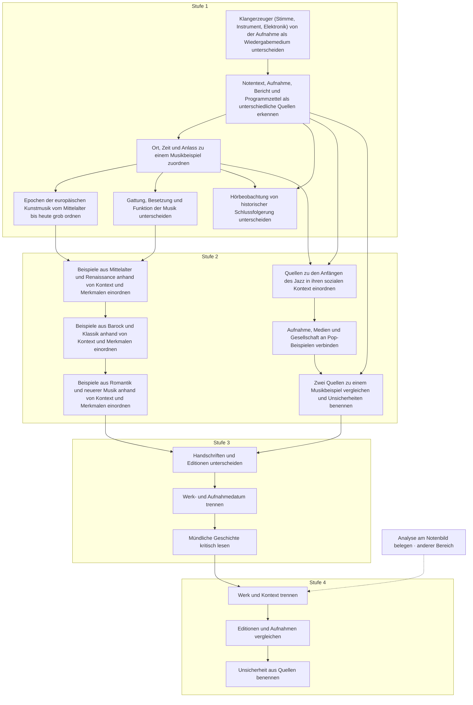

| Stufe / Einheit | Fähigkeit (DE) | Skill-ID | Ziel (EN-US / EN-GB) | Direkte Voraussetzungen | Status |
|---|---|---|---|---|---|
| 1 · Klänge, Quellen und Kontext | Klangerzeuger (Stimme, Instrument, Elektronik) von der Aufnahme als Wiedergabemedium unterscheiden | `history.sound-source` | Tell sound producers (voice, instruments, electronics) from recordings as a playback medium | — | entwurf |
| 1 · Klänge, Quellen und Kontext | Notentext, Aufnahme, Bericht und Programmzettel als unterschiedliche Quellen erkennen | `history.source-types` | Recognize scores, recordings, reports and programs as different kinds of source / Recognise scores, recordings, reports and programmes as different kinds of source | `history.sound-source` | entwurf |
| 1 · Klänge, Quellen und Kontext | Ort, Zeit und Anlass zu einem Musikbeispiel zuordnen | `history.context` | Relate place, time and occasion to a musical example | `history.source-types` | entwurf |
| 1 · Erster historischer Überblick | Epochen der europäischen Kunstmusik vom Mittelalter bis heute grob ordnen | `history.european-timeline` | Place periods of European art music from the Middle Ages to the present in broad order | `history.context` | entwurf |
| 1 · Erster historischer Überblick | Gattung, Besetzung und Funktion der Musik unterscheiden | `history.genre-function` | Distinguish genre, performing forces and the function of music | `history.context` | entwurf |
| 1 · Erster historischer Überblick | Hörbeobachtung von historischer Schlussfolgerung unterscheiden | `history.listening-observation` | Distinguish a listening observation from a historical inference | `history.source-types`, `history.context` | entwurf |
| 2 · Europäische Kunstmusik im Kontext | Beispiele aus Mittelalter und Renaissance anhand von Kontext und Merkmalen einordnen | `history.medieval-renaissance` | Place medieval and Renaissance examples using context and musical features | `history.european-timeline`, `history.genre-function` | entwurf |
| 2 · Europäische Kunstmusik im Kontext | Beispiele aus Barock und Klassik anhand von Kontext und Merkmalen einordnen | `history.baroque-classical` | Place Baroque and Classical examples using context and musical features | `history.medieval-renaissance` | entwurf |
| 2 · Europäische Kunstmusik im Kontext | Beispiele aus Romantik und neuerer Musik anhand von Kontext und Merkmalen einordnen | `history.romantic-modern` | Place Romantic and more recent examples using context and musical features | `history.baroque-classical` | entwurf |
| 2 · Jazz, Pop und Quellenvergleich | Quellen zu den Anfängen des Jazz in ihren sozialen Kontext einordnen | `history.jazz-roots` | Place sources about the origins of jazz in their social context | `history.context`, `history.source-types` | entwurf |
| 2 · Jazz, Pop und Quellenvergleich | Aufnahme, Medien und Gesellschaft an Pop-Beispielen verbinden | `history.popular-contexts` | Relate recording, media and society using examples of popular music | `history.jazz-roots` | entwurf |
| 2 · Jazz, Pop und Quellenvergleich | Zwei Quellen zu einem Musikbeispiel vergleichen und Unsicherheiten benennen | `history.compare-sources` | Compare two sources about a musical example and identify uncertainties | `history.source-types`, `history.popular-contexts` | entwurf |
| 3 · Musikgeschichte aus Quellen | Handschriften und Editionen unterscheiden | `history.l3.methods.s1` | Distinguish manuscripts and editions | `history.compare-sources`, `history.romantic-modern` | entwurf |
| 3 · Musikgeschichte aus Quellen | Werk- und Aufnahmedatum trennen | `history.l3.methods.s2` | Separate work and recording dates | `history.l3.methods.s1` | entwurf |
| 3 · Musikgeschichte aus Quellen | Mündliche Geschichte kritisch lesen | `history.l3.methods.s3` | Read oral history critically | `history.l3.methods.s2` | entwurf |
| 4 · Historische Werke einordnen | Werk und Kontext trennen | `history.l4.survey.s1` | Separate work and context | `history.l3.methods.s3`, `analysis.l4.score.s3` | entwurf |
| 4 · Historische Werke einordnen | Editionen und Aufnahmen vergleichen | `history.l4.survey.s2` | Compare editions and recordings | `history.l4.survey.s1` | entwurf |
| 4 · Historische Werke einordnen | Unsicherheit aus Quellen benennen | `history.l4.survey.s3` | State uncertainty from sources | `history.l4.survey.s2` | entwurf |

## Harmonielehre · `area.harmony`

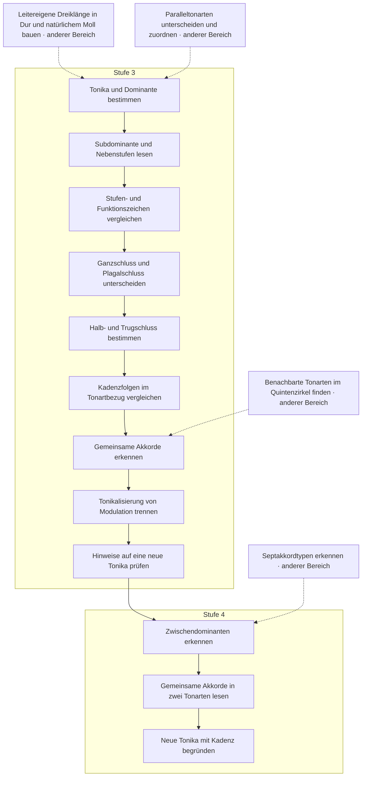

| Stufe / Einheit | Fähigkeit (DE) | Skill-ID | Ziel (EN-US / EN-GB) | Direkte Voraussetzungen | Status |
|---|---|---|---|---|---|
| 3 · Stufen und Funktionen | Tonika und Dominante bestimmen | `harmony.l3.functions.s1` | Find tonic and dominant | `chord.diatonic-triads`, `key.relative` | entwurf |
| 3 · Stufen und Funktionen | Subdominante und Nebenstufen lesen | `harmony.l3.functions.s2` | Read subdominant and other degrees | `harmony.l3.functions.s1` | entwurf |
| 3 · Stufen und Funktionen | Stufen- und Funktionszeichen vergleichen | `harmony.l3.functions.s3` | Compare degree and function symbols | `harmony.l3.functions.s2` | entwurf |
| 3 · Einfache Kadenzen | Ganzschluss und Plagalschluss unterscheiden | `harmony.l3.cadences.s1` | Distinguish authentic and plagal cadences | `harmony.l3.functions.s3` | entwurf |
| 3 · Einfache Kadenzen | Halb- und Trugschluss bestimmen | `harmony.l3.cadences.s2` | Identify half and deceptive cadences | `harmony.l3.cadences.s1` | entwurf |
| 3 · Einfache Kadenzen | Kadenzfolgen im Tonartbezug vergleichen | `harmony.l3.cadences.s3` | Compare cadences in a key | `harmony.l3.cadences.s2` | entwurf |
| 3 · Tonartwechsel als Einstieg | Gemeinsame Akkorde erkennen | `harmony.l3.modulation.s1` | Recognize pivot chords / Recognise pivot chords | `harmony.l3.cadences.s3`, `key.fifths` | entwurf |
| 3 · Tonartwechsel als Einstieg | Tonikalisierung von Modulation trennen | `harmony.l3.modulation.s2` | Separate tonicization from modulation / Separate tonicisation from modulation | `harmony.l3.modulation.s1` | entwurf |
| 3 · Tonartwechsel als Einstieg | Hinweise auf eine neue Tonika prüfen | `harmony.l3.modulation.s3` | Check evidence for a new tonic | `harmony.l3.modulation.s2` | entwurf |
| 4 · Angewandte Harmonik | Zwischendominanten erkennen | `harmony.l4.applied.s1` | Identify secondary dominants | `harmony.l3.modulation.s3`, `chords.l3.sevenths.s1` | entwurf |
| 4 · Angewandte Harmonik | Gemeinsame Akkorde in zwei Tonarten lesen | `harmony.l4.applied.s2` | Read pivot chords in two keys | `harmony.l4.applied.s1` | entwurf |
| 4 · Angewandte Harmonik | Neue Tonika mit Kadenz begründen | `harmony.l4.applied.s3` | Support a new tonic with a cadence | `harmony.l4.applied.s2` | entwurf |

## Formenlehre · `area.forms`

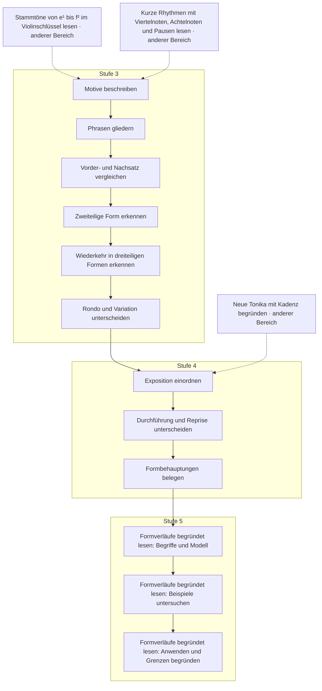

| Stufe / Einheit | Fähigkeit (DE) | Skill-ID | Ziel (EN-US / EN-GB) | Direkte Voraussetzungen | Status |
|---|---|---|---|---|---|
| 3 · Motiv und Phrase | Motive beschreiben | `forms.l3.phrases.s1` | Describe motives | `notation.treble-natural`, `rhythm.read-basic` | entwurf |
| 3 · Motiv und Phrase | Phrasen gliedern | `forms.l3.phrases.s2` | Segment phrases | `forms.l3.phrases.s1` | entwurf |
| 3 · Motiv und Phrase | Vorder- und Nachsatz vergleichen | `forms.l3.phrases.s3` | Compare antecedent and consequent | `forms.l3.phrases.s2` | entwurf |
| 3 · Kleine Formen | Zweiteilige Form erkennen | `forms.l3.designs.s1` | Recognize binary form / Recognise binary form | `forms.l3.phrases.s3` | entwurf |
| 3 · Kleine Formen | Wiederkehr in dreiteiligen Formen erkennen | `forms.l3.designs.s2` | Recognize return in ternary form / Recognise return in ternary form | `forms.l3.designs.s1` | entwurf |
| 3 · Kleine Formen | Rondo und Variation unterscheiden | `forms.l3.designs.s3` | Distinguish rondo and variation | `forms.l3.designs.s2` | entwurf |
| 4 · Sonatenform als Modell | Exposition einordnen | `forms.l4.sonata.s1` | Place an exposition | `forms.l3.designs.s3`, `harmony.l4.applied.s3` | entwurf |
| 4 · Sonatenform als Modell | Durchführung und Reprise unterscheiden | `forms.l4.sonata.s2` | Distinguish development and recapitulation | `forms.l4.sonata.s1` | entwurf |
| 4 · Sonatenform als Modell | Formbehauptungen belegen | `forms.l4.sonata.s3` | Support formal claims | `forms.l4.sonata.s2` | entwurf |
| 5 · Formverläufe begründet lesen | Formverläufe begründet lesen: Begriffe und Modell | `forms.l5.structure.s1` | Reading formal processes: Terms and model | `forms.l4.sonata.s3` | entwurf |
| 5 · Formverläufe begründet lesen | Formverläufe begründet lesen: Beispiele untersuchen | `forms.l5.structure.s2` | Reading formal processes: Investigate examples | `forms.l5.structure.s1` | entwurf |
| 5 · Formverläufe begründet lesen | Formverläufe begründet lesen: Anwenden und Grenzen begründen | `forms.l5.structure.s3` | Reading formal processes: Apply and justify limits | `forms.l5.structure.s2` | entwurf |

## Instrumentenkunde · `area.instruments`

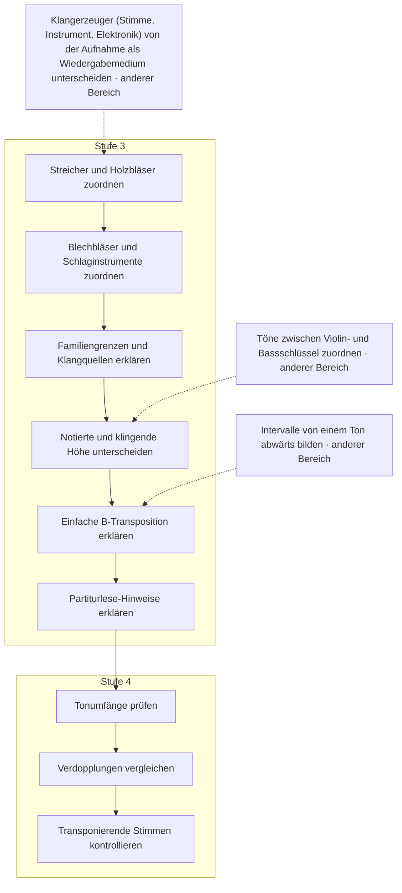

| Stufe / Einheit | Fähigkeit (DE) | Skill-ID | Ziel (EN-US / EN-GB) | Direkte Voraussetzungen | Status |
|---|---|---|---|---|---|
| 3 · Instrumentenfamilien | Streicher und Holzbläser zuordnen | `instruments.l3.families.s1` | Classify strings and woodwinds | `history.sound-source` | entwurf |
| 3 · Instrumentenfamilien | Blechbläser und Schlaginstrumente zuordnen | `instruments.l3.families.s2` | Classify brass and percussion | `instruments.l3.families.s1` | entwurf |
| 3 · Instrumentenfamilien | Familiengrenzen und Klangquellen erklären | `instruments.l3.families.s3` | Explain family boundaries and sound sources | `instruments.l3.families.s2` | entwurf |
| 3 · Partitur und Transposition | Notierte und klingende Höhe unterscheiden | `instruments.l3.scores.s1` | Distinguish written and sounding pitch | `instruments.l3.families.s3`, `notation.grand-staff` | entwurf |
| 3 · Partitur und Transposition | Einfache B-Transposition erklären | `instruments.l3.scores.s2` | Explain simple B-flat transposition | `instruments.l3.scores.s1`, `interval.descending` | entwurf |
| 3 · Partitur und Transposition | Partiturlese-Hinweise erklären | `instruments.l3.scores.s3` | Explain score-reading cues | `instruments.l3.scores.s2` | entwurf |
| 4 · Instrumentieren und Partitur | Tonumfänge prüfen | `instruments.l4.orchestration.s1` | Check instrument ranges | `instruments.l3.scores.s3` | entwurf |
| 4 · Instrumentieren und Partitur | Verdopplungen vergleichen | `instruments.l4.orchestration.s2` | Compare doublings | `instruments.l4.orchestration.s1` | entwurf |
| 4 · Instrumentieren und Partitur | Transponierende Stimmen kontrollieren | `instruments.l4.orchestration.s3` | Check transposing parts | `instruments.l4.orchestration.s2` | entwurf |

## Jazz und Pop · `area.jazzpop`

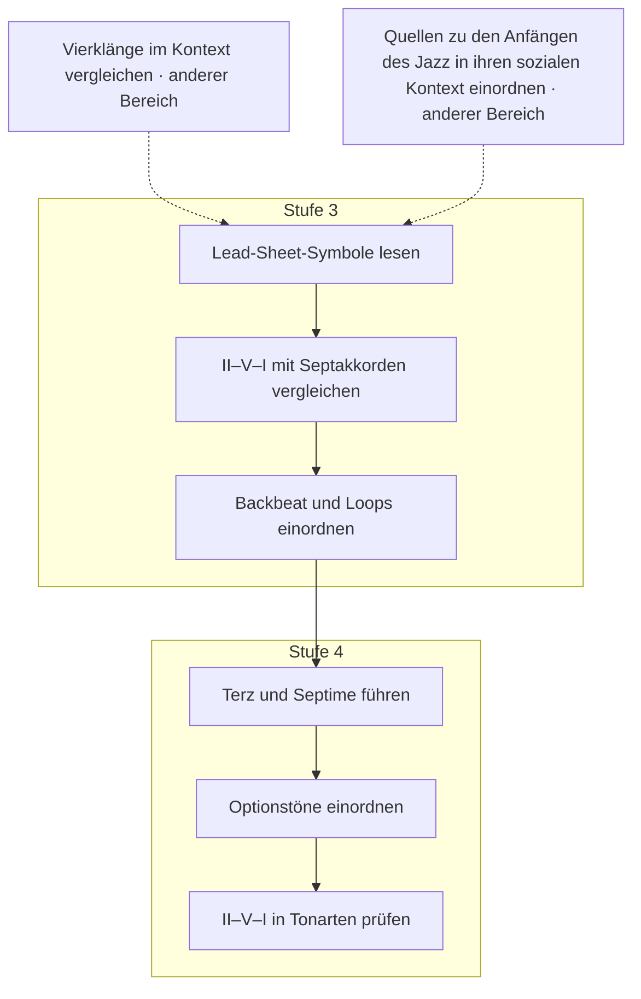

| Stufe / Einheit | Fähigkeit (DE) | Skill-ID | Ziel (EN-US / EN-GB) | Direkte Voraussetzungen | Status |
|---|---|---|---|---|---|
| 3 · Jazz- und Pop-Grundlagen | Lead-Sheet-Symbole lesen | `jazzpop.l3.harmony.s1` | Read lead-sheet symbols | `chords.l3.sevenths.s3`, `history.jazz-roots` | entwurf |
| 3 · Jazz- und Pop-Grundlagen | II–V–I mit Septakkorden vergleichen | `jazzpop.l3.harmony.s2` | Compare ii–V–I with seventh chords | `jazzpop.l3.harmony.s1` | entwurf |
| 3 · Jazz- und Pop-Grundlagen | Backbeat und Loops einordnen | `jazzpop.l3.harmony.s3` | Contextualize backbeats and loops / Contextualise backbeats and loops | `jazzpop.l3.harmony.s2` | entwurf |
| 4 · Jazz-Voicings und Lead Sheets | Terz und Septime führen | `jazzpop.l4.voicings.s1` | Lead thirds and sevenths | `jazzpop.l3.harmony.s3` | entwurf |
| 4 · Jazz-Voicings und Lead Sheets | Optionstöne einordnen | `jazzpop.l4.voicings.s2` | Contextualize extensions / Contextualise extensions | `jazzpop.l4.voicings.s1` | entwurf |
| 4 · Jazz-Voicings und Lead Sheets | II–V–I in Tonarten prüfen | `jazzpop.l4.voicings.s3` | Check ii–V–I in keys | `jazzpop.l4.voicings.s2` | entwurf |

## Tonsatz und Stimmführung · `area.satz`

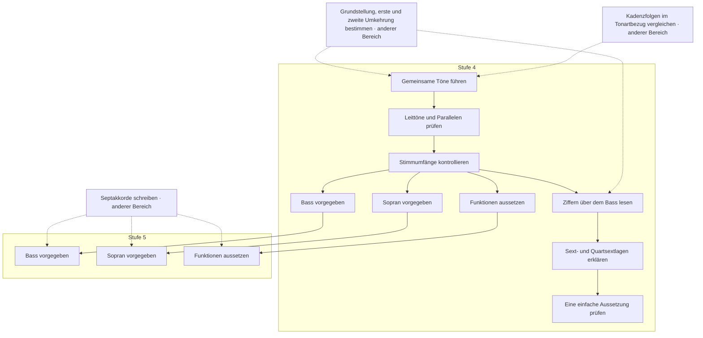

| Stufe / Einheit | Fähigkeit (DE) | Skill-ID | Ziel (EN-US / EN-GB) | Direkte Voraussetzungen | Status |
|---|---|---|---|---|---|
| 4 · Vierstimmiger Satz | Gemeinsame Töne führen | `satz.l4.voice-leading.s1` | Lead common tones | `chord.inversions`, `harmony.l3.cadences.s3` | entwurf |
| 4 · Vierstimmiger Satz | Leittöne und Parallelen prüfen | `satz.l4.voice-leading.s2` | Check leading tones and parallels / Check leading notes and parallels | `satz.l4.voice-leading.s1` | entwurf |
| 4 · Vierstimmiger Satz | Stimmumfänge kontrollieren | `satz.l4.voice-leading.s3` | Check voice ranges | `satz.l4.voice-leading.s2` | entwurf |
| 4 · Generalbass-Grundlagen | Ziffern über dem Bass lesen | `satz.l4.figured-bass.s1` | Read figures above a bass | `satz.l4.voice-leading.s3`, `chord.inversions` | entwurf |
| 4 · Generalbass-Grundlagen | Sext- und Quartsextlagen erklären | `satz.l4.figured-bass.s2` | Explain six and six-four positions | `satz.l4.figured-bass.s1` | entwurf |
| 4 · Generalbass-Grundlagen | Eine einfache Aussetzung prüfen | `satz.l4.figured-bass.s3` | Check a simple realization / Check a simple realisation | `satz.l4.figured-bass.s2` | entwurf |
| 4 · Vierstimmige Dreiklänge | Bass vorgegeben | `satz.l4.writing.bass` | Given bass | `satz.l4.voice-leading.s3` | entwurf |
| 4 · Vierstimmige Dreiklänge | Sopran vorgegeben | `satz.l4.writing.soprano` | Given soprano | `satz.l4.voice-leading.s3` | entwurf |
| 4 · Vierstimmige Dreiklänge | Funktionen aussetzen | `satz.l4.writing.functions` | Realizing functions / Realising functions | `satz.l4.voice-leading.s3` | entwurf |
| 5 · Dominantseptakkord im Satz | Bass vorgegeben | `satz.l5.writing.bass` | Given bass | `satz.l4.writing.bass`, `chords.l3.sevenths.s2` | entwurf |
| 5 · Dominantseptakkord im Satz | Sopran vorgegeben | `satz.l5.writing.soprano` | Given soprano | `satz.l4.writing.soprano`, `chords.l3.sevenths.s2` | entwurf |
| 5 · Dominantseptakkord im Satz | Funktionen aussetzen | `satz.l5.writing.functions` | Realizing functions / Realising functions | `satz.l4.writing.functions`, `chords.l3.sevenths.s2` | entwurf |

## Werkanalyse · `area.analysis`

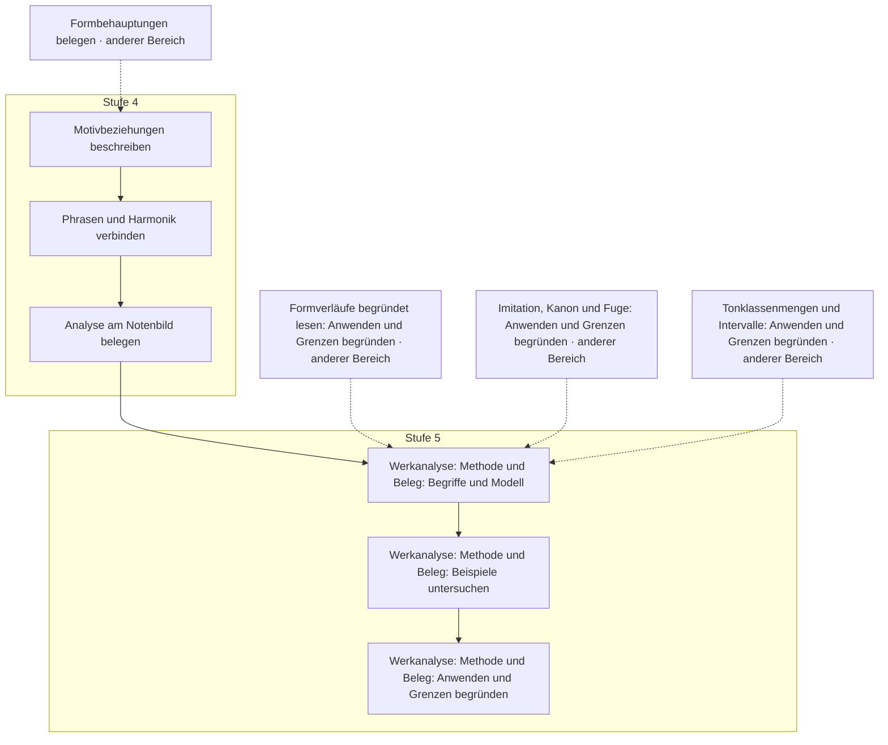

| Stufe / Einheit | Fähigkeit (DE) | Skill-ID | Ziel (EN-US / EN-GB) | Direkte Voraussetzungen | Status |
|---|---|---|---|---|---|
| 4 · Werkbezogene Analyse | Motivbeziehungen beschreiben | `analysis.l4.score.s1` | Describe motivic relations | `forms.l4.sonata.s3` | entwurf |
| 4 · Werkbezogene Analyse | Phrasen und Harmonik verbinden | `analysis.l4.score.s2` | Relate phrases and harmony | `analysis.l4.score.s1` | entwurf |
| 4 · Werkbezogene Analyse | Analyse am Notenbild belegen | `analysis.l4.score.s3` | Support analysis with score evidence | `analysis.l4.score.s2` | entwurf |
| 5 · Werkanalyse: Methode und Beleg | Werkanalyse: Methode und Beleg: Begriffe und Modell | `analysis.l5.methods.s1` | Work analysis: method and evidence: Terms and model | `analysis.l4.score.s3`, `forms.l5.structure.s3`, `counterpoint.l5.imitation.s3`, `contemporary.l5.sets.s3` | entwurf |
| 5 · Werkanalyse: Methode und Beleg | Werkanalyse: Methode und Beleg: Beispiele untersuchen | `analysis.l5.methods.s2` | Work analysis: method and evidence: Investigate examples | `analysis.l5.methods.s1` | entwurf |
| 5 · Werkanalyse: Methode und Beleg | Werkanalyse: Methode und Beleg: Anwenden und Grenzen begründen | `analysis.l5.methods.s3` | Work analysis: method and evidence: Apply and justify limits | `analysis.l5.methods.s2` | entwurf |

## Akustik und Stimmungen · `area.acoustics`

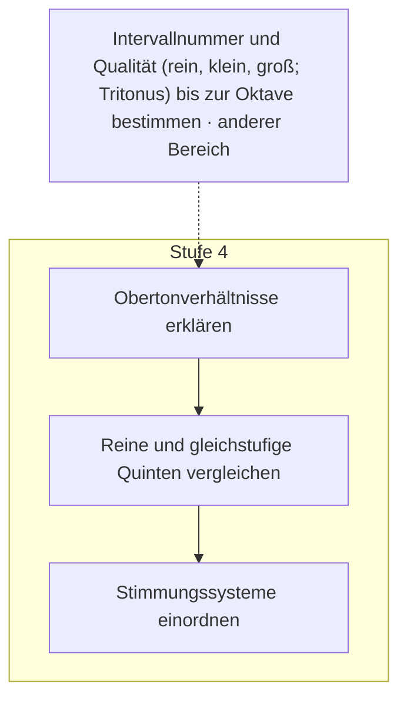

| Stufe / Einheit | Fähigkeit (DE) | Skill-ID | Ziel (EN-US / EN-GB) | Direkte Voraussetzungen | Status |
|---|---|---|---|---|---|
| 4 · Akustik und Stimmungen | Obertonverhältnisse erklären | `acoustics.l4.tuning.s1` | Explain harmonic ratios | `interval.simple-qualities` | entwurf |
| 4 · Akustik und Stimmungen | Reine und gleichstufige Quinten vergleichen | `acoustics.l4.tuning.s2` | Compare just and equal fifths | `acoustics.l4.tuning.s1` | entwurf |
| 4 · Akustik und Stimmungen | Stimmungssysteme einordnen | `acoustics.l4.tuning.s3` | Contextualize tuning systems / Contextualise tuning systems | `acoustics.l4.tuning.s2` | entwurf |

## Kontrapunkt · `area.counterpoint`

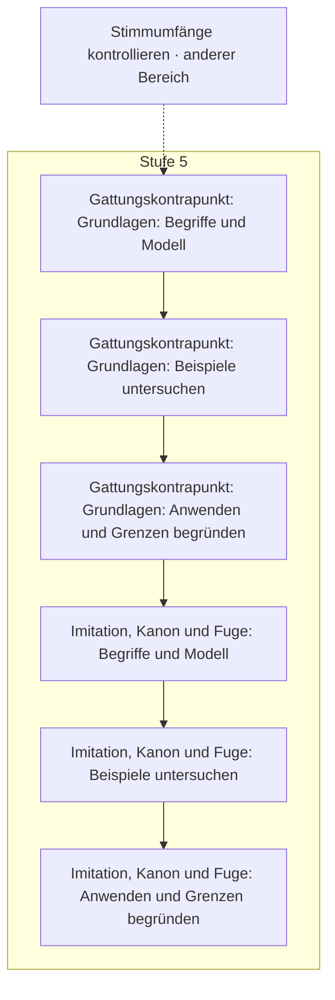

| Stufe / Einheit | Fähigkeit (DE) | Skill-ID | Ziel (EN-US / EN-GB) | Direkte Voraussetzungen | Status |
|---|---|---|---|---|---|
| 5 · Gattungskontrapunkt: Grundlagen | Gattungskontrapunkt: Grundlagen: Begriffe und Modell | `counterpoint.l5.species.s1` | Species counterpoint: foundations: Terms and model | `satz.l4.voice-leading.s3` | entwurf |
| 5 · Gattungskontrapunkt: Grundlagen | Gattungskontrapunkt: Grundlagen: Beispiele untersuchen | `counterpoint.l5.species.s2` | Species counterpoint: foundations: Investigate examples | `counterpoint.l5.species.s1` | entwurf |
| 5 · Gattungskontrapunkt: Grundlagen | Gattungskontrapunkt: Grundlagen: Anwenden und Grenzen begründen | `counterpoint.l5.species.s3` | Species counterpoint: foundations: Apply and justify limits | `counterpoint.l5.species.s2` | entwurf |
| 5 · Imitation, Kanon und Fuge | Imitation, Kanon und Fuge: Begriffe und Modell | `counterpoint.l5.imitation.s1` | Imitation, canon and fugue: Terms and model | `counterpoint.l5.species.s3` | entwurf |
| 5 · Imitation, Kanon und Fuge | Imitation, Kanon und Fuge: Beispiele untersuchen | `counterpoint.l5.imitation.s2` | Imitation, canon and fugue: Investigate examples | `counterpoint.l5.imitation.s1` | entwurf |
| 5 · Imitation, Kanon und Fuge | Imitation, Kanon und Fuge: Anwenden und Grenzen begründen | `counterpoint.l5.imitation.s3` | Imitation, canon and fugue: Apply and justify limits | `counterpoint.l5.imitation.s2` | entwurf |

## Musik des 20. und 21. Jahrhunderts · `area.contemporary`

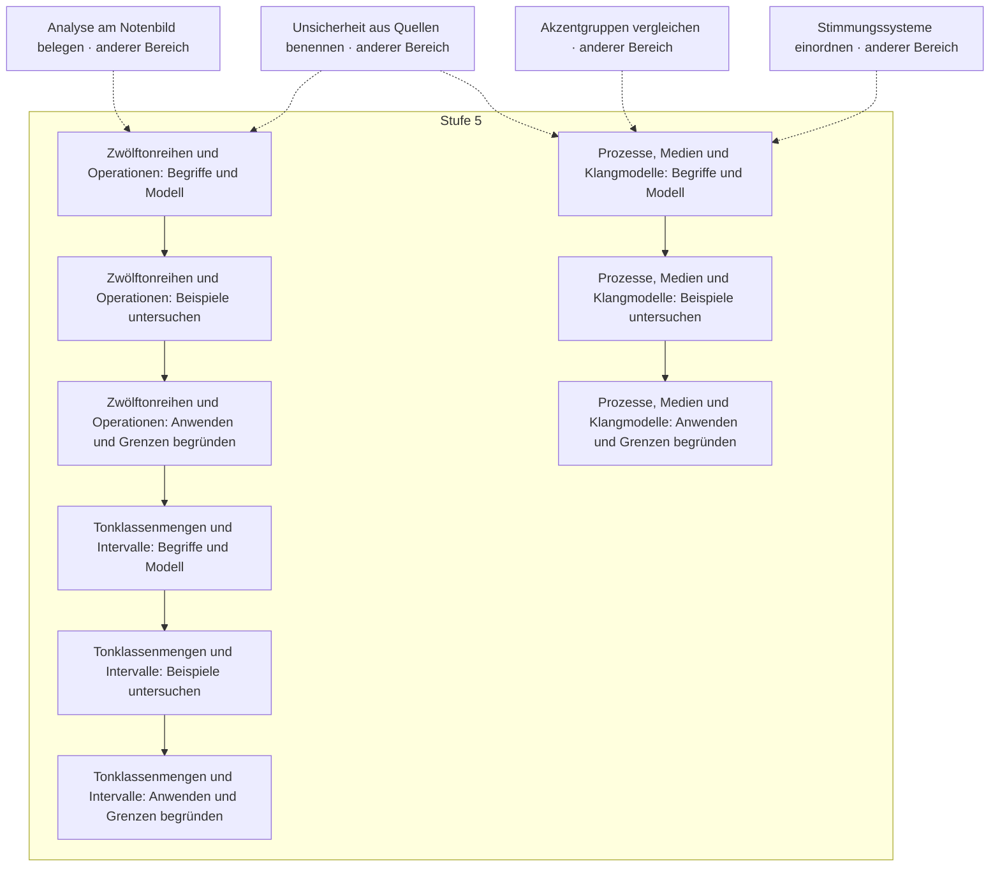

| Stufe / Einheit | Fähigkeit (DE) | Skill-ID | Ziel (EN-US / EN-GB) | Direkte Voraussetzungen | Status |
|---|---|---|---|---|---|
| 5 · Zwölftonreihen und Operationen | Zwölftonreihen und Operationen: Begriffe und Modell | `contemporary.l5.serial.s1` | Twelve-tone rows and operations: Terms and model | `history.l4.survey.s3`, `analysis.l4.score.s3` | entwurf |
| 5 · Zwölftonreihen und Operationen | Zwölftonreihen und Operationen: Beispiele untersuchen | `contemporary.l5.serial.s2` | Twelve-tone rows and operations: Investigate examples | `contemporary.l5.serial.s1` | entwurf |
| 5 · Zwölftonreihen und Operationen | Zwölftonreihen und Operationen: Anwenden und Grenzen begründen | `contemporary.l5.serial.s3` | Twelve-tone rows and operations: Apply and justify limits | `contemporary.l5.serial.s2` | entwurf |
| 5 · Tonklassenmengen und Intervalle | Tonklassenmengen und Intervalle: Begriffe und Modell | `contemporary.l5.sets.s1` | Pitch-class sets and intervals: Terms and model | `contemporary.l5.serial.s3` | entwurf |
| 5 · Tonklassenmengen und Intervalle | Tonklassenmengen und Intervalle: Beispiele untersuchen | `contemporary.l5.sets.s2` | Pitch-class sets and intervals: Investigate examples | `contemporary.l5.sets.s1` | entwurf |
| 5 · Tonklassenmengen und Intervalle | Tonklassenmengen und Intervalle: Anwenden und Grenzen begründen | `contemporary.l5.sets.s3` | Pitch-class sets and intervals: Apply and justify limits | `contemporary.l5.sets.s2` | entwurf |
| 5 · Prozesse, Medien und Klangmodelle | Prozesse, Medien und Klangmodelle: Begriffe und Modell | `contemporary.l5.process.s1` | Processes, media and sound models: Terms and model | `rhythm.l4.complex.s3`, `acoustics.l4.tuning.s3`, `history.l4.survey.s3` | entwurf |
| 5 · Prozesse, Medien und Klangmodelle | Prozesse, Medien und Klangmodelle: Beispiele untersuchen | `contemporary.l5.process.s2` | Processes, media and sound models: Investigate examples | `contemporary.l5.process.s1` | entwurf |
| 5 · Prozesse, Medien und Klangmodelle | Prozesse, Medien und Klangmodelle: Anwenden und Grenzen begründen | `contemporary.l5.process.s3` | Processes, media and sound models: Apply and justify limits | `contemporary.l5.process.s2` | entwurf |

## Musik anderer Kulturen · `area.world`

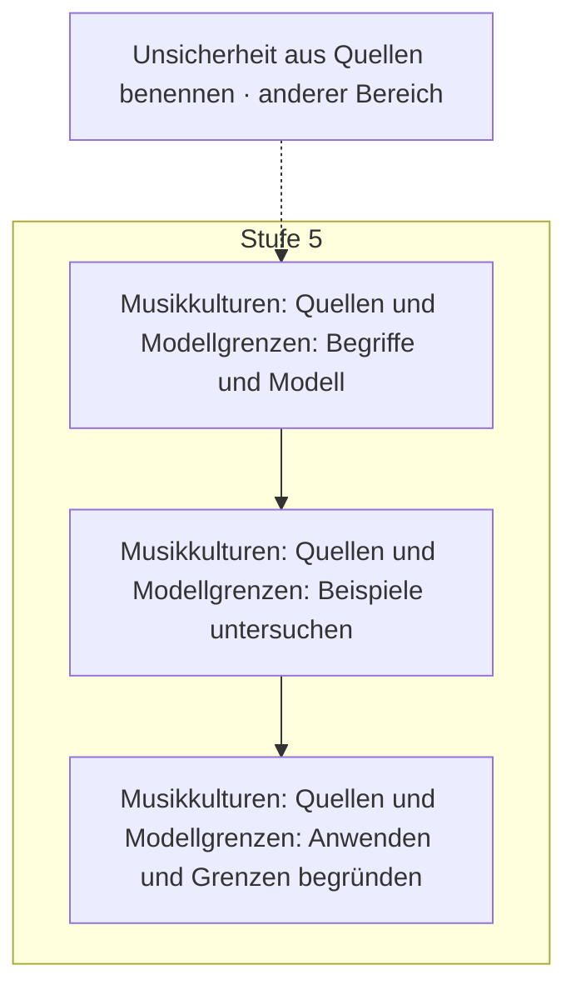

| Stufe / Einheit | Fähigkeit (DE) | Skill-ID | Ziel (EN-US / EN-GB) | Direkte Voraussetzungen | Status |
|---|---|---|---|---|---|
| 5 · Musikkulturen: Quellen und Modellgrenzen | Musikkulturen: Quellen und Modellgrenzen: Begriffe und Modell | `world.l5.context.s1` | Musical cultures: sources and model limits: Terms and model | `history.l4.survey.s3` | entwurf |
| 5 · Musikkulturen: Quellen und Modellgrenzen | Musikkulturen: Quellen und Modellgrenzen: Beispiele untersuchen | `world.l5.context.s2` | Musical cultures: sources and model limits: Investigate examples | `world.l5.context.s1` | entwurf |
| 5 · Musikkulturen: Quellen und Modellgrenzen | Musikkulturen: Quellen und Modellgrenzen: Anwenden und Grenzen begründen | `world.l5.context.s3` | Musical cultures: sources and model limits: Apply and justify limits | `world.l5.context.s2` | entwurf |
