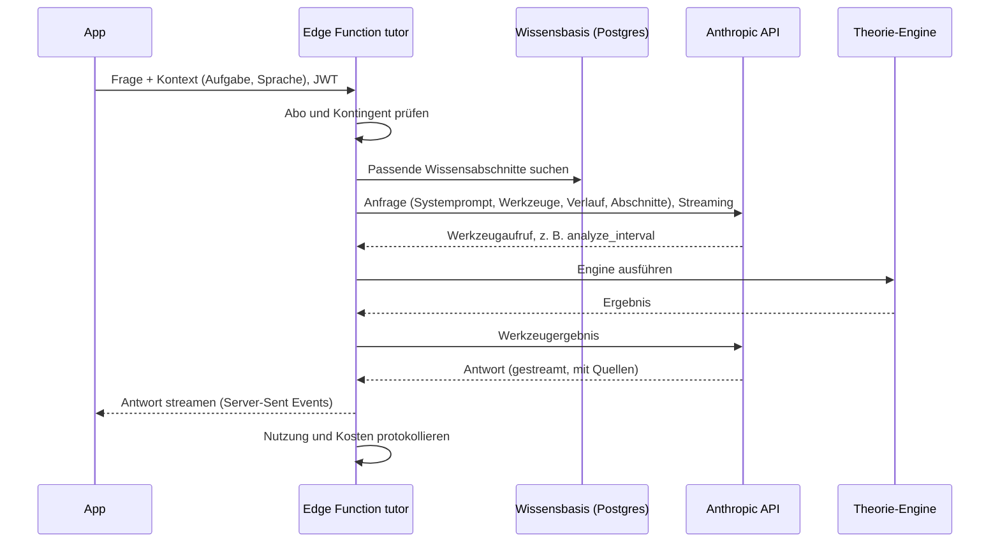

# KI-Tutor

Grundsatz aus [ADR 0002](../decisions/0002-ki-tutor-und-fachliche-korrektheit.md): **Die Engine entscheidet, die KI erklärt.**

## Rollen des Tutors

| Rolle | Wo | Phase |
|---|---|---|
| „Warum?“-Erklärer | Nach einer Aufgabe: erklärt den konkreten Fehler im Kontext | 2 |
| Hinweisgeber | In der Hinweisleiter einer Aufgabe (ergänzend zu festen Hinweisen) | 2 |
| Fragen-Chat | Freie Fragen zu Theorie, Geschichte, Werken | 2 |
| Lernplaner | Wochenplan aus Stärken und Schwächen | 3 |
| Tonsatz-Erklärer | Erklärt die von der Engine gefundenen Stimmführungsfehler | 4 |
| Sprach-Tutor | Live-Gespräch per Sprache (Max-Abo) | 4 |
| Erzähler | Zeitreise durch die Musikgeschichte, historische Personas klar als KI-Fiktion gekennzeichnet | 4 |

## Aufbau

- Der API-Schlüssel liegt nur in der Edge Function.
- **Modellwahl:** Standard ist das aktuelle Spitzenmodell von Anthropic. Ob einzelne Rollen (z. B. kurze Hinweise) ein günstigeres Modell nutzen, entscheiden wir erst nach Messung mit dem Testkatalog. Maßstab sind die Kosten pro erfolgreich beantworteter Frage, nicht pro Anfrage. Modell-IDs und Preise werden zum Zeitpunkt der Umsetzung aus der Anthropic-Dokumentation übernommen.
- Zugriff über eine eigene Schnittstelle (`TutorModelProvider`), damit ein Modellwechsel nur eine Stelle betrifft.

## Werkzeuge (Tool Use)

Der Tutor rechnet nicht selbst, sondern ruft die Engine auf. Werkzeuge mit strengem Schema (`strict: true`), Werkzeugwahl automatisch – das Modell entscheidet anhand der Anweisungen im Systemprompt.

| Werkzeug | Zweck | Phase |
|---|---|---|
| `analyze_interval` | Intervall zwischen zwei Tönen bestimmen | 2 |
| `build_interval` | Intervall von einem Ton aus bilden | 2 |
| `build_scale` / `key_signature` | Tonleitern und Vorzeichnungen | 2 |
| `identify_chord` / `build_chord` | Akkorde bestimmen und bauen | 2 |
| `get_exercise_context` | Aktuelle Aufgabe, Antwort des Nutzers, Engine-Bewertung | 2 |
| `render_example` | Prüft ein Notenbeispiel, bevor es angezeigt und abgespielt wird | 2 |
| `get_learner_summary` | Stärken und Schwächen (ohne personenbezogene Daten) | 3 |
| `analyze_progression` | Akkordfolge in Funktionen oder Stufen | 3 |
| `check_voice_leading` | Stimmführungsprüfung | 4 |

**Notenbeispiele in Antworten:** Seit P2.15 verwendet der Tutor `render_example`. Nur nach erfolgreicher Parser-/Engine-Prüfung sendet die Function ein strukturiertes `example`-Ereignis mit geprüftem Score und Tempo. Die App-Oberfläche aus P2.17 rendert und spielt diese Daten. Freie Noten-Makros des Modells werden entfernt und als `unverified_example` protokolliert.

**Oberfläche P2.17:** Eigener Tab und „Warum?“-Route mit Originalaufgabe, ausdrücklich gestarteter Erklärung, KI-Kennzeichnung, Fehlerhinweis, Quellen und Meldung pro gespeicherter Antwort. KI-Hinweise ergänzen ausschließlich eine bereits verwendete feste Stufe 1/2; Lösung folgt erst nach Stufe 3. Kontingent und Verfügbarkeit kommen vom Server. Unterbrechungen werden sichtbar, eine ausdrückliche Wiederholung behält dieselbe Anfrage-ID. Verlauf und Meldungen sind privat und löschbar; Chat wird in der App nicht persistiert. Übergabe: [Tutor-Oberfläche](tutor-oberflaeche.md).

## Wissensbasis

- Eigene Artikel (DE/EN) zu allen Themen der freigegebenen Stufen, geschrieben nach dem Prozess in [inhalte-und-didaktik.md](inhalte-und-didaktik.md).
- **Suche v1:** Postgres-Volltextsuche (deutsche und englische Wörterbücher). Später bei Bedarf zusätzlich semantische Suche mit Vektoren (`pgvector`).
- Gefundene Abschnitte gehen als Dokumente mit aktivierten Zitaten an die API. Die Antwort enthält Quellenverweise, die die App als Links auf die Artikel zeigt. P2.16 bindet sie vor dem ersten Modellaufruf ein: maximal sechs Dokumente, drei je Artikel und 6000 UTF-8-Bytes Quelldaten, zusätzlich begrenzt durch das vollständige Eingabebudget. Entscheidung und überprüfte Grenzen: [ADR 0016](../decisions/0016-wissensbasis-vorab-und-native-zitate.md).
- Quellen werden nur bei exakt passendem native Plaintext-Zitat verlinkt; Artikel-ID, Version, Sprache und Abschnittshash kommen vom Server. Die Artikelroute prüft dieselbe Fassung erneut. Vorschau und veröffentlichte Indexe bleiben getrennt; aktuell sind alle 29 Artikel Entwürfe, der öffentliche Index ist leer. Übergabe: [Wissensbasis v1](wissensbasis.md).
- Für Fragen außerhalb der Wissensbasis darf der Tutor antworten, kennzeichnet das aber („ohne Quelle aus der Harmonia-Bibliothek“) und benennt Unsicherheit.

## Pädagogische Regeln (Systemprompt)

- Im Aufgabenkontext: zuerst Denkanstoß, dann konkreter Hinweis, dann Lösung mit Erklärung. Die Lösung sofort, wenn ausdrücklich gewünscht.
- Im freien Chat: direkt und klar antworten.
- Immer in der Sprache des Nutzers; Fachbegriffe nach Glossar und gewählter Tonnamen-Einstellung.
- Musikalische Fakten nur mit Engine-Ergebnis oder Quelle.
- Altersgerechte, freundliche Sprache; keine Themen außerhalb von Musik und Lernen vertiefen.

## Kosten und Leistung

- **Prompt-Caching:** stabiler Teil vorne (Werkzeugliste, Systemprompt, Glossar), veränderliche Teile (Aufgabe, Verlauf) dahinter. Trefferquote über die Nutzungsfelder der API überwachen.
- **Streaming** für alle Chat-Antworten.
- **Aufwand (effort)** je Rolle festlegen und per Testkatalog kalibrieren.
- **Kontingente je Abo-Stufe** in `ai_usage`; Werte aus gemessenen Kosten ableiten (in P2.18).
- **Batch-Verarbeitung** (günstiger, asynchron) für Testkatalog-Läufe und Inhaltsentwürfe.
- **Ablehnungen behandeln:** Die API kann eine Anfrage ablehnen (eigener Stop-Grund). Die App zeigt dann eine verständliche Meldung, der Vorfall wird protokolliert.

## Qualitätssicherung (Testkatalog)

- **Umfang:** mindestens 200 Fragen in DE und EN, fachlich geprüft von Claude in einem getrennten Prüfdurchgang ([ADR 0005](../decisions/0005-fachliche-pruefung-durch-claude.md)). Abgedeckt sind Faktenfragen, Erklärungen zu Fehlern, Fangfragen (z. B. enharmonische Verwechslung) und Fragen außerhalb des Themas.
- **Bewertung:**
  - Fachlich korrekt
  - Engine-Werkzeug genutzt, wo nötig
  - Quelle angegeben
  - Hinweisleiter eingehalten
  - Sprache und Ton passend
- **Ablauf:** automatischer Lauf vor jedem Release und bei jeder Änderung an Prompt, Werkzeugen oder Modell. Die Ergebnisse werden versioniert gespeichert.
- **Freigabe:** Ein Release ist nur möglich, wenn kein Rückschritt bei der fachlichen Korrektheit auftritt.

**Umsetzung P2.18:** 245 Fälle/735 Sprachfassungen und versionierte Soll-Aufrufe; 19 Aufgabentypen in Erklärung, Hinweis 1/2 und Lösung. Ein wiederaufnehmbarer SDK-Batchlauf verwendet dieselbe Werkzeug-/Zitat-/Filter-Laufzeit wie Streaming und plant die nächste Welle erst nach quittierten Ergebnissen. Automatische Belege ersetzen keine Claude-Urteile über Prosa, Entailment oder Hinweislecks. Rollenwahl braucht vollständige Reviews, 98 % je Rolle/Sprache und keine fachliche Regression gegen die akzeptierte Basis. Simulierte oder mitgelieferte Quellenläufe können keine Launchfreigabe erhalten. Batchpreise sind explizit; Streamingkosten aus denselben Token sind zunächst eine Projektion. Kontingentvorschläge benötigen zusätzlich ein Geschäftsbudget und ändern keine Policy. Ablauf und offene echte Abnahme: [Testkatalog und Kalibrierung](tutor-testkatalog.md).

## Recht und Datenschutz

- **Transparenz:** Nutzer sehen klar, dass sie mit einer KI sprechen (Pflicht nach Art. 50 KI-Verordnung, seit 02.08.2026).
- **Datensparsamkeit:** Nur nötige Daten gehen an die API, keine Namen oder E-Mail-Adressen.
- **Auftragsverarbeitung:** Vertrag mit Anthropic; Drittlandübermittlung und Optionen für den Verarbeitungsort prüfen.
- **Löschung:** Gespräche sind für Nutzer einsehbar und löschbar.
- **Minderjährige:** siehe [recht-und-compliance.md](recht-und-compliance.md).

## Sprach-Tutor (Phase 4)

- **Ablauf:** Spracherkennung → Sprachmodell (mit denselben Werkzeugen) → Sprachausgabe, über LiveKit Agents. Das React-Native-SDK läuft mit Expo-Plugin in Development Builds, nicht in Expo Go.
- **Kosten und Grenzen:** Gesprächsminuten pro Monat im Max-Abo begrenzen.
- **Musikalische Anteile:** Der Tutor spielt Beispiele über die App-Audio-Engine ab, nicht über synthetische Sprache.

P4.17-Prüfvorbereitung (24.10.2026): Erklärfunktion und verdichtete Lernstandwerkzeuge werden im [KI-Funktionsinventar](ki-verordnung-pruefvorbereitung.md) getrennt erfasst. Lernsteuerung und Profiling im institutionellen Kontext sind ausdrücklich offene Rechtsfragen; deterministische Bewertung erteilt keine Gesamtfreigabe. Transparenz-/Markierungsfragen und der geänderte Rechtsstand sind in der [Voreinschätzung](../legal/ai-act/vorpruefung.md) belegt.
