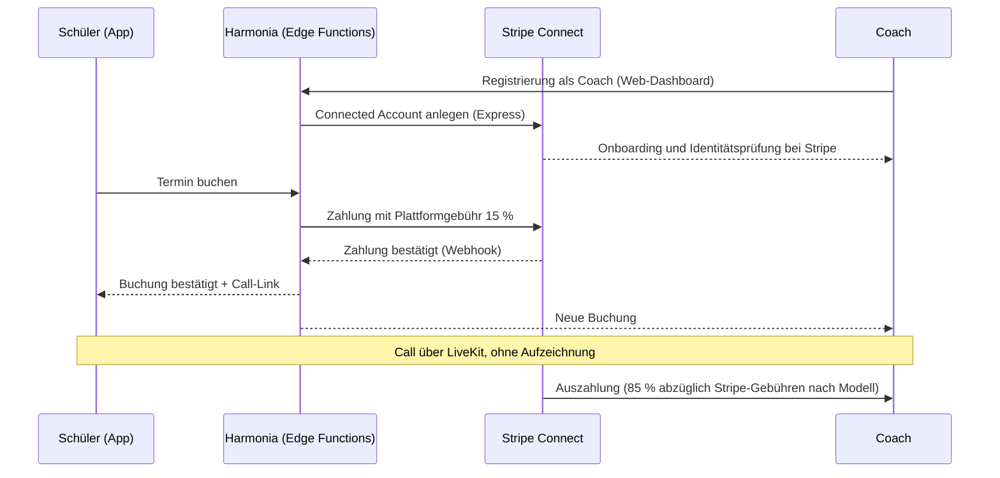

# Monetarisierung – technische Umsetzung

Geschäftliche Entscheidungen stehen in [business-model.md](../business-model.md). Dieses Dokument beschreibt die Umsetzung.

## Abos (Phase 2)

- **RevenueCat** (`react-native-purchases`) für iOS, Android und Web (Web Billing über Stripe).
- **Berechtigungen (Entitlements):** `premium`, `max`. Die App prüft sie über das SDK. Serverseitige Funktionen (KI-Tutor) prüfen die Tabelle `entitlements`.
- **Webhook:** RevenueCat → Edge Function `billing-webhook` → Signatur prüfen → `billing_events` (idempotent) → `entitlements` aktualisieren.
- Konto-Verknüpfung: RevenueCat-App-User-ID = Supabase-User-ID. So gelten Käufe auf allen Geräten.
- „Käufe wiederherstellen“ in den Einstellungen (Store-Pflicht).
- Testkäufe: Sandbox-Umgebungen von Apple und Google, Testmodus von Stripe.

## Paywall und Gratis-Limits (Phase 2)

- **Eigene Paywall** mit Vergleich Gratis / Premium / Max in DE und EN; Preise kommen aus dem Store (lokalisiert, mit Steuern).
- **Gratis-Limits** konfigurierbar (Modell offen: Energie wie bei Duolingo oder feste Tageskontingente wie bei chess.com).
- **Zeitpunkte der Paywall:** nach dem Onboarding (überspringbar), beim Erreichen eines Limits, bei Premium-Funktionen.
- **Keine Dark Patterns:** Kündigung so einfach wie Abschluss, klare Laufzeiten und Preise.
- **Web:** Kündigungsbutton nach § 312k BGB für im Web abgeschlossene Abos.

## Coach-Marktplatz (Phase 4)

**Provision:** 15 % pro Buchung (entschieden). Dazu ein **Coach-Pro-Abo** für Coaches.

- **Zahlung im Call-Kontext:** Live-1:1-Dienste zwischen zwei Personen dürfen bei Apple (3.1.3(d)) und Google (1:1-Ausnahme, ohne Aufzeichnung) außerhalb des In-App-Kaufs abgerechnet werden. Deshalb Stripe direkt in der App.
- **Wer die Stripe-Gebühren trägt** (Plattform oder Coach), ist eine offene Entscheidung.
- **Storno-Regeln:** kostenlos bis X Stunden vorher, danach anteilig. Bei Nichterscheinen des Coaches volle Erstattung.
- **Belege:** Rechnungen bzw. Quittungen, steuerliche Einordnung mit Steuerberatung klären.

**Coach-Pro-Abo:**

- Inhalt: bessere Sichtbarkeit, Analyse-Tools, KI-Assistent zur Unterrichtsvorbereitung, eigenes Profil-Design
- Ein Abo, das digitale Funktionen in einer iOS-App freischaltet, fällt unter die In-App-Kauf-Pflicht. Vorschlag: Das Coach-Pro-Abo wird über das **Web-Dashboard** verkauft (Stripe Billing), die Coach-Funktionen liegen hauptsächlich im Web. Mit den aktuellen Store-Regeln abgleichen, bevor es live geht.

## Schul-Lizenzen (Phase 4)

- Verkauf direkt an Organisationen (Angebot, Rechnung oder Stripe Invoicing). Apple 3.1.3(c) erlaubt den Zugang zu so gekauften Lizenzen in der App.
- Plätze (Seats) pro Organisation; Lehrkräfte laden Schüler per Code ein.
- Vertrag zur Auftragsverarbeitung (AVV) für Schulen als Vorlage.

## Zertifikate (Phase 4)

- Prüfungsgebühr: in der iOS- und Android-App als In-App-Kauf (digitaler Inhalt), im Web über Stripe.
- Verifizierbar über einen Code und eine öffentliche Prüfseite (nur Name, Stufe, Datum – mit Einwilligung).

## Creator-Kurse (Phase 5)

- In-App-Käufe für Kurse (digitale Inhalte), Umsatzbeteiligung an Creators über Stripe Connect.
- Prüfprozess für Kurse, Meldewege für Inhalte (Digital Services Act).

## Kennzahlen

Gemessen ab der Beta, Zielwerte nach der Beta festlegen:

- Umwandlung Gratis → Premium
- Kündigungsrate
- Umsatz pro Nutzer
- KI-Kosten pro zahlendem Nutzer
- Anteil der Store-Gebühren am Umsatz
- Für den Marktplatz zusätzlich: Buchungen pro aktivem Coach
