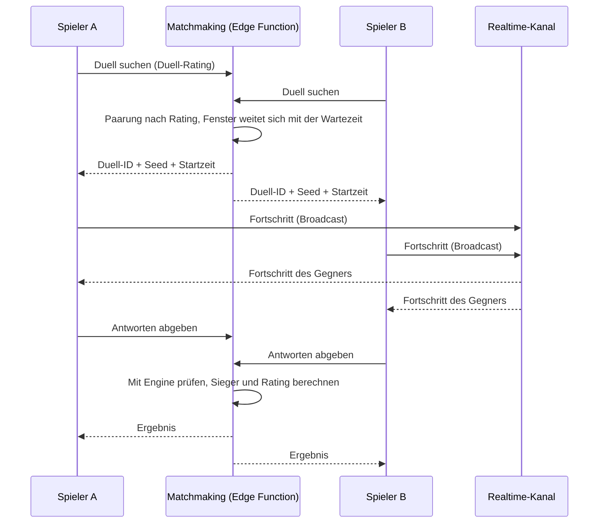

# Motivation und Social

Spielmechaniken nach dem Vorbild von Duolingo und chess.com (siehe [Marktrecherche](../research/marktrecherche.md)). Alle Zahlenwerte sind Startwerte und serverseitig konfigurierbar, damit wir sie ohne App-Update anpassen können.

## Grundsätze

- Motivation soll zum Lernen führen, nicht nur zum Punktesammeln. XP gibt es für echtes Üben.
- Keine manipulativen Muster: keine Lootboxen, kein künstlicher Zeitdruck beim Bezahlen, keine Schuldgefühl-Nachrichten.
- Rücksicht auf Minderjährige: Push-Benachrichtigungen nur mit Einwilligung, höchstens eine pro Tag, Ruhezeiten.

## XP und Tagesziel (Phase 2)

| Aktion | XP (Start) |
|---|---|
| Lektion bestanden (F11) | 10 |
| Bonus ab 90 % Genauigkeit | +5 |
| Bonus ohne Hinweise | +3 |
| Wiederholungslektion | 5 |
| Tägliches Rätsel (Phase 3) | 5 |
| Rush: pro richtige Antwort (Phase 3, Tagesobergrenze) | 1 |
| Duell gewonnen / verloren (Phase 3) | 10 / 3 |

- Tagesziel wählbar: 10 / 20 / 30 / 50 XP.
- XP werden als Buchungen gespeichert (`xp_ledger`) und vom Server berechnet.

## Streak (Phase 2)

- Ein Tag zählt, wenn mindestens eine Lektion in der lokalen Zeitzone des Nutzers abgeschlossen wurde.
- **Streak-Schutz:** wird nach je 7 Streak-Tagen verdient, höchstens 2 auf Vorrat, greift automatisch an einem verpassten Tag.
- **Spielwährung (F07, entschieden 14.10.2026):** zusätzlich 3 Münzen für erstmals bestandene Lektionen/Inhaltsversionen und 1 für bestandene Wiederholungen; ein Schutz kostet als Startwert 10 Münzen. Maximal zwei Vorräte einschließlich verdientem Schutz, keine Echtgeldzahlung in P2.14. Schutz vergibt keine XP und erhöht die Zahl der Lerntage nicht. [Umsetzung und Abnahme](streaks-xp-tagesziel-erinnerungen.md).
- Zeitzonenwechsel (Reisen) werden gutmütig behandelt: Ein Tag geht nie durch einen Zeitzonenwechsel verloren.

## Ligen (Phase 3)

- Wöchentliche Gruppen von etwa 30 Personen derselben Liga.
- **Ligastufen nach Dynamik:** pp → p → mp → mf → f → ff → fff.
- Beim Wochenabschluss: die besten 5 steigen auf, die letzten 5 steigen ab (in pp kein Abstieg, in fff kein Aufstieg). Kleine Gruppen: je Richtung höchstens die Hälfte; Gleichstand nach früherer Aufnahme.
- Gruppen entstehen bei der ersten XP der Woche (Nutzer ohne Aktivität werden nicht eingeteilt).
- Wochengrenze seit P3.04: Montag 00:00 UTC; lokales Ende zusätzlich anzeigen. [Umsetzung und Grenzfälle](ligen.md), ADR 0031.
- Abschluss und Einteilung per geplantem Job (`pg_cron` oder geplanter Edge-Function-Aufruf).

## Ratings (Phase 3)

**Glicko-2** (Mark Glickman) für drei Zwecke:

1. **Fähigkeiten der Nutzer:** eine Wertung je Fähigkeit (Startwert 1500, Unsicherheit 350)
2. **Schwierigkeit der Aufgaben:** eine Wertung je Parameter-Gruppe eines Übungstyps. Jede Antwort ist eine „Partie“ zwischen Nutzer und Aufgabe.
3. **Duelle:** eigene Duell-Wertung für faire Paarungen

Glicko-2 berücksichtigt die Unsicherheit. Neue Nutzer bewegen sich schnell, erfahrene stabil.

**Adaptive Auswahl:** Aufgaben werden so gewählt, dass die erwartete Lösungswahrscheinlichkeit bei etwa 70–85 % liegt. Wiederholungen planen wir mit FSRS (`ts-fsrs`, MIT-Lizenz) für Wissenskarten und Fähigkeiten, die gelernt, aber nicht mehr geübt sind.

## Theorie-Rush (Phase 3)

P3.05 ist technisch vorbereitet: [Übergabe](theorie-rush.md), ADR 0032. Ein Gratis-Start pro UTC-Tag, bezahlte Konten zunächst höchstens 100; serverseitig konfigurierbar. Wertung aus atomar gespeicherten, von der Edge-Engine geprüften Schritten, genau einmal im kanonischen XP-Buch; keine Münzen oder Serientage. Freundesfilter verwendet ausschließlich gegenseitig akzeptierte Beziehungen; Einladungen/Verwaltung siehe P3.08. Remote-/Scheduler- und Geräteabnahme bleiben offen.

- **Modi:** 3 Minuten, 5 Minuten, „Überleben“ (ohne Zeit)
- **Ablauf:** steigende Schwierigkeit; drei Fehler beenden den Lauf
- **Gratis-Kontingent:** ein Lauf pro Tag (Vorbild chess.com)
- **Fairness:** Aufgaben aus einem Seed. Der Server prüft das Ergebnis, indem er den Lauf mit der Engine nachrechnet, und gibt erst dann XP und Bestenliste frei.
- **Bestenlisten:** Tag, Woche, Allzeit, Freunde

## Live-Duelle (Phase 3)

- **Format:** 3 Minuten, gleiche Aufgaben für beide
- **Ghost-Duelle (eigene Idee):** Findet sich in etwa 10 Sekunden kein Gegner, tritt man gegen die Aufzeichnung eines echten Laufs mit ähnlichem Rating an, klar gekennzeichnet. Das löst das Startproblem leerer Wartelisten.
- **Freundes-Duelle** per Einladungslink
- **Schutz vor Missbrauch:** Plausibilität der Antwortzeiten, Ratenbegrenzung, Melden

## Tägliches Rätsel (Phase 3)

- **Inhalt:** ein Hör- oder Analyse-Rätsel, für alle gleich
- **Schwierigkeit:** steigt von Montag bis Sonntag
- **Teilen:** als Text ohne Lösung mit Datum, Erfolgszeichen und Serienlänge; ein bestätigter Versuch pro Tag (ADR 0034)
- **Serie:** eigene Rätsel-Serie neben dem Lern-Streak

## Freunde und Freundes-Quests (Phase 3)

- **Freunde finden:** nur per Einladungslink oder Freundescode. Keine Suche nach Klarnamen, kein Abgleich von Kontakten.
- **Freundes-Quest:** Jede Woche ein gemeinsames Ziel mit einer befreundeten Person, z. B. zusammen 300 XP. Beide Beiträge zählen.
- **Keine freie Chatfunktion** zwischen Nutzern. Das senkt den Moderationsaufwand und schützt Minderjährige.

P3.08 ist technisch vorbereitet: [Übergabe](freunde-und-quests.md), ADR 0035. Einmalcodes laufen nach sieben Tagen ab; die Liste zeigt bestätigten Freunden nur Kennung, gespeicherte Serie und Liga-Stufe. Pro UTC-Woche und Person gibt es höchstens eine Paar-Quest. Ab Start zählen 300 neue kanonisch bestätigte XP zusammen; beide erhalten ein Abzeichen ohne Bonus-XP oder Münzen. Blockieren und Entfernen beenden die Quest und nehmen die Person aus dem Rush-Freundesfilter. DB-, Geräte-, Scheduler- und Rechtsabnahme bleiben offen.

## Benachrichtigungen

- **Technik:** `expo-notifications` (iOS, Android); Web-Push später
- **Arten:**
  - Lernerinnerung zur gewählten Uhrzeit, nur wenn heute noch nicht geübt wurde
  - Streak in Gefahr (abends)
  - Liga-Ergebnis
  - Duell-Einladung
- **Einstellungen:** jede Art einzeln abschaltbar
