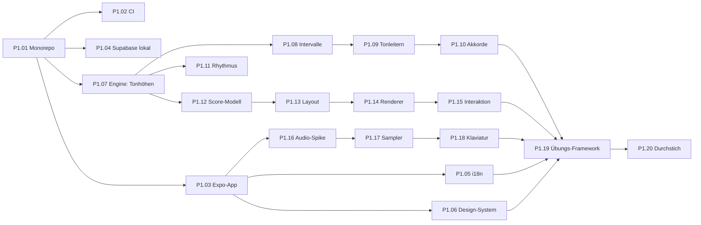

# Phase 1 – Fundament (technischer Prototyp)

**Ziel:** Eine Lektion mit echten Übungen läuft auf iOS, Android und Web. Sie nutzt Notendarstellung, Klang, Klaviatur und die Theorie-Engine. Die technischen Risiken (Audio-Latenz, Notendarstellung) sind geklärt.

**Nicht in dieser Phase:** Konten, Server-Synchronisation, Bezahlung, KI.

---

### P1.01 – Monorepo und Werkzeuge

- **Ziel:** Ein lauffähiges Monorepo mit einheitlichen Regeln.
- **Abhängig von:** P0.06
- **Umfang:** M
- **Aufgaben:**
  - [ ] pnpm Workspaces mit Struktur aus [architektur.md](architektur.md); Kompatibilität mit Expo prüfen (sonst npm Workspaces, als ADR festhalten)
  - [ ] Gemeinsame `tsconfig` (strict), ESLint (inkl. Regel für erlaubte Paket-Abhängigkeiten), Prettier
  - [ ] Vitest für Pakete, Beispiel-Test
  - [ ] Skripte: `lint`, `format`, `typecheck`, `test` auf oberster Ebene
  - [ ] `.editorconfig`, `.nvmrc` (Node-Version), README-Abschnitt „Entwickeln“
  - [ ] CLAUDE.md: Abschnitt „Befehle“ füllen
- **Fertig, wenn:** `pnpm install && pnpm lint && pnpm typecheck && pnpm test` läuft lokal fehlerfrei.
- **Tests:** Beispieltest in einem Paket.

### P1.02 – CI-Grundgerüst

- **Ziel:** Jeder Pull Request wird automatisch geprüft.
- **Abhängig von:** P1.01
- **Umfang:** S
- **Aufgaben:**
  - [ ] GitHub Actions: Installation mit Cache, Lint, Format-Prüfung, Typprüfung, Tests
  - [ ] Branch-Schutz für `main` (nur per Pull Request, CI muss grün sein)
  - [ ] Dependabot oder Renovate für Abhängigkeiten
- **Fertig, wenn:** Ein absichtlich fehlerhafter Pull Request wird rot, ein korrekter grün.

### P1.03 – Expo-App-Grundgerüst

- **Ziel:** Leere App mit Navigation auf allen drei Plattformen.
- **Abhängig von:** P1.01
- **Umfang:** M
- **Aufgaben:**
  - [ ] Expo-App in `apps/mobile` mit Expo Router und TypeScript
  - [ ] Grundnavigation: Tabs (Lernen, Üben, Profil) als Platzhalter
  - [ ] `app.config.ts` mit Umgebungen (development, preview, production), Bundle-IDs
  - [ ] EAS einrichten: Development Builds für iOS und Android
  - [ ] Web-Build lokal und als Vorschau
  - [ ] TanStack Query und Zustand-Store als Grundlage (siehe Architektur) bestätigen
  - [ ] Sentry einbinden (zunächst nur Fehler)
- **Fertig, wenn:** Die App startet auf iOS-Gerät, Android-Gerät und im Browser; Navigation funktioniert.
- **Tests:** Ein Komponententest mit jest-expo; die CI baut das Web-Bundle.

### P1.04 – Supabase lokal und Projekte

- **Ziel:** Backend-Grundlage für Phase 2, lokal reproduzierbar.
- **Abhängig von:** P1.01, P0.04
- **Umfang:** S
- **Aufgaben:**
  - [ ] Supabase CLI im Repo (`supabase/`), lokaler Start dokumentiert
  - [ ] Erste Migration: Tabelle `profiles` mit RLS
  - [ ] pgTAP-Testgerüst mit einem RLS-Test
  - [ ] CI-Job für DB-Tests
  - [ ] Projekte staging und production (EU-Region) mit Repo verbinden; Migrationen per CI auf staging
- **Fertig, wenn:** `supabase start` + `supabase test db` laufen lokal und in der CI.

### P1.05 – Internationalisierung (DE/EN)

- **Ziel:** Jeder Text der App ist in beiden Sprachen vorhanden. Fehlende Übersetzungen fallen in der CI auf.
- **Abhängig von:** P1.03
- **Umfang:** M
- **Aufgaben:**
  - [ ] `packages/i18n` mit i18next (+ react-i18next), Spracherkennung über `expo-localization`, Wechsel in den Einstellungen
  - [ ] Typsichere Schlüssel (Tippfehler = Compilerfehler)
  - [ ] Pluralregeln, Zahlen- und Datumsformate über `Intl`
  - [ ] Prüfskript: Jeder Schlüssel existiert in DE und EN, keine leeren Werte
  - [ ] Glossar aus P0.05 als Daten in `packages/i18n`
  - [ ] ESLint-Regel gegen hartkodierte Texte in Komponenten
- **Fertig, wenn:** Sprachwechsel zur Laufzeit funktioniert; Prüfskript läuft in der CI.

### P1.06 – Design-System v0

- **Ziel:** Einheitliche Grundbausteine für alle Screens.
- **Abhängig von:** P1.03, P0.07
- **Umfang:** M
- **Aufgaben:**
  - [ ] Design-Tokens: Farben (hell/dunkel), Typografie, Abstände, Radien, Schatten
  - [ ] Komponenten: Button, Card, ProgressBar, FeedbackBanner (richtig/falsch mit Symbol), BottomSheet, Toggle, ListItem
  - [ ] Barrierefreiheit: Beschriftungen, Mindestgrößen für Touch-Ziele, dynamische Schrift
  - [ ] Haptik-Hilfsfunktionen (richtig/falsch)
  - [ ] Galerie-Screen (nur in Entwicklungsbuilds) zum Ansehen aller Komponenten
- **Fertig, wenn:** Alle Komponenten sehen in hell und dunkel auf allen Plattformen korrekt aus.
- **Tests:** Komponententests inkl. Barrierefreiheits-Eigenschaften.

### P1.07 – Engine: Tonhöhen, Benennung, Grundsatzentscheidung

- **Ziel:** Kern-Datentypen der Engine; Entscheidung eigene Engine oder `tonal` (ADR 0004).
- **Abhängig von:** P1.01, P0.05
- **Umfang:** L
- **Aufgaben:**
  - [ ] Spike: `tonal` gegen die Kriterien aus [theorie-engine.md](theorie-engine.md) testen
  - [ ] ADR 0004 schreiben
  - [ ] `Pitch`: Parsen (`C4`, `F#3`, `Bb2`), Formatieren, MIDI, Frequenz, Transponieren, Enharmonik
  - [ ] `naming`: Deutsch (H/B, -is/-es, Doppelvorzeichen, Helmholtz-Oktaven) und international
  - [ ] Seedbarer Zufallsgenerator
  - [ ] Paket läuft unter Deno (CI-Job)
- **Fertig, wenn:** Alle Beispiel- und Eigenschaftstests grün; Phillip hat die Benennungstabelle geprüft.
- **Tests:** Benennung aller 35 Töne mit einfachen und doppelten Vorzeichen in beiden Sprachen; Rundreise Parsen ↔ Formatieren.

### P1.08 – Engine: Intervalle

- **Ziel:** Intervalle korrekt bestimmen und bilden.
- **Abhängig von:** P1.07
- **Umfang:** M
- **Aufgaben:**
  - [ ] Bestimmen nach dem Algorithmus in [theorie-engine.md](theorie-engine.md)
  - [ ] Bilden (aufwärts, abwärts), Umkehrung, zusammengesetzte Intervalle
  - [ ] Benennung DE/EN, Kurzform (z. B. „gr. 3“ / „M3“)
- **Fertig, wenn:** Alle Intervalle bis zur Doppeloktave von allen 35 Tönen aus korrekt; Eigenschaftstests grün.

### P1.09 – Engine: Tonleitern und Tonarten

- **Ziel:** Tonleitern korrekt buchstabiert, Vorzeichnungen, Quintenzirkel.
- **Abhängig von:** P1.08
- **Umfang:** M
- **Aufgaben:**
  - [ ] Dur, Moll (natürlich, harmonisch, melodisch), Kirchentonarten, Pentatonik (Dur/Moll), chromatisch
  - [ ] Vorzeichnung für alle 30 Dur- und Molltonarten (bis 7 Vorzeichen), Reihenfolge der Vorzeichen
  - [ ] Parallel- und Varianttonart, leitereigene Dreiklänge
- **Fertig, wenn:** Tabellentests für alle Tonarten grün; Phillip hat Stichproben geprüft.

### P1.10 – Engine: Akkorde (Grundlagen)

- **Ziel:** Dreiklänge bauen und bestimmen, inkl. Umkehrungen.
- **Abhängig von:** P1.09
- **Umfang:** M
- **Aufgaben:**
  - [ ] Dur, Moll, vermindert, übermäßig; Grundstellung, Sextakkord, Quartsextakkord
  - [ ] Bestimmen aus beliebiger Lage und Verdopplung; mehrdeutige Fälle als Kandidatenliste
  - [ ] Benennung DE/EN; Vorbereitung für Septakkorde (Datenmodell)
- **Fertig, wenn:** Alle Dreiklänge auf allen Grundtönen bis zu Doppelvorzeichen korrekt.

### P1.11 – Engine: Rhythmus und Takt

- **Ziel:** Dauern exakt rechnen, Takte prüfen.
- **Abhängig von:** P1.07
- **Umfang:** S
- **Aufgaben:**
  - [ ] Bruch-Arithmetik für Dauern, Punktierungen, Triolen
  - [ ] Taktarten mit Gruppierung, Prüfung „Takt voll“
  - [ ] Umrechnung in Sekunden bei gegebenem Tempo
- **Fertig, wenn:** Tests für gängige Taktarten und Notenwerte grün.

### P1.12 – Notation: Score-Modell

- **Ziel:** Datenmodell für alles, was gerendert wird.
- **Abhängig von:** P1.07, P1.11
- **Umfang:** S
- **Aufgaben:**
  - [ ] Typen: Score, Staff, Clef, KeySignature, TimeSignature, Measure, Voice, Note, Rest, Chord, Tie
  - [ ] Kurzschreibweise für Tests und Inhalte (z. B. `"treble | 4/4 | C4/4 E4/4 G4/2"`) mit Parser
- **Fertig, wenn:** Parser deckt alle Elemente von Phase 1 ab; Rundreise-Tests grün.

### P1.13 – Notation: Layout v1

- **Ziel:** Positionen für alle Elemente berechnen.
- **Abhängig von:** P1.12
- **Umfang:** L
- **Aufgaben:**
  - [ ] Bravura-Metadaten einlesen (Glyphenmaße, Ankerpunkte, Standardstärken)
  - [ ] Layout-Regeln aus [notation-audio-eingabe.md](notation-audio-eingabe.md) (Phase-1-Umfang)
  - [ ] Ausgabe als reine Daten (Liste von Glyphen, Linien, Balken mit Koordinaten)
  - [ ] Leistungsmessung (Ziel unter 50 ms für 8 Takte)
- **Fertig, wenn:** Referenzbeispiele (Einzeltöne, Intervalle, Akkorde, Tonleitern, einfacher Rhythmus) sehen korrekt aus. Phillip nimmt die Darstellung ab.
- **Tests:** Snapshot-Tests der Layout-Daten.

### P1.14 – Notation: SVG-Renderer

- **Ziel:** Layout-Daten auf allen Plattformen zeichnen.
- **Abhängig von:** P1.13, P1.03
- **Umfang:** M
- **Aufgaben:**
  - [ ] Renderer mit `react-native-svg`; Web-Unterstützung prüfen
  - [ ] Bravura laden (Expo Fonts) auf iOS, Android, Web; Lizenz in Credits
  - [ ] Skalierung (Zoom), Hell- und Dunkelmodus
  - [ ] Screenreader-Text pro Note
- **Fertig, wenn:** Identische Darstellung auf drei Plattformen (Screenshot-Vergleich im Web, Sichtprüfung mobil).

### P1.15 – Notation: Interaktion

- **Ziel:** Noten antippen, setzen und hervorheben.
- **Abhängig von:** P1.14
- **Umfang:** M
- **Aufgaben:**
  - [ ] Treffererkennung: Tipp → Linie/Zwischenraum → Tonhöhe (unter Berücksichtigung von Schlüssel und Vorzeichnung)
  - [ ] Note setzen, verschieben, löschen; Vorzeichen-Leiste
  - [ ] Hervorhebung: richtig, falsch, aktiv (Farbe plus Symbol)
- **Fertig, wenn:** Ein Intervall lässt sich auf allen Plattformen zuverlässig per Finger und Maus eingeben.

### P1.16 – Audio-Spike und Latenzmessung

- **Ziel:** Entscheidung über die Audio-Grundlage auf Basis echter Messwerte (ADR 0005).
- **Abhängig von:** P1.03
- **Umfang:** M
- **Aufgaben:**
  - [ ] `react-native-audio-api` in Development Build einbinden; Web über native Web Audio API
  - [ ] Testseite: Ton bei Tippen, Akkord, Sequenz mit Metronom
  - [ ] Latenz messen auf mindestens: einem aktuellen iPhone, einem älteren iPhone, einem teuren und einem günstigen Android-Gerät, Desktop-Browser
  - [ ] Verhalten bei iOS-Stummschalter (F12), Kopfhörer, Bluetooth-Kopfhörer (Latenz notieren)
  - [ ] ADR 0005 mit Messwerten
- **Fertig, wenn:** Messwerte dokumentiert; Entscheidung getroffen. Falls Ziel verfehlt: Gegenmaßnahmen im ADR.

### P1.17 – Audio: Sampler und Wiedergabe

- **Ziel:** Klavierklang für Töne, Intervalle, Akkorde und Sequenzen.
- **Abhängig von:** P1.16
- **Umfang:** M
- **Aufgaben:**
  - [ ] Skript in `tools/` zur Sample-Aufbereitung (Auswahl, Normalisierung, Kürzung, Kompression)
  - [ ] Sampler mit Tonhöhenverschiebung zwischen Stützstellen, Hüllkurve, Lautstärke
  - [ ] API: `playPitch`, `playInterval(mode)`, `playChord(arpeggio?)`, `playSequence(tempo)`, `metronome`
  - [ ] Credits (Salamander Grand Piano, CC BY 3.0)
- **Fertig, wenn:** Klang auf allen Plattformen sauber (kein Knacken, keine hörbaren Sprünge zwischen Stützstellen); Paketgröße unter 10 MB.

### P1.18 – Bildschirm-Klaviatur

- **Ziel:** Spielbare Klaviatur als Eingabe und Anzeige.
- **Abhängig von:** P1.17, P1.06
- **Umfang:** M
- **Aufgaben:**
  - [ ] Mehrfachberührung, Scrollen, Zoom, wählbarer Ausschnitt
  - [ ] Beschriftung (keine / deutsch / international)
  - [ ] Hervorhebungen (Lösung, Fehler), Tastatursteuerung im Web
- **Fertig, wenn:** Spielen fühlt sich auf Telefon und Tablet direkt an; Klaviatur liefert Tonhöhen an die Engine.

### P1.19 – Übungs-Framework und erste Übungstypen

- **Ziel:** Einheitliche Schnittstelle für alle Übungstypen; drei Typen fertig.
- **Abhängig von:** P1.10, P1.15, P1.18, P1.05, P1.06
- **Umfang:** L
- **Aufgaben:**
  - [ ] Schnittstelle: `generate(params, rng)`, `evaluate(item, answer)`, `feedback(item, result, locale)`, `hints(item, level)`
  - [ ] Aufgaben-Screen: Frage, Eingabebereich, Prüfen, Feedback, Weiter
  - [ ] Typen: `NOTE_NAME`, `INTERVAL_IDENTIFY_VISUAL`, `INTERVAL_IDENTIFY_AURAL`
  - [ ] Feste Hinweise und Erklärtexte aus der Engine (DE/EN)
- **Fertig, wenn:** Jeder Typ erzeugt sinnvolle Aufgaben über seinen Parameterraum und bewertet korrekt.
- **Tests:** Generatoren mit vielen Seeds: keine ungültigen Aufgaben; Bewertung gegen Engine.

### P1.20 – Durchstich: eine Lektion

- **Ziel:** Nachweis, dass alle Teile zusammen funktionieren.
- **Abhängig von:** P1.19
- **Umfang:** M
- **Aufgaben:**
  - [ ] Eine Lektion mit 10 Aufgaben (gemischt aus den drei Typen) als Inhaltsdatei
  - [ ] Ablauf: Einführungskarte → Aufgaben → falsche wiederholen → Ergebnis
  - [ ] Ergebnis lokal speichern (SQLite)
  - [ ] Interner Test mit 3–5 Personen; Notizen zu Gefühl, Klang, Verständlichkeit
  - [ ] Rückblick Phase 1, Plan für Phase 2 anpassen
- **Fertig, wenn:** Die Lektion läuft auf iOS, Android und Web ohne Fehler; die Testpersonen verstehen die Bedienung ohne Erklärung.

---

**Phase 1 abgeschlossen, wenn:**

- [ ] P1.01–P1.20 fertig
- [ ] ADR 0004 (Engine) und ADR 0005 (Audio) geschrieben
- [ ] Keine offenen Blocker für Phase 2
