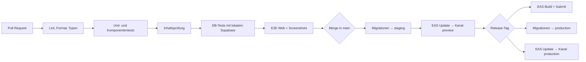

# Qualität und Betrieb

## Testpyramide

| Ebene | Werkzeug | Was | Wann |
|---|---|---|---|
| Unit | Vitest | Engine, Layout, Generatoren, Bewertung, Hilfsfunktionen | jeder Push |
| Eigenschaftsbasiert | fast-check | Invarianten der Engine (siehe [theorie-engine.md](theorie-engine.md)) | jeder Push |
| Komponenten | jest-expo + React Native Testing Library | Screens und Komponenten, Barrierefreiheit-Beschriftungen | jeder Push |
| Datenbank | pgTAP (Supabase CLI) | Zugriffsregeln, Funktionen, Trigger | jeder Push |
| Edge Functions | Deno-Tests | Webhooks, Sync, Tutor (mit Attrappe der API) | jeder Push |
| Inhalte | eigenes Prüfskript | Schema, beide Sprachen vorhanden, Notenbeispiele gültig, Fähigkeitsgraph ohne Zyklen | jeder Push |
| E2E Web | Playwright | Kernabläufe: Onboarding, Lektion, Kauf (Testmodus) | Pull Request |
| E2E Mobil | Maestro | Kernabläufe auf iOS-Simulator und Android-Emulator | vor Release |
| Visuell | Playwright-Screenshots | Notendarstellung, wichtige Screens | Pull Request |
| Tutor | Testkatalog (siehe [ki-tutor.md](ki-tutor.md)) | Fachliche Qualität der KI | vor Release, bei Änderungen am Tutor |
| Manuell | Testplan auf echten Geräten | Audio-Latenz, Mikrofon, Gefühl | vor Release |

## CI/CD (GitHub Actions + EAS)

- **Branch-Schutz für `main`:** nur über Pull Request mit grüner CI.
- **Versionierung:** Semantic Versioning für die App; Changelog aus Pull-Request-Titeln.
- **Over-the-air-Updates (EAS Update)** nur für JavaScript- und Inhaltsänderungen. Native Änderungen brauchen einen neuen Store-Build.
- **Rollback:** Ein früheres Update kann sofort erneut veröffentlicht werden. Migrationen werden so geschrieben, dass sie rückwärtskompatibel sind (erst erweitern, später aufräumen).

## Release-Ablauf

1. Feature-Freeze, Release-Branch
2. Tutor-Testkatalog, E2E mobil, manueller Gerätetest (Checkliste)
3. Store-Texte und Screenshots DE/EN aktualisieren
4. Gestaffelte Veröffentlichung (Android: prozentual; iOS: phasenweise)
5. Beobachtung: Absturzrate, Fehler, Kosten, Rückmeldungen in den ersten 72 Stunden

## Monitoring und Alarme

| Signal | Werkzeug | Alarm bei |
|---|---|---|
| Abstürze, Fehler | Sentry | neue Fehlerart, Absturzfreiheit unter 99,5 % |
| KI-Kosten | `ai_usage` + tägliche Auswertung | Tageskosten über Budget |
| Webhooks | `billing_events` | unverarbeitete Ereignisse älter als 1 Stunde |
| Datenbank | Supabase-Dashboard | Auslastung, langsame Abfragen |
| Sync | eigene Metrik | Fehlerquote beim Sync über 1 % |

## Leistungsbudgets

- App-Start bis zum Lernpfad: unter 3 Sekunden auf Mittelklasse-Geräten
- Lektion laden: unter 1 Sekunde (Inhalte lokal)
- Tippen bis Klang: unter 50 ms (Ziel, siehe [notation-audio-eingabe.md](notation-audio-eingabe.md))
- Bundle-Größe beobachten; Audio-Samples nachladbar, wenn das Paket zu groß wird

## Barrierefreiheit

- **Ziel:** WCAG 2.2 AA im Web; gleichwertig auf iOS und Android
- **Grundregeln:**
  - Screenreader-Beschriftungen für alle Bedienelemente und Notenbilder
  - Dynamische Schriftgrößen
  - Kontraste
  - Feedback nie nur über Farbe (zusätzlich Symbol und Haptik)
  - Bedienung mit Tastatur im Web
- **Sehbehinderte Menschen:** Gehörbildung funktioniert ohne Notenbild. Wir prüfen, welche Übungstypen sich vollständig über Ton und Sprache bedienen lassen.
- **Hörbehinderte Menschen:** Theorie-Übungen ohne Audio-Pflicht; Hörübungen sind als solche gekennzeichnet.
- **Prüfung:** ein Barrierefreiheits-Durchgang je Phase, dazu automatische Prüfungen im Web (z. B. axe mit Playwright).

## Betrieb

- **Backups:** tägliche Sicherung der Datenbank (Funktionsumfang hängt vom Supabase-Tarif ab, Point-in-Time-Recovery prüfen); Wiederherstellung einmal pro Phase testen.
- **Support:** Kontaktformular in der App, Antwortvorlagen DE/EN, Kategorie „Inhaltsfehler“ direkt an `content_reports`.
- **Störungen:** kurzes Ablaufdokument (Wer prüft was, wie wird kommuniziert, Nachbetrachtung).
- **Kosten:** monatliche Übersicht aller Dienste (Supabase, EAS, Anthropic, RevenueCat, Stripe, LiveKit, Sentry, Analytics).
